

# 胜利的方程式

——进阶20下的战士碎心攻略

## 目录

**[一．写在前面](#p-0002)**

- [1.历史背景](#p-0003)

- [2.更新日志](#p-0015)

- [3.关于质疑](#p-0022)

- [4.特别鸣谢](#p-0024)

**[二．通解结构](#p-0027)**

- [1.攻略的研究对象](#p-0028)

- [2.通解](#p-0032)

- [3.核卡组和均卡组](#p-0038)

- [4.核卡组的运作方式](#p-0049)

- [5.几种重要循环](#p-0053)

- [6.特解](#p-0058)

**[三．以血量为中心的思考](#p-0064)**

- [1.胜利的条件](#p-0065)

- [2.血量的周转](#p-0071)

- [3.攻杀和防杀](#p-0087)

- [4.若尔当典范型](#p-0098)

**[四．卡池结构](#p-0115)**

- [1.牌效与费效](#p-0116)

- [2.卡位的集中与分散——由牌效引发的讨论](#p-0121)

- [3.ZERO-MAX——由费效引发的讨论](#p-0141)

- [4.力量](#p-0148)

- [5.过渡卡](#p-0153)

- [6.运转](#p-0175)

- [7.防御](#p-0199)

**[五．单卡评测](#p-0203)**

- [1.单卡评分](#p-0204)

- [2.力量篇](#p-0207)

- [3.烧牌篇](#p-0291)

- [4.过牌篇](#p-0336)

- [5.加费篇](#p-0379)

- [6.过渡篇](#p-0402)

- [7.防御篇](#p-0548)

- [8.功能牌](#p-0630)

- [9.常见核心输出](#p-0697)

**[六．结语——进阶之路](#p-0727)**

## 一．写在前面

### 1.历史背景

在介绍本文之前，不妨回顾一下，尖塔圈已经有多久没有产出过“高端攻略”了？这里的“高端”并不是指攻略本身的质量，而是面向的受众。上一篇能算作面向高端玩家的攻略，已经能追溯到2020年7月，笔者发布的《胜利的方程式》（初版），以及同时期发布的观者全卡评测。从那时到现在，期间并非没有攻略更新，只是这些攻略，都属于新手指南的范畴。这背后的原因，主观上是由于现阶段塔圈缺乏有纪律性和行动力的组织，客观上是现在的游戏版本过于简单了。前者是在所难免的事，毕竟尖塔已经开始进入寿命的尾声，此后很可能再也不会有大的更新，而随着贴吧的分裂，以及一些优秀的理论作者的离开，产出攻略变得越来越困难。

而后者是根本原因，因为这关系到攻略本身存在的意义：不会输的游戏哪里还需要攻略呢？2019年6月，笔者发布第一篇攻略的1.0时期，能打出十连胜的人屈指可数，笔者拼尽全力最终也只能止步19连胜。而随着2.0的更新后，笔者轻易地达到了39连胜，继续追求胜率，仿佛在试图用二等分把一根木棍分到无穷小——徒劳。

而为这篇文章的诞生提供契机的有两个，一个是战士现阶段胜率的极限。2.0更新到现在，尖塔又发布了几个修正补丁，难度进一步降低，而现在已经有数位玩家实现了观者的100连胜，前段时间某主播也达成了机器人的100连胜——虽然有些“SL CHEATER”的意味。而至今为止，没有任何一位玩家用战士达到了100连胜，笔者对此感到相当惊讶。输了就是菜，既然如此，这篇文章并非没有存在的理由。

第二个契机则是，笔者在一次活动中开始接触前路已定。前路已定，意味着缺乏开局祝福，没有逃跑路线，以及一层必须强杀带火精英。和其他自定义不同，前路已定和正常对局的毒种具有高度的相似性，但是前路已定的最大意义不在于此，而在于：让玩家久违地感受到了失败。任何追求连胜的玩家在过程中都会不自觉变得畏首畏尾，对一些卡牌的评价逐渐变得教条主义，对卡组战斗力，尤其是击杀精英的能力也会产生偏差。在前路已定中，一些被忽视的卡牌得以重见天日，玩家对数值的理解也会更上一个层次。

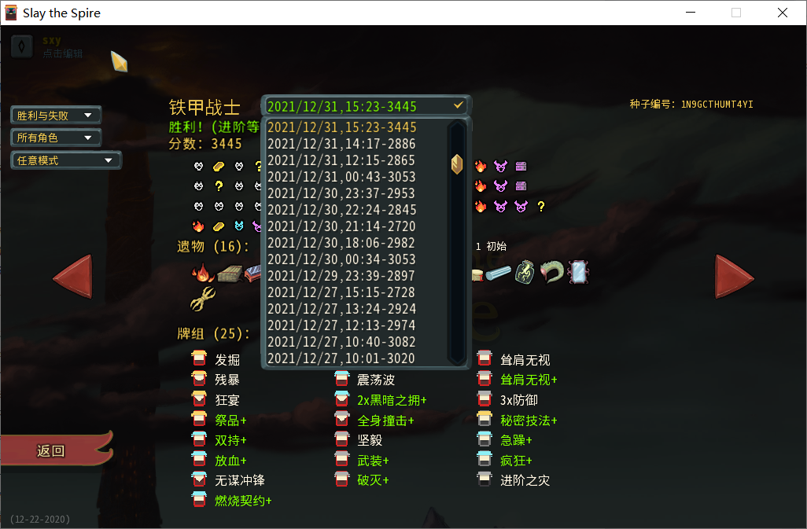

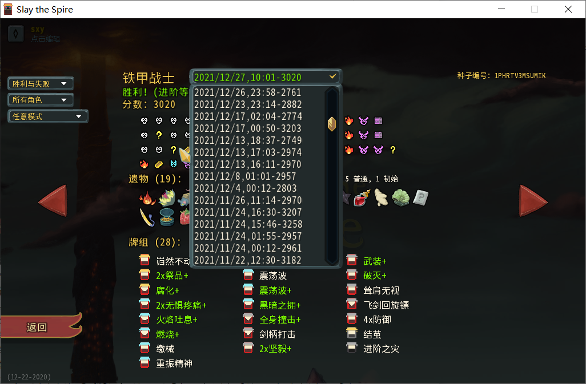

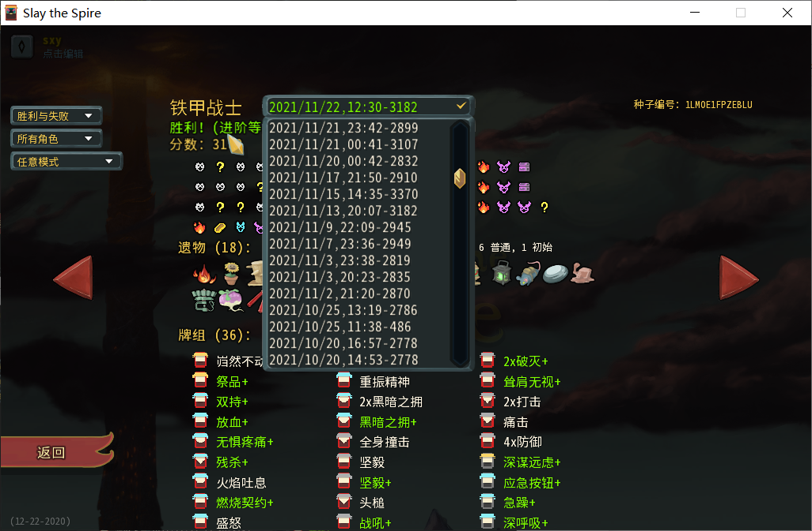

随着在前路已定中重新达到39连胜，笔者的水平达到了一个新的境界，再回看之前写的文章，实在是漏洞百出，丑态尽显，有些贻笑大方之家。再加上之前的单卡评测并不完善，对之前的攻略进行全面彻底的修改，成了必然要求。

事物的发展总是通过不断否定而螺旋上升的，笔者于2019年6月发布的第一篇攻略，无论从逻辑还是游戏理解来看，几乎没有任何可取之处；而几乎另起炉灶，于2020年7月发布的第二篇攻略，虽然在完成度和系统性上远超第一篇文章，逻辑上也相对自洽，但是对游戏理解，尤其是数值层面的理解过于薄弱，导致部分单卡评价的错误，也使得对“过渡”这一过程的描述犹如空中楼阁。此外，一些历史遗留问题依然没有得到解决。

现在更新的PLUS版本，虽然目前看来相对完善，在未来是否会进一步否定也犹未可知。写完这篇文章后，笔者自觉已到能力的极限，本文的否定，只能交给各位读者了。

<strong>本文篇幅较长，阅读时建议活用CTRL+左键点击目录和超链接的跳转功能。</strong>

### 2.更新日志

曾阅读过笔者所写的《胜利的方程式》（2020版）一文的读者，在阅读本文时可以主要关注下面的变化。

①广义加费什么的就到此为止吧。删除了“广义加费”和“敲位很高同时敲位很低”这两个愚蠢的谜语人概念。

②对所有的战士职业卡和罕见，稀有无色卡重新评分，并重新编写了完整的战士单卡评测。

③对文章进行结构性的调整，新增若干章节，使逻辑更加严密，章节间的衔接更为流畅。

④修正了一些细节上的错误。

当然，本文是一篇完整独立的文章，对本文的阅读，并不以阅读之前的文章为前提。

### 3.关于质疑

毫无疑问，这篇文章的很多地方，与当下的主流观点大相径庭，这也是笔者写这篇文章的目的之一——打破主流观点的陈规。笔者欢迎任何人对任何有疑问的地方进行提问，但是不欢迎并道而来的各种质疑。攻略具有权威性，这这种权威是根据严格的实践得来的，目前没有玩家用战士打出100连胜，意味着没有玩家取得了比笔者更成功的实践。诚然，本文依然存在一些笔者也不确定以及不完备之处，比如对灼热的评价，对换4，棱镜的故意忽略。只是，<strong>能否定攻略的只有另一篇攻略</strong>，在另一位足够强大的玩家写出一篇能把笔者彻底击溃的文章之前，这篇文章不接受任何质疑。

### 4.特别鸣谢

首先是给笔者带来战士启蒙的肥宅大佬，还有和笔者进行过密切讨论的外星人，帮忙代写灼热攻击的HELLE，以及最终参与校对的小水、TNoName、有影子的水、雨息、阿独、轻蹈云巅♬、rickee7、寒辞歌。可以说没有上述各位，就没有这篇文章，在此，笔者对上述各位表示衷心的感谢。

当然，也非常感谢所有能耐着性子看完这篇又臭又长攻略的读者，笔者衷心期待着本文被各位读者否定的那一天。

## 二．通解结构

### 1.攻略的研究对象

何谓攻略？从实践的角度来看，能提高某一部分读者胜率的文章便可称作一篇攻略，那么显然地，一篇攻略的效果和读者自身水平息息相关。对于很多进阶0的新手而言，卡池还未完全解锁，对卡牌效果也不够熟悉，可能更适合看一些古早的流派攻略。而本文面向的对象主要是：<strong>能比较稳定通关进阶20，并试图更进一步，达到几乎无法失败境界的玩家</strong>。水平暂时不足的读者，可能在实践上产生一些困难。

为了提高读者的胜率，前前后后诸多攻略分别对各种对象都进行了研究。有的探讨<strong>流派</strong>，有的<strong>对单卡进行评测</strong>，还有的研究尖塔的<strong>循环机制</strong>，而这些研究对象都有一个共同点——<strong>都是种子变换下的不变量</strong>。本文自然也不例外，以尖塔这个ROUGELIKE游戏中的不变量为出发点，寻找以不变应万变的通关手段，从而达成极限的胜率。

而尖塔的最终BOSS——<strong>腐化之心</strong>便是一个明显的不变量，面对心脏的卡组，即是玩家的通关卡组。在心脏固定的数值和相对固定的行动方式下，对应的通关卡组具有何种性质？这就是本文研究的第一个问题。

### 2.通解

所有击败心脏的卡组都可称为一个<strong>解</strong>。本文的目的是<strong>寻求一个卡组结构，满足下列条件：</strong>

<strong>①符合这个结构的卡组一定是解。</strong>

<strong>②对任意种子，都存在一个符合这个结构的解</strong>。

这样的结构称为<strong>通解结构，</strong>对应的解称为<strong>通解</strong>。尖塔不是数学，通解的存在性无法通过理论证明，但是实践表明，<strong>目前的所有种子都有解且不唯一</strong>，其中比较简明的解也确实具有高度相似的特征。既然如此，不妨假设通解存在，不在这种细枝末节的地方浪费过多笔墨。

显然，通解涉及对象<strong>有且仅有卡组</strong>，依靠<strong>特定</strong>遗物（通解并非不依赖任何遗物）、药水乃至强运获胜的解，称为<strong>特解</strong>。对特解的研究留到本章最后，接下来讨论通解的具体性质。

### 3.核卡组和均卡组

击败心脏的前提，可以笼统概括为<strong>打出更高的数值</strong>，由此便产生了一个矛盾——<strong>碎心要求的高数值，和初始卡组的低数值之间的矛盾</strong>。为了解决该矛盾，诞生了两种提高卡组数值的手段:

①抓取大量高数值卡牌，降低低数值的初始卡牌在卡组所占比例。

②抓取少量高数值卡牌，同时设法减少初始卡牌的数量。

仅凭上述两种手段，离击败心脏的目标依然相差甚远。在尖塔经典费伤比、费防比的限制下，初始矛盾转化为——<strong>碎心要求的高数值，和尖塔的单卡数值上限的矛盾</strong>，而解决这一矛盾的手段是，加入COMBO。

手段①引入COMBO，最终演化为均卡组，比如50牌工头贼、80牌机器人、大卡组神格观。手段②引入COMBO，最终演化为核卡组，比如10牌无限的华丽贼、陨石无限机器人、猛虎无限的观者。

尖塔COMBO的种类千千万万，但所有COMBO都有一个共同前提——<strong>卡组的掌控力</strong>，而卡组的掌控力根源于<strong>运转能力</strong>（当然运转本身也属于COMBO的一种）。猎手的运转来源于完备的弃牌体系，加费过牌卸牌一气呵成；机器人的运转来源于强大的能量体系，以及散热片等优质过牌；观者运转能力稍差一些，但依然有平静神格的加费体系与猛虎操纵洞见的过牌手段。

而战士的运转靠什么？最强加费:<strong>腐化</strong>。最强过牌:<strong>黑暗之拥。</strong>而这两者都和战士自带的运转体系——<strong>烧牌</strong>密切相关。

毫不夸张地说，<strong>没有烧牌的战士就没有运转</strong>， 而烧牌的最终结果便是<strong>核卡组</strong>——这是充分条件。

如果说均卡组是取平均值，核卡组便是取最大值。对其他职业而言，核卡组有着过渡困难、容易被塞牌干扰等弱点，而战士的烧牌和能力提供了处理废牌的手段，在碎心战中，均卡组几乎被核卡组全方位碾压——这是必要条件。

由此可以断言，<strong>通解一定是核卡组。#</strong>

### 4.核卡组的运作方式

杀戮尖塔的卡组是循环使用的——这是核卡组成立的最大前提。

烧牌筛选出了运转最大者和数值最大者，其中数值最大者，可以简称为卡组的<strong>核心卡</strong>。<strong>通过运转最大化核心卡的收益</strong>，这是核卡组运作的终极目标，而实现该目标的具体手段是:<strong>卡组的高速循环</strong>。

“高速”一词，形容的<strong>并不是每个回合卡组的循环次数，而是每次抽牌卡组的循环次数</strong>，这个指标的数值才是核卡组和均卡组的根本区别。打出的卡会进入弃牌堆，当抽牌堆为0时再进行抽牌，会将弃牌堆的牌重新洗到抽牌堆再抽牌，这便完成了卡组的一轮循环。通过烧牌完全剔除掉多余因素之后，便达成了<strong>每次抽牌都会循环卡组</strong>的效果。卡组循环，意味着弃牌堆的再利用。核卡组高速循环的运作方式最大化了核心卡的利用率，<strong>数值最大者+运转最大者+最高利用率</strong>，最终可以轻易产生远超碎心要求的数值，这就是核卡组的运作方式。

### 5.几种重要循环

在笼统介绍了核卡组的运作方式后，下面简单描述几个具体案例。

如果把核心卡简称为X，配上最简单的过牌——过1，便可以达成（X-过1-X）的小循环。该循环面临的问题是，打出核心卡会亏1卡，而过1不能赚卡，循环一次便会中断。为了使循环继续进行，补充手牌的卡成为必然要求，而最简单的补牌卡便是过2。

上述卡组添加过2之后，得到了X-（过1-X-过2）的循环，括号内的步骤循环往复。（耸肩无视-全身撞击-急躁），暴走-（妙计-暴走-剑柄打击）都是这种循环的典型。进一步地，为了使循环更有效率，把过1加强为过2，或者把过2加强为过3，便得到两种加强循环：X1X2-（过2-Xi-过2-Xj），Xi-(过1-X1X2-过3),i,j=1,2。全身撞击狂怒深呼吸+急躁，全身撞击狂怒妙计急躁+，都是常见案例。

上面的几种循环确实重要，但实战中的情况远没这么简单，操作起来也大可不必按照模板死板操作。有1/2/3/4层<strong>黑暗之拥</strong>的循环，<strong>破灭</strong>的循环，穿插<strong>放血/预谋</strong>的循环，加入<strong>愤怒/无谋/硬撑/双持</strong>产燃料的循环，具体情况千变万化。实战操作中，要牢记<strong>数值最大化</strong>的原则。

### 6.特解

正如在[二.2.通解](#p-0032)末尾所说，依靠场外因素获胜的解称为特解。一位安徒生靠一张转化口胡碎心，一位超高校级的幸运用混沌药无限，这种依赖强运的特解不在本文讨论范围内。另外，一些依赖药水的特解，由于情况过于复杂，也无法讨论。这一节讨论的仅仅是部分<strong>依赖特定遗物的简单特解</strong>，本节之后的讨论，将不再考虑任何特解。

（1）<strong>树枝</strong>。均卡版黑暗之拥，本身强度毋庸置疑，但是其不稳定性和对构筑的破坏性，让很多高手都敬而远之。不同于其他特解遗物，树枝对卡组强度的提升更多体现在前中期，后期大概率会降低卡组强度，但碎心也绰绰有余。树枝彻底断绝了核卡组的构筑可能，只能沿着均卡组思路走到底，把烧牌当做过牌，依靠能力和加费遗物提供费用。而树枝卡组的终极形态，自然是腐化树枝。树枝卡组的腐化，单卡充当了腐化黑拥两卡的功能，集加费补牌于一身，单卡实现了究极运转。此外，即便没有腐化，空手烧出腐化也是决斗者的基本操作，树枝给任何卡组都提供了一转奇迹的可能。值得强调的是，即便是腐化树枝，也没有任何拒绝黑暗之拥的理由。诚然，黑暗之拥的抽牌会卡掉一部分大烧牌印出的牌，但同时在很大程度上保证了腐化的上手率，开启腐化之后也能将手牌快速拉满防止夹断。对腐化树枝来说，稳定性显然比这种无谓的上限重要得多。

（2）<strong>蛇眼</strong>。蛇眼类似树枝，具有高强度的同时，附带了极高的不稳定性和对构筑的破坏性。通常来说，拿了蛇眼也只能走均卡路线，通过填充大量高牌效的卡提供质量，依靠蛇眼过牌加费。但是，神奇的腐化解决了绝大部分蛇眼带来的不稳定性，使核卡思路又变为可能。蛇眼+腐化+无惧疼痛+黑暗之拥+全身撞击，蛇眼+腐化+燃烧+突破+飞剑，都是典型的核卡组。

（3）<strong>日晷</strong>。很强，但被过度神化的遗物。核卡组的运作方式是卡组的高速循环，和日晷的洗牌收益完美契合。问题在于，核卡组的假想敌是心脏，在开局很长一段时期，卡组的循环都极其缓慢笨拙，日晷几乎无法发挥任何作用，和“拿到就赢”相去甚远。而在运转成型的后期，日晷能被各种循环玩出花活，比如剑柄耸肩、医疗箱黑暗之拥硬撑、黑暗之拥燃烧契约、深呼吸。笔者不知道一只猴子乱敲键盘能不能打出莎士比亚全集，但是它肯定能用一个日晷剑耸卡组碎心。

（4）<strong>算盘</strong>。笔者眼中比日晷更强的遗物。不同于日晷，算盘的收益每轮洗牌都会触发，并且是简单直接的防御收益，不像能量需要别的手段变现。同时，算盘作为商店遗物，在现版本有非常低的价格，几乎不存在买不起的情况。在运转成型后，算盘能单遗物彻底解决防御的问题。

## 三．以血量为中心的思考

### 1.胜利的条件

第二章从心脏出发描绘了通解的基本框架，而实际上心脏只是游戏的一小部分，<strong>活到心脏并打败心脏，这才是胜利的充要条件</strong>。而具体如何达成这一条件，很多玩家都提出了自己的见解，比如上限论，战力论，而这些想法都是<strong>以攻防为核心</strong>。在笔者看来，这些想法<strong>混淆了本质与手段，导致定量的计算成为了必需课题</strong>。比如衡量一个卡组的战力，离不开计算卡组每回合的平均输出和防御；进一步地，启动时间、爆发能力、可持续能力也要纳入考量；最后，还要根据各个怪物的属性设定每个阶段的战力及格线。综合下来，这种量化实在过于复杂，从根本上不具备可行性，人不行，交给AI也不行，而这些计算的万恶之源就是攻防——因为<strong>攻防只是计算战损的参数</strong>。

事实上，判断一个卡组强度的方法远不需要那么复杂，直接看战损便一目了然，实践是检验真理的唯一标准，比起虚无缥缈的攻防，战损是实打实能由实践得到的数据。再回顾活到心脏并打败心脏这一条件，其实<strong>等价于每一层损失的生命都低于当前生命</strong>，损失生命的方式除了战损还有事件卖血，增加生命的手段则是各种回复。可以说，生命值才是尖塔最核心的数据、爬塔的过程，实际上是血量周转的过程，舍弃血量换取攻防（打精英、事件卖血、火堆敲牌），攻防在后续战斗中滚出更大的雪球，循环往复最终把心脏的战损压到合适的值，最后碎心。

这一过程，玩过魔塔的玩家应该不会陌生。尖塔和魔塔有很多相似之处：  
①战斗同为回合制。  
②攻防对伤害的作用都是线性。  
③战损都会累计。

在笔者看来，尖塔就是不能量化的魔塔，在之后的单卡评测中，除了攻击和防御，也会从生命的角度出发来点评。

最后，尖塔有着独特的运转体系，这是和大部分魔塔不一样的地方。不过，现在早已不是全民无限的年代了，运转服务于数值的观念早已深入人心，之后对运转卡的点评，将在分析中结合其对攻防的作用情况。

### 2.血量的周转

#### （1）从破烂软泥谈起

在讨论血量的周转之前，先来看一个实战的案例:破烂软泥事件，掉35血摸一个<strong>小血瓶</strong>，拿还是不拿？

毫无疑问，大部分情况都不会拿。如果把小血瓶换成外卡钳、烟斗、或者壶铃，选择会变化吗？依然不会；而换成带骨肉、化石、怀表呢？笔者估计有大概率会拿；要是换成日晷呢？这时候不得不进行长考，权衡卡组、遗物、路线、BOSS再做决定。

若想从根源分析拿与不拿的理由，必须先明确破烂软泥的本质。实际上，爬塔的任何操作，<strong>都是主动或被动地进行资源的转化</strong>。普通战斗把血量转化为选卡机会，商店把金币转化为卡牌、卡位、遗物或药水，破烂软泥事件则是把血量转化为遗物。尖塔的资源多种多样，而本质都可分为三种：<strong>血量、攻击、防御</strong>，而攻击和防御最终会通过减少战损的形式转化为血量。所以，主动转化是否进行，<strong>都取决于转化后的总血量是否有正收益</strong>。

而破烂软泥摸小血瓶，这是个相当简单的案例，交换双方都只涉及到血量。如果只从总血量来看，一层的35血换小血瓶显然是正收益，小血瓶的总回复一般都不低于35点，更何况每经过一个大层血量会贬值为原来的1/4，一层的35血到了三层只有3点不到，这点血量小血瓶能轻松赚回来。

而实战中的抉择却恰恰相反，为何？原因也很简单——血量小于等于0会暴毙。花35血拿小血瓶，通常会让血量周转产生很大的问题，最坏的可能是直接暴毙，更多的情况则是为了紧急周转血量，只能在火堆睡觉，放弃别的事件卖血或者选择战损更低收益也更低的路线等。这种舍弃长期收益换取短期收益的行为，称为“<strong>咸</strong>”，这里的咸是咸鱼的简称，可以说是一个非常形象的动词，其反义词自然是“<strong>贪</strong>”。上述咸鱼行为，往往伴随着血量总量的亏损，这一过程，称为<strong>亏周转</strong>。拒绝小血瓶，根本原因是<strong>付出的代价+亏的周转＞遗物的收益，最终导致这一转化是负收益</strong>。同理 ，外卡钳，烟斗和壶铃这些遗物，对血量周转没有任何帮助，长期收益也不见得有多高，所以并不会拿；而带骨肉，化石和怀表都能通过直接回复或降低战损的形式周转血量，值得一拿；日晷的收益通常远超35血亏的周转，但是短时间内对血量周转几乎没有帮助，所以会根据具体情况分析拿了是否会暴毙，不暴毙就会拿。

这是一个值得引起重视的案例，不同于观者和猎人这种前期强势的职业，但凡稍微正常点的种子，都不会允许战士0咸通关，这导致亏周转几乎成为必然。而怎么咸才能使周转亏得最少，这是玩战士最值得关注的地方。

#### （2）咸

授之以鱼不如授之以渔，不管从总体收益还是血量分布来看，咸攻防是最佳的咸鱼方式，而对应手段则是<strong>抓过渡卡</strong>。过渡卡以后期的运转强度为代价，换取了长时间内攻防的稳定提高，滚出的雪球价值远大于这一两个卡位的代价。由于过渡卡的收益具有边际效应，在抓取一定数量之后，挖掘卡牌，遗物甚至药水间的细小配合，并通过运转最大化过渡卡的收益是比继续堆叠过渡卡数量收益高得多的选择。

剩下的咸鱼手段普遍是一次性的血量收益，在本身的直接收益以外，造成的攻防亏损进而亏的周转也应纳入考量。相对而言，<strong>商店咸药</strong>是收益很高的咸鱼方式，金币转化为攻防血量，通常需要商店的参与，而一个合理的路线规划不会频繁出现商店，离开商店既意味着一波攻防的提升，也表明之后一段时间内，金币很难产生作用。本身商店咸药的金币—血量转化比相当可观，对长期攻防的影响也微乎其微。特别地，一些带有RNG的药水，更会提供广阔的操作空间，面对越强大的敌人收益越高。在过渡时期，咸药打精英算是战士的基本操作。而<strong>火堆睡觉</strong>则是收益很低，也很无奈的手段。火堆睡觉亏攻防，在不会亏周转的前提下，必然是能不睡就不睡，能晚睡就晚睡。不过这种简单粗暴的咸鱼方式，往往是活出二层的关键。

此外，咸路线和咸事件也是极其常见的操作，不过咸路线，事件往往对玩家的战损估计能力提出了很高要求，再加上涉及的变量太多，这里暂不予讨论。

#### （3）血量上限

血量上限的作用只涉及到血量，比如部分卖血事件会掉更多的血，一些百分比回复更多，对战士而言，血量上限是非常重要，同时也是极易被低估的资源，这些看似简单的效果，会对游戏的进程产生巨大的影响。血量上限的强大之处在于，这是一种<strong>跨越大层的保值血量</strong>。对通常的血量而言，每经过一个大层便会贬值为原来的1/4，而血量上限不同，会根据增加这部分血量的损失情况，保留75%——100%不等，即使按照保留的下限来考虑，也远超过普通血量的1/4。

显然，<strong>对血量要求越多的地方，血量的价值越珍贵</strong>，而尖塔什么地方对血量的要求最高？毫无疑问是在二层。战士在二层血量的周转往往非常极限，亏周转甚至暴毙是家常便饭。一层增加的血量上限保留到二层的血量，加上二层被迫睡觉时增加的回复，这些血量可以给玩家提供更广阔的操作空间。以一个62血限进二层的战士为例，开局被三鸟打掉25血，之后一个精英堵路但是收益很高的路线还敢冲吗？怕是只能咸掉，而如果是80血限，只要牌不是太差，冲起来都不会有太大的压力。这里的62血限正好是开局掉血限+金神像躲藏的数值，80血限则是75血限吃甜甜圈的数值。相对而言，战士在一层打起来还是相对轻松的，时常会有血量的盈余，把部分一层的血量转化为血量上限，保留到二层也是不错的选择。当然，笔者并不是说掉血限的选项不要选，而是应当合理地把掉血限的副作用纳入考量，而不是像部分玩家一样直接当成无副作用来考虑，甚至用一层宝箱里的草莓换蓝宝石。

二层以外，第四大层矛盾的开幕雷击，心脏五福临门之后的夺命镰刀，对血量也有不低的要求，这时血量上限能极大缓解面对心脏时的启动压力。把额外的血量用于卖血强行启动，这种启动速度的变化往往会产生比血量上限本身数值更大的收益。

### 3.攻杀和防杀

对血量影响最大的因素，毫无疑问是<strong>战损</strong>，设法减少战损，是胜利最重要的条件。在讨论战损之前，先引入并延拓“<strong>攻杀”</strong>和“<strong>防杀”</strong>这两个魔塔中的概念。

在魔塔里，防杀，指玩家的防御≥怪物的攻击，玩家能无伤击破怪物；攻杀，指玩家的攻击≥怪物的血量+防御，玩家先手一击秒杀怪物，称为攻杀。

事实上，无论是防杀还是攻杀，都属于减少战损的极限情况。减少战损的手段有两种，<strong>提升防御减少每回合受到伤害，或增加攻击减少受伤的战斗回合</strong>，这两种战略在魔塔中有着极为重要的体现——临界。遗憾的是，尖塔的攻防很难量化，本文只能定性分析，仅用防杀和攻杀的概念加以延拓，代指减少战损的两种手段。

[三．1.胜利的条件](#p-0065)中提到的尖塔和魔塔三条相似之处保证了引入概念的合理性。第三点要求每场战斗都追求最小战损，前两点说明尖塔本质是个关于三位数加减法的游戏，涉及对象有且仅有攻防血量，自然地引出了攻杀和防杀两种手段。

一个概念除了要具备合理性，更重要的是能否更好地指导实践，换言之，为何要刻意把攻、防对立起来？原因有二：

①提升攻击会降低提升防御的收益，提升防御会降低提升攻击的收益。

②提升攻击与提升防御间充满矛盾。

第一个原因很简单，假设怪物每回合会对玩家造成5点伤害，玩家需要花5回合才能击败怪物。此时无论是增加攻击减少1个战斗回合，还是增加1点防御，减少的战损都是5点。如果增加攻击把战斗回合降为4，1点防御的收益便从5点降到了4点。同理，如果提升了1点防御，减少一个战斗回合的收益也从5降到了4。

第二点，这个矛盾的前提是，尖塔中的卡很少能一卡分饰两角。在这个前提下，输出牌和防御牌在卡位和费用上都会产生竞争。这个矛盾只能通过加费和过牌，也就是运转创造出能同时满足攻击、防御对卡位和费用需求的卡组形式来解决。只是在运转达到足够强度之前，只能在攻击防御一方面有所侧重，这一点对过渡时期的战士尤为关键。

最后，虽然玩家都试图构筑出一个攻防全方位MAX的最终卡组，但这样的卡组对进阶20的心脏来说实在有点太欺负人了。在卡组绝对实力不足的情况下，采取攻杀或防杀的思路碎心也是不难的，毕竟“<strong>心脏就是个会塞牌上DEBUFF的大颚虫</strong>”（by 外星人）。用复活药硬抗重击4-5回合碎心的灼热战、力量战、暴走战等，用重锤输出的壁垒巩固乌龟战、恶魔形态飞剑输出的撑振战，都是这种思想的具体体现。

### 4.若尔当典范型

为了方便读者理解，本章对战士的攻杀防杀的要点做一个简述，并给出几个典例。

#### （1）攻杀

制约输出的因素有三个，<strong>输出卡本身</strong>，<strong>手牌数量</strong>，<strong>费用</strong>。在讨论战士的攻杀之前，先来对比一下另外两个职业：观者和猎人。观者由于愤怒姿态的存在，费伤比可看作翻倍；猎人自带超强的运转体系，坐拥和攻杀完美契合的初始遗物，加强之后又获得了更为优质的输出牌。相比之下，战士的攻击卡大而笨重，过牌加费孱弱无力，可以说，战士的攻杀比起观者，猎人会困难得多。这是没办法的事，烧牌体系和变态的能力卡赋予了战士无与伦比的后期能力，在过渡时期相对弱小是应当付出的代价。即使攻杀型战士不过是乞丐版观者，只要能顺利过渡，攻杀就是一个成功的战略。攻杀降低战损的方式是减少战斗回合数，可能一个回合之差就是生死之别。而尖塔并没有直接标出减少回合数的输出临界，发牌也具有不稳定性，因此战士的攻杀对使用者的数值理解，局内操作，概率估算以及防范化解重大风险水平都提出了很高的要求。对一个采取攻杀策略的战士而言，最大的问题是：<strong>如何突破尖塔经典费伤比的限制？</strong>具体的手段只有0费、易伤、力量以及面对群怪的AOE四种。这里只简单分析几个攻杀过渡的典范型，具体问题留到单卡评测部分解决。

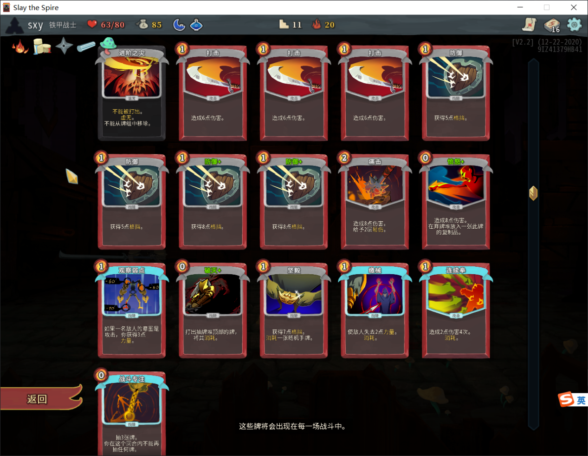

这是非常典型而强力的一套攻杀型卡组。输出核心毫无疑问是愤怒，一方面缓解了卡组的费用压力，另一方面也保证了卡组的攻击牌密度，这两点都能给观察弱点提供更广阔的发挥空间。连续拳的存在提供了额外的爆点，配合观察提供的力量，是压血甚至点杀的利器。战斗专注则给本来0过牌的卡组提供了无副作用，可持续的0费过牌，而破灭愤怒的存在，使得过上来的牌能被充分利用。观察弱点提供力量具有不稳定性，而手里剑配合愤怒，可作为第二个力量提供源。总而言之，除了没有消耗能力和祭品之外，这是一个近乎完美的过渡卡组，离胜利仅有一步之遥。

进一步分析，这个卡组的核心实际上是0费输出（愤怒）+1费力量源(观察弱点)+0费过牌（战斗专注）。如果把各个组件替换一下，把力量源换为0费的活动肌肉，输出换为1费的飞剑回旋镖，或者把过牌换为燃烧契约甚至剑柄打击，实际效果会因为单卡质量而差一些，但是构筑难度会进一步降低，依然是一个可用的攻杀过渡卡组。

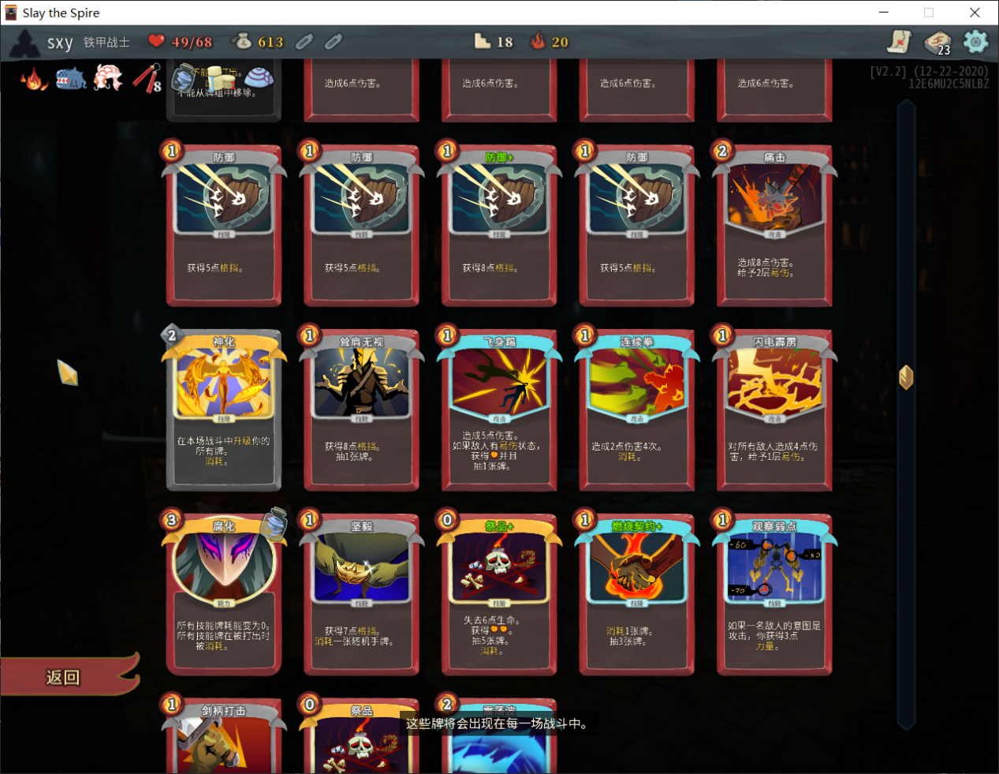

相比上面的平民卡组，这个卡组显得有点过于土豪了，不过这四张金卡提供的战力也完全对得起其价值。瓶装腐化几乎单卡解决了费用问题，对技能牌的消耗（主要是烧防御），也能保证后续卡组抽牌的连续性；观察和震荡波分别提供了力量和易伤两种高额的伤害加成；连续拳依然是提供爆点；飞身踢和剑柄打击可以在腐化烧干卡组之后循环若干次打出爆炸输出。这个卡组即使没有两张祭品和神化依然能乱杀二层，而这三张金卡的存在直接使游戏索然无味，抽到祭品的那一刻已经宣告了怪物的死亡。这个卡组再加一张突破带瓶精灵药可以拿去碎心了。

#### （2）防杀

对一个防杀型卡组而言，唯一需要考虑的是——能不能防住。这句话有两个含义，第一点是卡组要有<strong>超出怪物输出的防御数值</strong>，对这一点来说，战士拥有极其优质的白卡防御——耸肩、坚毅、武装，最强叠甲能力无惧疼痛，以及硬撑重振、循环狂怒、壁垒巩固等结构简单、数值强力的叠甲COMBO，防御数值极高；第二点，由于战斗回合偏长，卡组的叠甲<strong>在每个回合必须足够均匀稳定</strong>，而战士的烧牌特性提供了处理废牌的手段，随着回合推进，也能逐步提高稳定性。而这种延长回合的战斗方式，也和很多成长性卡牌契合，比如暴走、观察弱点、恶魔形态。

从上面两点来看，防杀似乎是非常适合战士的一种作战思路，然而熟悉魔塔的玩家都知道，防杀前提是角色的攻防和大于怪物的攻防和，一言蔽之，角色硬实力比怪物更强。防杀无伤虐菜的时候越爽，被怪物防杀的时候暴毙得越快。不巧的是，尖塔中有不少极端型怪物：高成长的三咔咔和双圆球行者，输出爆炸的拜蛇术士和倏忽魔，通过塞牌拉低卡组下限的天罚，甚至还有三者兼备的大爹三奴隶。所以几乎所有的防杀型卡组，都需要相应的输出手段来缓解防御压力，甚至专门准备另一套攻杀的战略来针对部分怪物。万幸的是，战士有一张白卡叫<strong>全身撞击</strong>，可以说，正是因为全身撞击这张白卡的存在，防杀才得以成为一个健全的战略，而不是虐菜养猪的特殊手段。全身撞击的强大留到单卡部分再分析，一个没有全身撞击的防杀型卡组，只能通过各种咸鱼方式化解风险，比如购置药水、逃之夭夭等，而一旦失去了这些操作空间，只能调整卡组结构，以降低防御稳定性为代价换取一定输出。这里依然附上几个防杀型卡组的典范型，具体的防牌留到单卡评测部分。

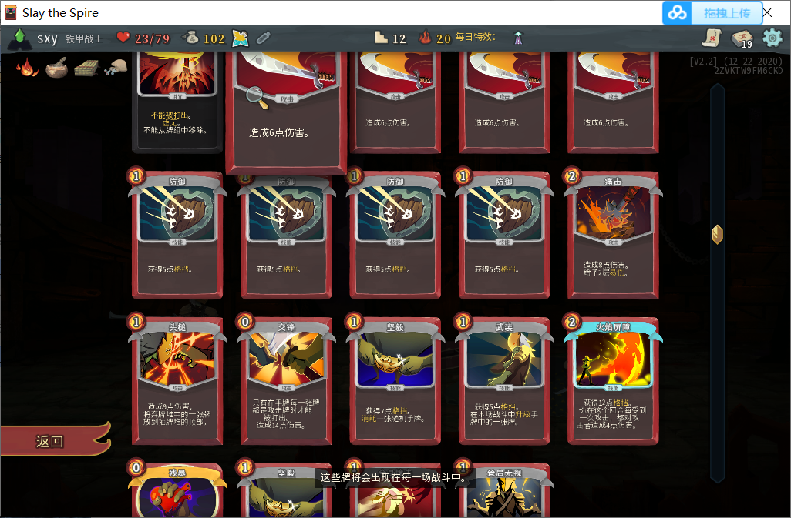

非常典型的一套防杀型卡组，武装耸肩坚毅白卡三巨头，加上优质蓝卡防御火焰屏障，以及无敌的全身撞击。如果能再把武装升级一下，防杀一些二层怪不是什么难事。残暴的持续掉血看似与防杀拖长战斗回合的思路不搭，而实际上残暴持续过牌对卡组稳定性的提升比损失的这点血量重要得多，一些稳定无伤的战斗也可以将其大胆烧掉。比起这些，头槌交锋是更值得关注的点。诚然，头槌和交锋并没有很高的强度，但是交锋和升级后的坚毅有相当不错的配合，头槌在补充攻击频率的同时，自带的特效也能增加卡组的稳定性和操作性。这个卡组的缺点是过牌仅有残暴，如果有一张战斗专注或者消耗能力，该卡组的强度会产生质变。

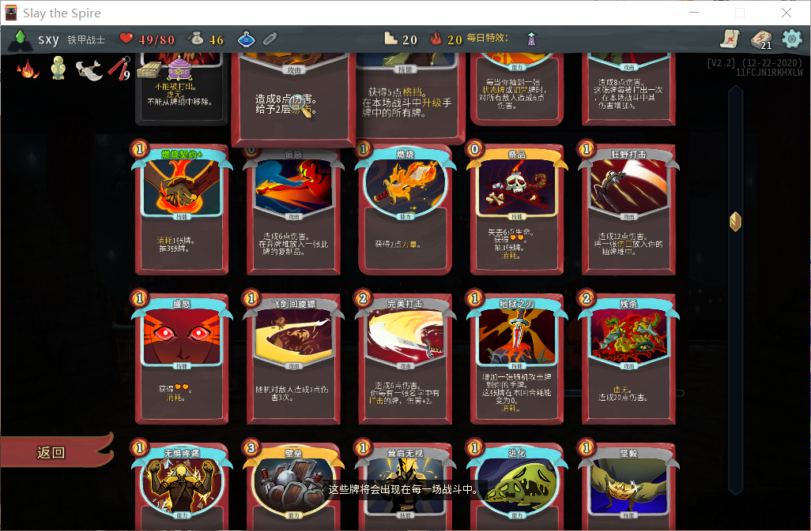

和上面的卡组相比，这个潘多拉后的卡组显得实在有点乱七八糟，几乎不像是一个防杀型卡组。这个卡组初看更像是一套攻杀型卡组，而笔者在实战中经过SL对比之后，大部分战斗防杀的战损反而更低。虽然这套卡组也有武装坚毅耸肩三巨头，但让防杀战略真正成立的是无惧疼痛，使卡组凭空多出了6张防御。再加上燃烧契约和祭品的辅助启动，一回合开出无惧壁垒并叠出20+甲相当轻松，之后通过烧牌处理攻击，武装耸肩便接过叠甲的大旗。此外，暴走的存在保证了卡组的上限，进化保证了异常状态抗性，祭品燃烧和一些优质攻击牌保证了爆攻秒杀的可能性。总而言之，虽然这个卡组没有全身撞击，但整体强度远远强于第一个卡组，再添加一张放血与黑暗之拥就能吊锤心脏。

## 四．卡池结构

### 1.牌效与费效

相对而言，前几章的讨论更多基于游戏机制，与战士的具体情况并没有太多关系，而本章则是对战士的卡池进行大致分类，并简单分析每个部分的性质，<strong>为下一章的单卡评测做好铺垫。</strong>

卡池由一张张具体的卡牌组成。对绝大部分卡牌来说，打出是发挥效果的前提，而打出卡牌需要消耗的资源有两个:<strong>手牌数量</strong>和<strong>费用</strong>。打出卡牌产生的效果，结合消耗的手牌或费用，便得到了<strong>手牌利用率</strong>和<strong>费用利用率</strong>两个参数，简称为<strong>牌效</strong>和<strong>费效</strong>。在这个定义下，一张卡牌的优劣，<strong>由牌效和费效完全决定</strong>。

由上面的描述便能看出，牌效和费效仅仅是一个<strong>笼统的</strong>、<strong>定性的</strong>定义。一般地，对特效不同的卡牌，比较两者的牌效和费效是比较困难的，这种比较更多用于相似卡牌中。比如，双持和残杀的牌效和费效几乎无法比较，而残杀的牌效显然大于双重打击，费效大于剑柄打击。传统的经典费伤比，便是剔除了卡牌伤害以外所有特性之后的费效比较。

从卡牌设计的合理性来看，卡牌的费效和牌效<strong>理应反相关</strong>，否则必然会产生卡牌质量的两极分化。杀戮尖塔有四个职业，其中有个职业叫战士，很平衡——虽然笔者很想这么说，但是大部分玩家都能看出来，战士恰恰是卡牌质量两极分化最严重的职业。踩着一众垃圾登上顶点的是——以<strong>黑暗之拥</strong>为首的消耗能力，以<strong>重振精神</strong>为首的强大烧牌。这些卡已经强到，此外的卡几乎没有与之比较牌效和费效的资格。

### 2.卡位的集中与分散——由牌效引发的讨论

#### （1）残杀和双重打击

残杀和双重打击作为过渡卡谁更强？答案毫无疑问是残杀。诚然，两者在特效上有些许不同，不过对过渡卡来说，比特效更重要的是数值。单纯比较2费打20/28，1费打10/14这两个数值间的优劣，依然是2费打20/28优秀得多。原因也很简单，<strong>两者有相同的费效，但是前者的牌效是后者的两倍。</strong>

不过无论是牌效还是费效，都是脱离实战的空泛概念。牌效的差距在实战的具体体现是，打出双重打击的一方为了弥补和打出残杀一方的数值差额，通常会采取两种手段:

①再打一次双重打击

②使用打击

对前者而言，再次使用双重打击需要等到卡组的下轮循环，直接延长了战斗回合。对后者而言，依靠低效率的打击弥补伤害，自然需要更多的费用和手牌，而前期卡组获得费用和手牌的手段只有——结束回合。无论采取何种手段，<strong>都无法避免回合数的延长，附带的额外战损成为必然。</strong>

为了使差额数值的填充更有效率，抓取了双重打击的一方通常会采取另一种操作:额外抓取别的过渡牌，而其中最简单的情况是：再抓一张双重打击。

<strong>一张残杀</strong>和<strong>两张双重打击</strong>，分别代表了<strong>卡位的集中</strong>和<strong>分散</strong>。

#### （2）卡位

一般地，卡位的集中和分散互有优劣。分散的卡位具有更高的下限，对鬼抽沉底以及怪物塞牌的抗性更高。同时，分散的卡位通常伴随着分散的费用，使用起来也更加灵活，数值大量溢出的情况更少。最后，对通常的攻击牌而言，分散的卡位能更大化力量的收益。而卡位集中的优点，全部凝结在<strong>“省卡位”</strong>一句无比正确的废话当中。所有人都知道，残杀作为过渡卡的强度远大于两张双重打击。欲究其原因，必须对“卡位”一词进行更深刻的分析。

从卡位的影响来看，卡位可分为三个构成部分:

<strong>①卡牌抓取的卡位</strong>

抓牌影响卡组大小，那么相比分散的卡位，集中卡位的卡组更小。在核卡组的终极目标下，大部分卡最终都会沦为需要被删掉或烧掉的废牌，而集中的卡位使得删牌及烧牌的过程更为简单。

<strong>②局内操作的卡位</strong>

消耗同样的费用，产生同样的效果，集中的卡位消耗的手牌数和出牌数比分散卡位更少。这使得集中的卡位对过牌的要求更低。

<strong>③火堆升级的卡位</strong>

卡位集中的卡牌升级后提升的效果，大致等于卡位分散的卡牌分别升级后提升的效果之和——这是一个大前提。在这个前提下，卡位集中的卡牌能省下更多的升级位。

再回顾卡位的分散带来的优势，可以明显看出，这些优势<strong>全部隶属于局内操作层面</strong>，仅从这一点来考虑，卡位的分散相比集中有着更好的发挥。但是在<strong>卡组大小</strong>、<strong>火堆升级位</strong>的综合限制下，<strong>卡位的集中远比卡位的分散优秀得多。</strong>

从表面上看，卡位的集中和分散是绝对对立的，而大部分卡牌的表现也确实如此。不过，战士依然拥有些许<strong>兼具卡位集中和分散各自优势的卡牌</strong>。这些卡牌，将在单卡评测部分重点介绍。

### 3.ZERO-MAX——由费效引发的讨论

一些不够熟练的战士玩家总觉得战士缺费，这是不无道理的。战士的卡牌费用普遍偏高，也缺少持续加费的手段，导致了费用的紧张。

但是，加费的根本目的是为了打出更高的数值，缺费的根源，<strong>与其说是没有加费，不如说是费效太低</strong>，而费效最高的卡，自然是0费牌——<strong>0费牌有无穷的费效</strong>。

正如在[四.1.牌效与费效](#p-0116)末尾所说的，费效和牌效通常反相关，大部分0费卡，都受到牌效的制约，通常来说，牌效远不及需要费用的卡。然而，这个“通常”对战士来说并不太适用。破灭/全身撞击/战斗专注，作为0费牌却有着究极牌效；狂怒/无谋冲锋/愤怒，虽然不及前两者那么夸张，但牌效也完全可以和部分需要费用的卡相媲美。一旦把这些卡重新纳入视野，战士缺费的问题一下子得到了解决。

在[二.5.几种重要循环](#p-0053)中，笔者给出了几种简单循环，其他所有的循环都是这类循环的衍生。从出牌数量来看，循环后核卡组的出牌量极其庞大，每轮包含核心卡的完整循环，通常都需要5张甚至更多的出牌数。同时，为了打出足够的数值，一轮循环显然远远不够。由此可以断言：<strong>核卡组的循环，必然有放血与0费牌其中一者的参与。</strong>

进一步地，循环中的卡，可简单分为<strong>核心卡</strong>和<strong>抽牌卡</strong>，而同时兼备两种功能的卡少之又少。战士的卡牌中，有核心功能的0费牌不少，有抽牌功能的0费牌，似乎只有破灭黑暗之拥的组合。为了寻求更多的0费抽牌卡，玩家们把目光放到了<strong>无色卡</strong>中，又发现了一片新的天地。同时兼备数值与抽牌的亮剑妙计，无条件抽2的深呼吸，过牌量巨大的急躁，加费卡疯狂，以及结茧印出的0费技能过牌。对无色牌的使用，是战士的一门必修课。

对牌效费效的讨论就到此为止，下面，对战士卡池结构的讨论正式开始。

### 4.力量

战士的所有卡牌中，和力量密切相关的约占1/6，按照功能可分为两类，一类是<strong>基础力量卡</strong>，另一类则是<strong>力量的增幅器</strong>。不管是从规模还是职责分工上来看，力量都是一个相当完备的体系。

体系的完备与否和整体强度并没有必然联系，而力量体系的强度究竟如何呢？笔者在两年前的攻略中，给所有力量相关卡都打出了非常低的分数，而随着水平的提升，笔者对力量的评分也发生了天翻地覆的变化。从个人经历来看，低看力量的人或多或少都陷入了一种“<strong>突破极限陷阱</strong>”——即过于迷信突破到999，而忽略了数值的重要性。在这种看法下，原本干脆利落的力量战变得拖泥带水，为了抵消战斗回合延长带来的巨额战损，死亡收割也成了必要组件。力量战由此沦为了需要两张金卡才能玩的套路，胜率自然相当惨淡。

力量的根本作用是缩短战斗回合，<strong>速杀乃是力量战的立身之本</strong>。无论是通过极致运转一回合突破十次，还是通过力量倍率卡和易伤打出暴力的数值碾压，力量战追求的是这种杀敌如切纸的流畅感。那种突破如便秘，防御单吊收割的力量战，实属有些不入流。实际上，对力量战来说打出数值碾压并非什么难事，仅靠燃烧飞剑就能打穿过渡时期绝大部分怪物，再加上震荡波，就算面对精英也有一战之力，随便来点运转就开始乱杀。

力量体系的强度贯穿全场，基础力量使过渡到单核成型的过程变得更加自然，大部分都具有极高的抓位。

### 5.过渡卡

#### （1）何谓过渡卡？

这是一个困扰了笔者很久的问题，而当笔者想起了总设计师的“不管是黑猫白猫，能抓耗子的就是好猫”，再结合以血量为中心的思考方式，这个问题直接迎刃而解。<strong>过渡卡以后期的运转强度为代价，换取前期的数值，而这两者通过影响战损的形式，实现了血量的周转和调度。</strong>换言之，能实现这个功能的，就可以称之为过渡卡。（其中卡牌对战损的影响，考虑的是<strong>均值</strong>，不能因为一个超级运气选手裸抓华丽随缘乱华乱杀，就称华丽为超强过渡）。顺带一提，本文为了简化卡牌分类，过渡卡仅涉及输出卡，并且剔除了力量体系。

#### （2）过渡卡的优劣

之前困扰笔者的过渡卡定义问题，根本在于两点。

第一，对单卡质量的要求如何？双重打击和打击唯一的区别在于数值，双重打击是过渡而打击不是（认为打击是的人笔者也认为他是弱智）。问题在于，是与不是之间的临界点如何划分？每个人对该临界的接受度不同。

第二，是否应包含COMBO？如果不包含，一些本来很强的过渡——比如猎手的投掷匕首和隐秘打击——直接沦为弱智。如果包含，那么将面对非常愚蠢的无限打击碎心问题。最好的办法是对COMBO加以限制，考虑一些容易实现且有一定强度的COMBO，忽略不容易实现和非常低能的COMBO。而问题又在于，对COMBO限制的临界在哪里？和第一点的问题如出一辙。

而<strong>战损是单卡质量和COMBO可能性和强度的综合反馈</strong>，而且能轻易通过实践得到，可以一劳永逸地解决上述问题。

从战损出发来考虑过渡卡的优劣，最重要也最直观的反馈是<strong>赚取的总血量</strong>。残杀燔祭强于顺劈斩双重打击，因为能赚取的血量更多；突然一拳铁斩波是大便，因为走几层赚取了寥寥几点血之后就开始疯狂亏损。

而除了赚取总血量之外，衡量过渡卡优劣的另一个要素是：<strong>赚取血量的分布情况</strong>。由于每个大层之后血量会贬值为原来的1/4，前一个大层溢出的血量收益将大打折扣。而战士的过渡卡赚取血量的分布如何呢？乱杀一层，二层吃屎，这是战士过渡卡的典型写照。一张残杀加一点针对牌就能乱杀一层，这个卡组会在二层被红石三鸟满血打死。究其原因，大概是由于二层怪物属性的增长，使得经典费伤比限制下的卡牌很难靠数值硬吃，依靠运转和各类其他COMBO提升输出成为必然；不巧的是，这类卡牌对COMBO的适应性较低，无论是配合<strong>力量</strong>、<strong>运转</strong>还是<strong>双持</strong>，效果都极其平庸，如果没有<strong>祭品</strong>、<strong>腐化</strong>等究极运转，会陷入一种进退维谷的绝望境地。而战士有没有能顺应COMBO，在二层大放异彩的过渡卡呢？是有的，那才是笔者眼中战士的最强过渡，具体卡牌留到下面的单卡评测部分再讨论。

#### （3）1费打9

1费打9是一个极其平庸，也很有代表性的数值，这个数值频频出现在战士的各类输出卡中。升级后的打击是1费打9，易伤/燃烧+/红头骨/观察弱点/打击木偶增幅后的打击也是1费打9，头锤剑柄飞剑也是1费打9。如果把数值略微放宽，还有顺劈斩连续拳的1费打8和双重打击的1费打10，不妨统称为1费打9的等价类。

1费打9，恰恰处在一个及格线，一个<strong>填充攻击牌密度，调整卡组结构的及格线</strong>。

为何1费打9的数值能达到及格线？从笔者的实践情况来看，初始卡组抓取了1张1费打9之后，打大颚虫大概率能省下5点血；打咔咔，特别是53血以上的咔咔能省下1-5点血；3张1费打9有机会踩到小红的临界少吃一下重击。而之后的情况逐渐变得复杂，但1费打9减少战斗回合的功能依然是不能忽视的。这是1费打9数值方面的作用。

而调整卡组结构又有何作用呢？在[四.2.卡位的集中与分散——由牌效引发的讨论](#p-0121)中，笔者提到了卡位集中和分散各自的优劣。虽然总体而言卡位高度集中的卡牌比分散的卡牌更有优势，但是战士的过渡卡中，卡位集中且具有较高抓位的卡至少蓝卡起步，不难遇到只能靠数量弥补质量的情况。即使抓到了残杀、重锤等卡位高度集中的强力过渡，也会面临所有单核卡组共同的风险：会被各种杂毛疯狂恶心，被塞牌怪重新教育，还可能被二层怪物硬实力碾压。典型的例子，单残杀打幼儿园，单暴走打6火史莱姆，单重锤打带壳……总而言之就是打不过。

而填充攻击牌密度，便能享有卡位分散带来的局内操作优势，不失为另一种过渡的选择。

当然，如果仅仅为了上述功能抓取一张打击+，确实显得有些愚蠢，而一旦1费打9附上一些特殊的收益，抓取的理由则变得充分了起来。实战中，往往也会填充不同特效的1费打9，以提高卡组的全面性。具体卡牌，留到单卡评测部分解决。

#### （4）AOE

AOE是过渡卡最常见的特效，由于死亡收割本身的特殊性，下文的讨论会将其排除。

老中医曾提出过这么一个观点，面对群怪，比起用AOE压低平均血线，用强火力点杀一个减少场攻才是更好的做法。这个观点看似没什么问题，笔者也曾抱有这个观点，而在不断的实践过后，能明显发现这个观点的漏洞——点杀并不是说做就能做到的事，就算能，也大多依靠祭品、药水等一次性的爆发，剩下的怪依然很难处理。这个问题在面对三咔咔，三哨位等久战不利的怪时更为致命。

根据维基给出的怪物出现概率，<strong>群怪出现的概率占比甚至超过了50%</strong>，已经高到了不能打马虎眼混过去的地步，而AOE在面对群怪时，能轻易突破费伤比的限制。通过AOE压血，之后依靠单体输出一一补刀，是面对群怪的极佳选择。

如果要对AOE的作用进行划分，明显属于<strong>补弱</strong>而非补强，所以AOE的抓取与否，非常依赖对卡组战力的估计。有一定强度的卡组对燔祭不屑一顾，弱小的卡组则可能被迫抓取旋风斩或顺劈斩。每轮洗牌的输出、循环速度、卡组的攻击频率这些因素，可以作为是否抓取AOE的简单参考。

### 6.运转

<strong>运转的根本目的是打出更高的数值</strong>，具体运转卡对数值的作用留到单卡部分，本小节只谈运转本身。

运转卡按功能大概可分为<strong>过牌</strong>、<strong>加费</strong>、<strong>卸牌</strong>、<strong>烧牌</strong>。战士的加费很少，比起加费而言，战士更依赖0费牌提高费效，这里暂不讨论。接下来分别讨论过牌、卸牌、烧牌的效果。

#### （1）过牌

过牌的效果，从卡组循环的角度来看，能<strong>加速卡组循环</strong>；从手牌角度来看，能<strong>对手牌进行置换</strong>。不同于加费卡（加费卡只有通过出牌把费用消耗掉才能发挥作用），过牌卡如果抽到了不需要的卡牌，即使没有在手牌置换上取得收益，依然加速了卡组循环。问题在于，由于回合规划——主要是费用规划的问题——过牌卡置换手牌的作用并不一定会产生正面效果。如果抽上来想要打出的牌却因为某些情况无法打出，此时的抽牌无异于刮削PLUS。对战士而言，最经典的过牌产生副作用的案例就是——战斗专注抽祭品。

虽然过牌可能会产生副作用，但过牌是运转的经济基础，属于卡组的刚需。对战士而言，可能80%的过牌都来源于黑暗之拥。

#### （2）卸牌

在讨论卸牌之前，先引用肥宅大佬关于运转的一个经典论述——卡组运转有两个矛盾：<strong>过牌与加费的矛盾</strong>，<strong>卡组大小与手牌上限的矛盾</strong>。其中，前者是人民内部的矛盾，是次要矛盾；后者为敌我矛盾，是主要矛盾。

对前者来说，矛盾的根源是，<strong>过牌卡与加费卡的效率</strong>。一般地，过牌卡都需要消耗费用，而加费卡需要消耗手牌，一旦过牌与加费的周转呈现总体亏损的趋势，运转的停滞将成为必然。而这一矛盾为次要的，原因在于，尖塔的高效运转卡不在少数，就算是效率略低的运转卡，在升级之后也能在运转上总体取得正面收益。<strong>通过高质量运转卡，加费与过牌的矛盾得到了解决。</strong>

对于后者，矛盾产生的前提是游戏机制本身:

①尖塔的手牌上限永远也不能突破10张。

②由于初始卡组，删牌位等限制，卡组大小一般远大于10。

③当手牌数+抽牌数＞10时，超出的牌不会凭空消失，也不会进入弃牌堆，而是卡在抽排堆不动。

在主要矛盾的限制下，卸牌的概念应运而生。顾名思义，卸牌指设法减少手牌数量这一行为，腾出手牌位用于后续过牌。而烧牌，正是卸牌的手段之一，除此之外，卸牌手段还有弃牌，以及直接打出。

卸牌会大量消耗手牌资源，也或多或少伴随着能量的消耗。卸牌，本质上是用手牌和费用给主要矛盾进行的“割地赔款”，赔款的多少由卡组大小和整体费用决定，赔款的频率由卡组的过牌量决定。羊毛出在羊身上，卸牌消耗的资源由压榨过牌卡和加费卡所得，进一步激化了过牌和加费的矛盾。猎手这样有弃牌辅助卸牌的职业还好，机器人这种卸牌全靠手打的职业则深受其害。对战士而言，完备的烧牌体系，尤其是数张大烧牌使战士在卸牌上并不存在太大的费用压力，面临的更多是手牌数量的问题。

#### （3）烧牌

烧牌确实是一种卸牌手段，不过其作用远不止于此。烧牌的真正强大之处在于：<strong>提供了一种运转上的成长手段。</strong>通过在战斗内削减卡组大小，<strong>直接解决了卡组运转的主要矛盾</strong>，使运转不再受到卸牌的迫害，并让卡组掌控力达到顶点——一种三千弱水，我全都要的境界。

但是，烧牌不是一个瞬间，而是一个过程，烧牌的收益也只有在下轮循环才会体现。对每一张烧牌单卡而言，矛盾变为了<strong>当回合烧牌代价和后续循环收益</strong>的矛盾；而当烧牌卡凝结为一个集体，便体现为<strong>烧牌速度和战损限制下的回合数之间的矛盾</strong>。而解决这一矛盾通常会采取四种方法：

①抓取更多烧牌。

②抓取更高效烧牌。

③抓取更高效过牌。

④抓取更高效防牌。

手段①有着抓取更多烧牌的同时会使卡组大小进一步增大的缺点。手段②对应的是抓取重振精神为首的大烧牌，缺点是烧牌效率依然受到过牌的制约，腐化以外的烧牌也极其依赖卡组的掌控力。手段③则是一句无比正确的废话，对战士来说，高效过牌从来都是有没有，而不是抓不抓的问题。手段④的目的是延长战斗回合，而延长回合最大收益是获取由回合开始带来的自然抽牌和费用，从对烧牌速度的影响来看，获取抽牌是延长回合的主要目的，④实际上是③的延伸。

综上所述，解决这一矛盾的出发点和落脚点有两个：<strong>烧牌</strong>和<strong>过牌</strong>。战士拥有相当多的烧牌卡，而烧牌体系也赋予了战士无与伦比的后期能力。作为力量的代价，战士的过牌水平弱得可怕，几乎单吊几张能力牌。<strong>烧牌突破了卡组大小的限制，而过牌水平则再次限制了卡组大小。</strong>对战士来说，卡组大小的极限，几乎完全取决于黑暗之拥的数量。

### 7.防御

从数量上看，战士的防牌约占卡池的1/6，并广泛分布于各个稀有度之中；从功能上看，战士的防御手段多点开花，百花齐放。可惜的是，从质量上看，战士的防牌质量<strong>两极分化极其严重</strong>，不少低质防牌几乎不存在抓取的可能。再加上一些优质防牌的收益也建立在COMBO基础上，战士对防牌的选择实际上并没有太大的操作空间。而战士极其糟糕的初始卡组，进一步扩大了战士对防牌的需求。因此，即便是咸鱼防御牌，在战士手里也有不低的抓位。

同时，一张能用的防牌在战士手中也容易取得比其他职业更高的收益。任意能用的防牌+任意单体烧牌，便得到了一个防杀型卡组的基础框架，对防御能力、过牌能力进行补强之后，便衍生出养猪的可能。此外，防牌也使得战士的最强核心卡——全身撞击的抓取变得极其自然，进而平稳衔接了过渡到单核成型这一过程。

最后，防御并不是玩家单方面的行为，而是玩家和怪物的一种互动，以机械的观点来看待防御是不可取的。防御确实能减少当回合的战损，但能否减少整局对战的战损，根本在于能否通过防御在立回中取得优势，如果不能，不如把投资在防御上的费用用于输出。为了使这种出牌策略的改变更有效率，提前调整卡组结构，并使用场外因素辅助是既充分又必要的选择。在防不住时，是否拥有这种应变能力和魄力，是战士水平的重要分水岭。

## 五．单卡评测

### 1.单卡评分

首先要明确一点，卡牌评分体现的，是特定玩家或玩家群体，对<strong>卡牌综合降低战损能力的价值评价</strong>，而这种评价，只能通过不断实践获得。笔者目前给出的评分表，主观上体现了笔者个人的打牌风格，客观上也代表了目前允许SL前提下战士的最高胜率。对这个评分表，各位读者应该结合自身情况批判地理解。同时，由于不同卡牌降低战损的分布情况不同——例如过渡牌降低战损的能力主要集中在前期，而另一些卡牌集中在后期——以及类似功能的卡牌可能会产生冲突，<strong>卡牌的抓位不能单纯由评分决定</strong>，而应该结合时期和卡组构成综合考量。此外，不同稀有度卡牌之间的得分并不完全相通，不能彻底反映卡牌间的强度关系。最后，无色卡部分的评分，都是从战士的观点出发，与其他角色没有关系。

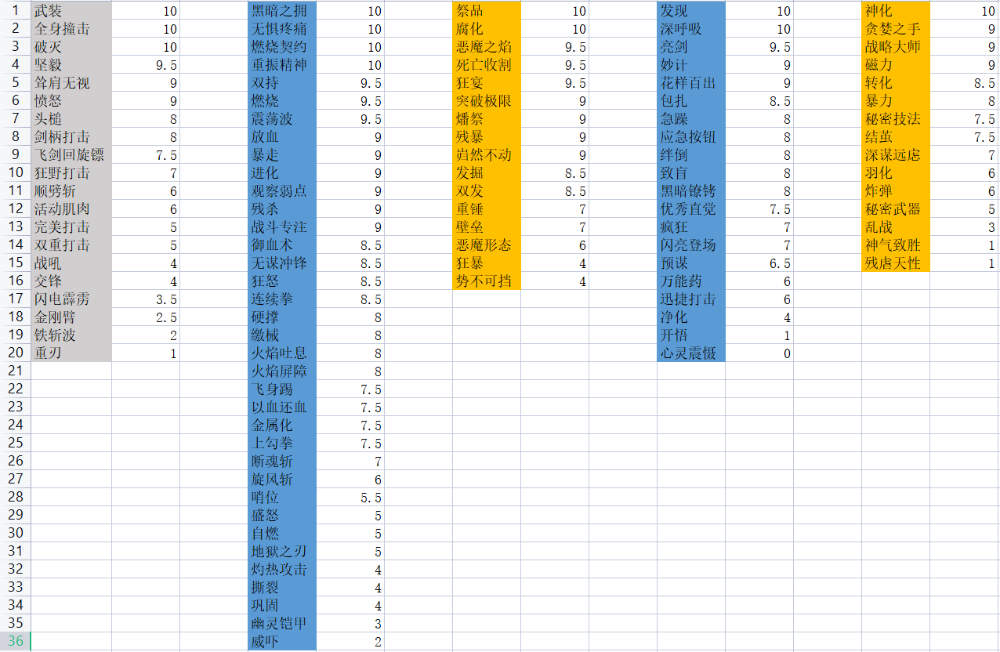

### 2.力量篇

#### （1）活动肌肉

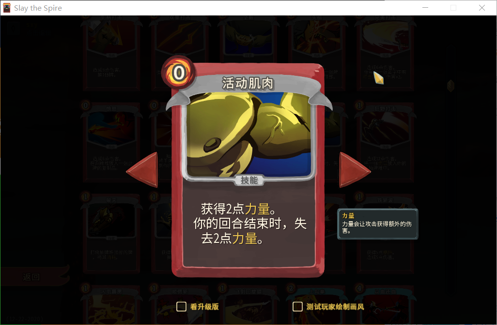

0费普通技能卡，6分，白卡中排名11-12/20。获得2（4）点力量。你的回合结束时，失去2（4）点力量。

简评： 活动肌肉是战士所有卡牌里最难驾驭的一张，对大部分玩家而言，可以无脑不拿。

笔者把活动肌肉放单卡评测的开头，是想表明一个态度：批评与自我批评，是加深卡牌理解，提升爬塔技术的必要条件。活动肌肉是玩家从第一次爬塔就开始接触的一张卡，也是玩家从萌新变成老手的过程中，最先被抛弃的卡之一，类似的卡还有交锋、完美打击。诚然，这些卡并非什么好卡，但是随着时间的推进，对这些卡牌的批判也变得相当教条主义。正如笔者在文章开头所说，这篇文章的一大目的就是打破这些陈规，而活动肌肉，则是最有代表性的卡牌。

在讨论肌肉之前，先分析一下力量体系的构成。在力量篇已经提过，力量体系的牌可以分为<strong>基础力量卡</strong>和<strong>力量增幅器</strong>，其中增幅器只是一个比喻，具体包括各种力量倍率卡，以及突破极限和死亡收割。这两类卡互相依存，体现在：

①力量增幅器的发挥高度依赖基础力量。

②基础力量牌有着极强的时效性，抓位随着层数推进会快速贬值，需要依靠力量倍率卡减缓自身的贬值速度。

既然两者互相依存，那么不可避免地产生了听牌的矛盾——抓取其中一方，能否能快速抓到另外一方？对基础力量→力量增幅器这个听牌顺序而言，这似乎是一个极其自然的过程，可能有玩家把这种自然，归结于基础力量自身具备的过渡作用。这个想法没有问题，但是没有意识到，基础力量的过渡作用，很大程度上正是由一些极易获得的力量增幅器提供的——飞剑回旋镖，乃至重刃，如果再放宽一点，还有0费1倍的愤怒，0牌1倍的剑柄打击。这些白卡的存在，极大降低了听牌难度，才使这个过程显得极为自然。另一方面，一些不够熟练的玩家在使用力量战碎心时格外依赖突破极限和死亡收割，有的还依赖祭品——而这些都是金卡。于是乎，大量人开始抱怨：“力量战太难玩了，碎心还得玩防战。”他们的抱怨是不无道理的，毕竟听一张白卡远比听好几张金卡简单，但是为何不重新考虑一下这些金卡是否是必要的呢？只听一张白卡的赢法是否有着更苛刻的前置条件呢？事实上，力量战的强度绝不亚于所谓的防战，当然，这些都是题外话了。

类似的，从力量增幅器→基础力量这个听牌顺序，大部分人都觉得有些别扭而困难。这种违和感并不是错觉，基础力量卡中，撕裂需要更为苛刻的前置条件，恶魔形态不打BOSS基本开不出来，如果再忽略掉白卡活动肌肉，剩下的仅有燃烧和观察弱点——而这两者都是蓝卡。在这种前提下，裸抓任何力量增幅器，都等于在赌能否在短时间内抓到两张蓝卡其一，赌失败自然是难免的，因为这些裸抓的“粘液”或“打击”被滚起雪球，最后暴毙也并非不可能。这使得各种力量增幅器，特别是突破极限这张卡，陷入了一种进退两难的窘境，拿了害怕听牌失败，不拿又怕机不可失，时不再来。那么突破裸不裸拿呢？相应的，死亡收割裸不裸，甚至飞剑回旋镖裸不裸等一系列问题都顺势引申了出来。而一旦把活动肌肉重新纳入视线，这张极易获得的白卡基础力量，极大降低了这种听牌过程的难度，而上述问题也瞬间失去了意义。

极大增加了卡牌的选择空间——这才是活动肌肉的真正强大之处。

此外，活动肌肉作为0费牌，在局内有天生的灵活性，能提升战斗的操作空间。一回合多次打出肌肉可以线性叠加，恰好顺应卡组循环，保证了肌肉的上限。特别地，活动肌肉——死亡收割构成了一个结构简单，上限极高的回复体系，几乎所有形态的战士都能外挂一个。

而肌肉的硬伤也极其明显。第一，极其依赖卡组掌控力，前期任何配合都要看发牌员脸色，牌序不好很容易沦为诅咒；第二，肌肉的数值偏低，为了获得差强人意的数值，还得消耗一个敲位。第一个弱点可以靠填充攻击牌密度来弥补，也可以靠充足的过牌解决；第二个弱点则没有任何解决办法，只能投入敲位或者凑合使用。正因如此，笔者才把肌肉称为战士最难驾驭的卡，战斗回合和COMBO的概率的估算，局内的处理和SL技巧，在这里些临场应变的方面，肌肉对玩家的要求比其他卡高得多，这也是笔者不推荐大众玩家抓取肌肉的原因。

#### （2）燃烧

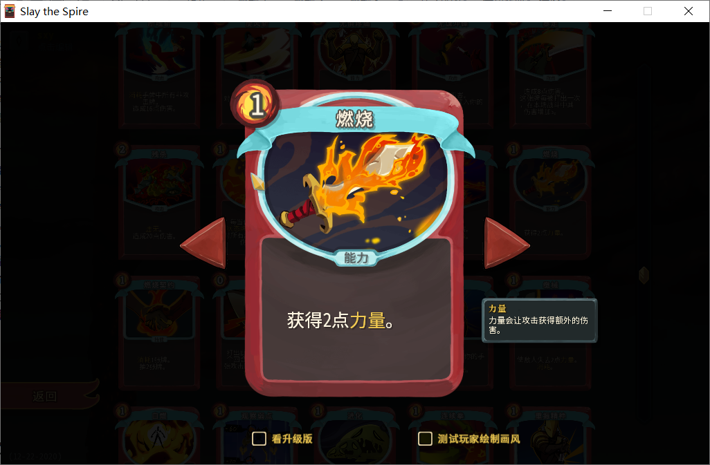

1费罕见能力卡，9.5分，蓝卡中排名5-7/36。获得2（3）点力量。

简评: 最强的基础力量，有比所有过渡卡更高的抓位。

笔者在[四.卡池结构2.卡位的集中与分散——由牌效引发的讨论](#p-0121)一节提过，卡位的集中与分散互有优劣，而所有的力量相关卡，既享有卡位集中带来的一切优势，同时也具备卡位分散带来的灵活。力量以攻击牌为中介转化为输出，这使得力量收益的分布几乎等同于卡组攻击牌的分布。同时，获得这种收益仅仅需要付出一个卡位——无论是抓牌位，出牌位还是升级位都只需要一个。可以说，力量这种属性和普通过渡牌相比有天生的优越性，只是战士的大部分基础力量过于拉垮，只剩下两个正常人——燃烧和观察弱点。“真理总是质朴的”，生效及时，发挥稳定，数值可观，燃烧凭其朴实而实用的特性，稳居第一力量的宝座。虽然和其他基础力量源相比，燃烧的上限相对较低，碎心比较依赖突破极限，但是在其稳定性的基础上，辅以易伤、力量倍率卡的加持，杀穿前两层并非难事。这种稳定的强战斗力，也使击杀精英变得更为容易，可以一步步滚起雪球，在三层BOSS前获取突破极限的概率也绝不算低。没有突破极限的情况下，可以通过抓取第二张燃烧维持力量战的数值碾压。燃烧相对来说缺乏上限和成长，升级的提升高达50％，再加上力量本身的优越性，燃烧自然有着极高的升级位。

#### （3）观察弱点

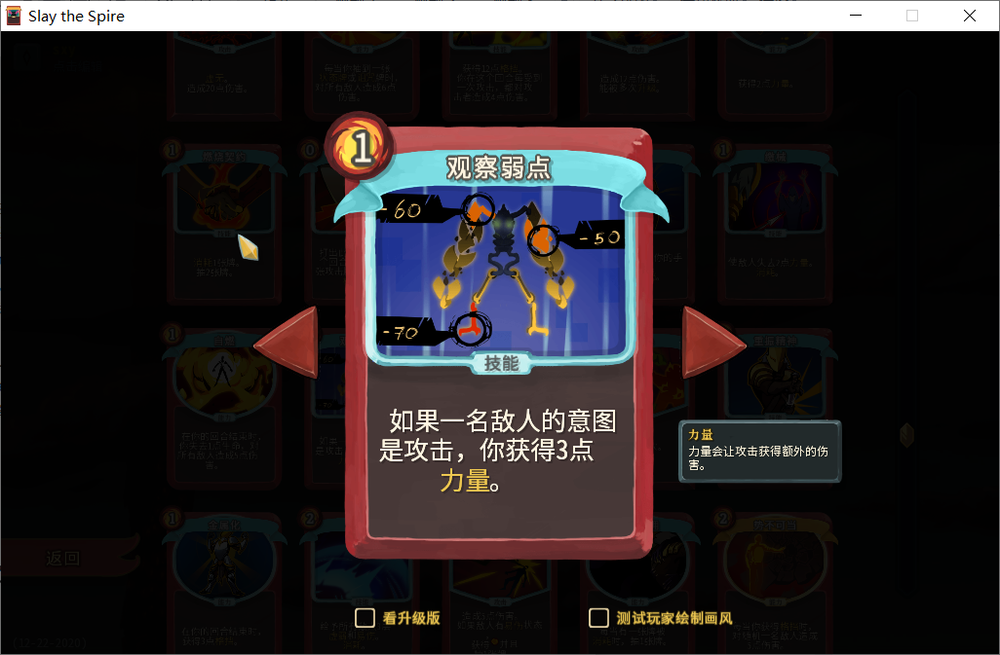

1费罕见技能卡，9分，蓝卡中排名8-13/36。如果一名敌人的意图是攻击，你获得3（4）点力量。

简评：和燃烧相比，观察弱点以稳定性为代价，换取了更高的数值和成长性。

观察的数值比燃烧高出1点，同时作为技能牌可以反复打出，这两点使观察并不缺数值和上限，不升级也有极其出色的发挥。此外，观察也能在防杀型卡组中配合死亡收割养猪，以及享受腐化的减费和消耗效果。

另一方面，观察的限制条件某种程度上说比肌肉更加严格。如果说肌肉的不稳定性来源于卡组自身，那么观察的不稳定性则是怪物行动和牌序综合作用的结果。在敌人非攻击意图的回合获取力量，对观察来说是一件宿命般不可能的事，能做的只有点下结束回合，并等到下轮洗牌。力量战本身对战斗回合数极其敏感，这种节奏的延缓，往往会带来巨额战损，也导致和突破极限的配合相当依赖运气。再者，在敌人攻击的回合打出观察，无疑会增加防御压力，甚至使自己变得满身弱点。这些缺点，在对阵史莱姆老大时体现得淋漓尽致。不过，要是因为BOSS是史莱姆就放弃观察，就显得有些因噎废食了。力量是二层最好的输出之一，后续也存在着大量配合空间，而史莱姆老大也可以通过两张状态能力或填充攻击牌轻松击败，观察作为第二优质的基础力量，完全值得顶着史莱姆抓一张。

#### （4）撕裂

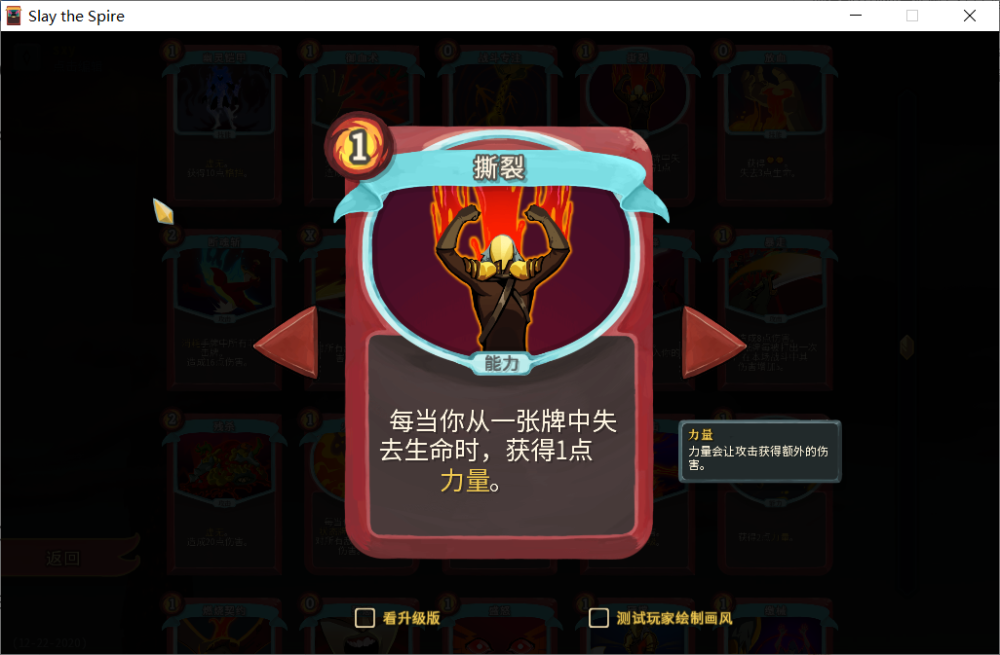

1费罕见能力卡，4分，蓝卡中排名32-34/36。每当你从一张牌中失去生命时，获得1（2）点力量。

简评：比起本身效果，更重要的是其战略价值。

曾经的撕裂升级效果只是减费，被调侃为“最大的作用是配合棱镜双持散热片过牌”，更新之后撕裂终于拥有了最基本的实战强度——也仅仅是“最基本”的强度而已。撕裂的优点在于极高的上限，在特定卡组中，一回合获得十余点力量并非难事，不需要突破极限就能轻松达成彻底的数值碾压。相对地，撕裂的平均发挥极低，绝不是一张适合裸拿的卡牌。首先要明确力量战的基本战斗逻辑——依靠力量缩短战斗回合降低战损，而撕裂获取力量则加入了打出卖血牌的中间条件，开撕裂→打出卖血牌→打输出终结战斗，很难说这种战斗方式的回合数比抛开撕裂的战斗回合更短，更别说赚回卖血卡带来的战损了。

再从前置条件来考虑，战士卡池的卖血卡有5张，数量其实并不算少，但是放血、祭品和御血术自身便有很强的终结战斗能力，而剩下的自燃和残暴，都是按回合生效的卡，这种情况下，撕裂变成了一张小恶魔形态。虽然费用比恶魔形态更加灵活，但是整个基础力量系统变得更加臃肿，也会面临牌序的问题。此外，回合成长这种成长方式，本身也和力量战的战斗逻辑有些矛盾。最后，自燃并非一张好卡，残暴虽好但也是金卡。在种种限制下，撕裂的配合空间实在是太窄了。

除了战士卡池的牌以外，卖血卡还有三张诅咒和JAX，其中唯一能和撕裂形成比较好配合的是疼痛。疼痛撕裂确实是一个强度不错的COMBO，只是疼痛缺乏稳定的入手手段，同时疼痛带来的战损也是所有诅咒中最高的一档，这个配合达成难度较大，实际发挥也取决于卡组及遗物的综合回复能力。

上面的论述实际上说明了两件事：①撕裂不适合裸拿。②撕裂和大部分卖血卡的配合都是下策。从另一方面考虑，在已经拥有了卖血卡的前提下，撕裂可以作为一种保底选择——毕竟下策总比束手无策好。撕裂的强度不在自身，而在于提高了所有卖血卡的潜在配合空间。

#### （5）恶魔形态

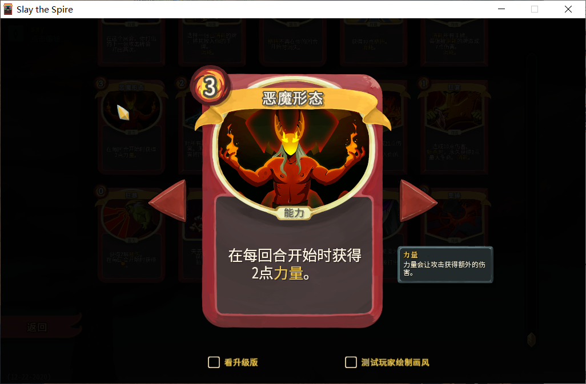

3费稀有能力卡，6分，金卡中排名14/16。在每回合开始时获得2（3）点力量。

简评：游离于力量体系外的一张基础力量卡。

力量的目的是减少战斗回合，而恶魔形态的效果却很尴尬地随着回合线性增长，同时，恶魔形态的数值也仅仅停留在“差强人意”的水平，这使得恶魔形态陷入了进退维谷的窘境——只有把超长盘战斗缩短为长盘战斗，恶魔形态才可能取得不错的收益。再从战损的角度来看，如果防御端不够强大，即便恶魔形态缩短了战斗回合，剩下的战损依然难以接受；如果防御端强大到能够防杀怪物，恶魔形态缩短回合的收益则只会更小。最为致命的是，作为一张形态卡，固定的3费对战士来说简直是灾难，开恶魔形态基本等于空过一回合，带来的战损极难从后续回合中弥补回来。

上述的种种缺点，导致恶魔形态大部分时候只是一张BOSS特攻卡——BOSS战对战损的要求相对宽松，战斗回合偏长，一定程度上弥补了恶魔形态本身的缺陷。而恶魔形态在BOSS战中缩短的回合，也往往是BOSS最为狂暴最难防住的回合。总而言之，恶魔形态在BOSS战的发挥还是相当优秀的。

和其他基础力量卡相比，燃烧、观察、肌肉都迫切地需要力量倍率卡以扩大战果，而恶魔形态较容易获得溢出的力量，对力量倍率卡的需求较低。从这种角度来看，恶魔形态的结构更加简单，比起力量战自己使用，更适合外挂于其他体系的战士当中，用来针对BOSS或配合死亡收割养猪。

最后，虽然恶魔形态是BOSS特攻卡，但也不能完全忽略恶魔形态在杂鱼战发挥作用的可能性，关键是如何以较低的战损打出恶魔形态。一般是用放血/祭品/蛇眼解决费用问题，或用死亡收割解决战损问题。

恶魔形态的抓取条件比较苛刻，但是抓取之后有比较高的升级位，恶魔形态随着回合推进能提供巨额的力量，在如此巨大的基数下，50%的加成相当夸张。

#### （6）飞剑回旋镖

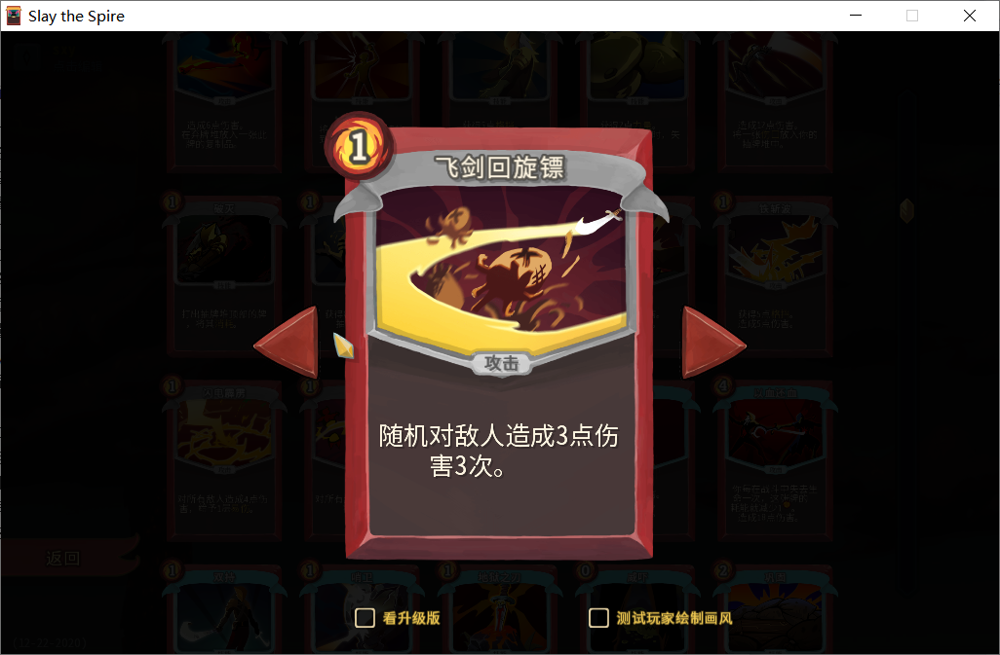

1费普通攻击卡，7.5分，白卡中排名第9/20。随机对敌人造成3点伤害3（4）次。

简评:最好的力量倍率卡，甚至可以裸抓。

在讨论飞剑之前，先浅谈一下力量倍率卡的重要性。力量是战士突破费伤比限制的重要手段，而力量无法直接造成伤害，只能以增加攻击卡输出的形式间接造成伤害。力量的间接增伤只能依靠攻击牌数量来堆积，堆积攻击牌数量的方式有两种：一是增加卡组攻击牌浓度，二是反复多次循环打出某一张攻击卡。这两个方式，正好是“均卡组”和“核卡组”的思路。在运转不足的过渡时期，战士的确需要靠填充攻击牌数量来扩大力量的收益，而随着运转的加强，力量战的作战方式会逐渐转化为核卡的思路。为了保证这种转化的流畅性，填充的攻击牌自然不能太多。方式二作为循环核心卡，最重要的是效率，没有效率的卡不具备循环的价值。而力量倍率卡，既大幅降低了需要填充的攻击牌数量，也提供了一个集中卡位和费用的循环核心。

1费3/4倍力量，飞剑的费用力量倍率比仅次于连续拳和恶魔火（7/9张手牌以上），而这两者都是消耗牌，不消耗的飞剑自然成为了力量战的王牌杀器。高额的倍率配合力量能轻松打出数值碾压，6点力量的飞剑配合震荡波已经能满足碎心的基本输出需求，12点就能乱杀心脏。

力量加成下的飞剑像个杀神，相比之下白板飞剑确实有点弱，1费打9只有打击+的水准，3段随机虽然能避免伤害的溢出，但更多时候是雨露均沾，一个不死。笔者裸抓飞剑很大程度上是因为会抓活动肌肉，不喜欢抓肌肉的玩家，不建议裸抓飞剑。

作为一张1费打9，飞剑的升级位非常低，很少在火堆手敲。为了避免功能的重复，一般只抓一张。

#### （7）连续拳

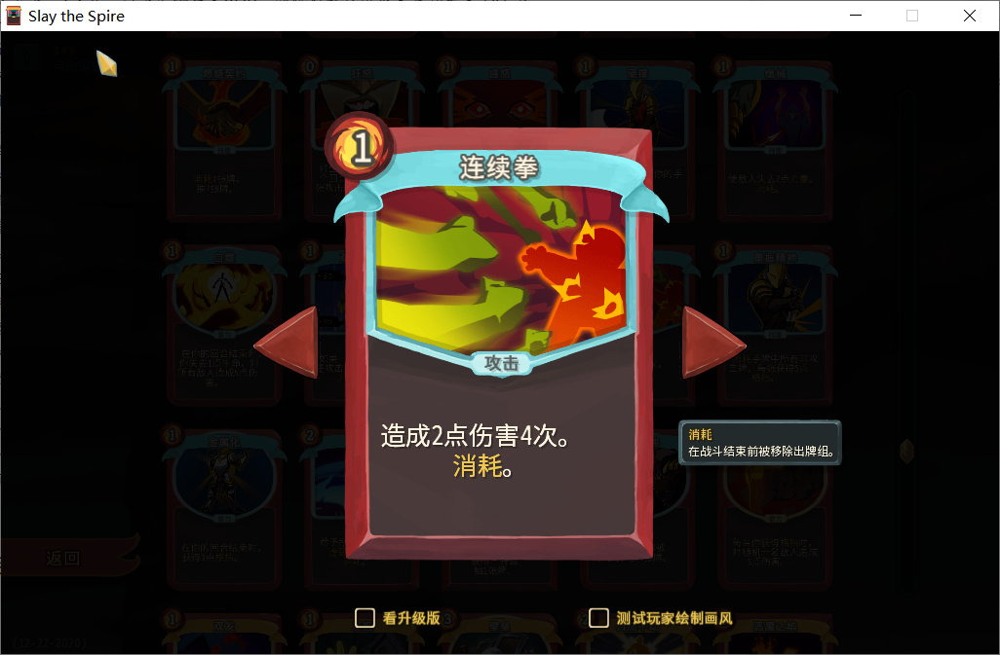

1费罕见攻击卡，8.5分，蓝卡中排名14-17/36。造成2点伤害4（5）次。消耗。

简评：消耗属性使连续拳难以扮演核心的角色，另一方面却提升了连续拳的抓位。

单从力量倍率卡来看，消耗的负面影响显然大于正面作用，但是从整个卡池来看，这反而使连续拳不再受限于前置力量，成为了所有卡组填充攻击牌密度的极佳选择。消耗属性大大降低了连续拳的抓取门槛，一瓶类固醇药水都能成为抓取连续拳的理由，即使裸抓也不会产生什么风险，再不济也能一拳打落一只鸟不是么。相较飞剑，连续拳有更高的力量倍率/费用比，同时具备飞剑没有的集火能力，如果用于点杀小怪或压低血线，消耗的副作用几乎可以忽略不计。最后，连续拳作为不多的消耗攻击牌可以配合消耗能力，加上双持和特定加费可以弄出各种奇怪的花活。

作为一张消耗的1费打8，没有任何主动升级的可能，也没有必要抓第二张。

#### （8）重刃

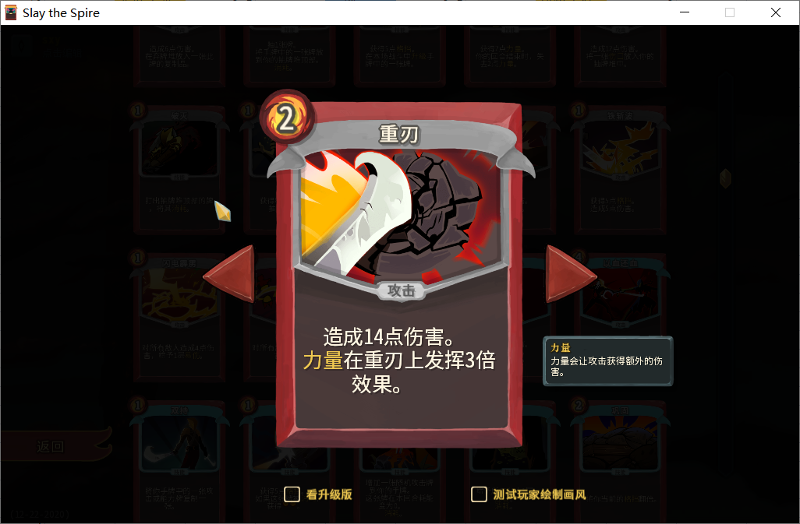

2费普通攻击卡，1分，白卡中排名20/20。造成14点伤害。力量在重刃上发挥3（5）倍效果。

简评：战士卡池中最差的牌，几乎不存在主动抓取的可能。

作为一张力量倍率卡，重刃脱离力量的伤害低得有些过分了。更让人无法接受的是，升级之后重刃的伤害依然是14点，这样看甚至不如打击。配合力量的重刃也没厉害到哪去，1费1.5的力量倍率，结合糟糕的初始伤害，被各种1费打9完爆。作为一张卡位集中的卡牌，糟糕的初始伤害和升级不提升基础伤害的缺点，使其完全不具有卡位集中带来的优势，反而在局内操作上变得更加笨重。能集火算是重刃唯一的优点，但是也被低下的数值掩盖掉了。

不要主动抓取，不要升级，变化出来尽快删掉。

#### （9）突破极限

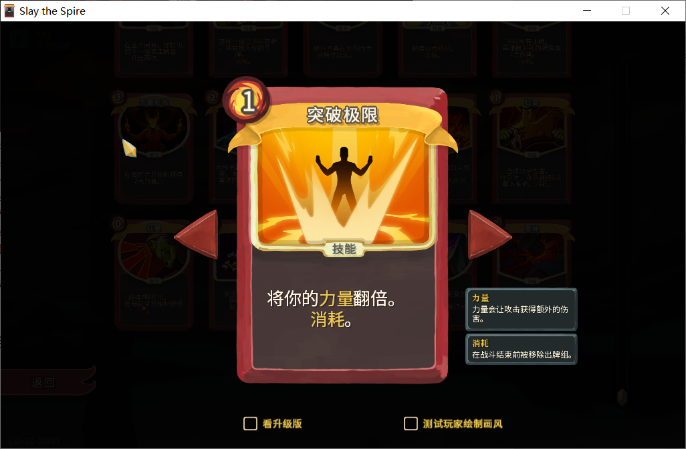

1费稀有技能卡，9分，金卡中排名6-9/16。将你的力量翻倍。消耗（不消耗）。

简评：战士的浪漫，碾压的开始。

和大部分卡不同，突破极限的敲位是非常深刻而复杂的，只有理解了<strong>不敲的突破＞敲了的突破</strong>这一暴论背后的含义，才能真正理解突破极限的正确使用方法。

敲突破的收益是什么？消除突破的消耗特性，从而在多轮循环中打出多次，形成力量的指数成长，最终达成究极的数值碾压。

问题在于，达成这一目标需要多少回合？如果运转够强，祭品黑拥放血燃烧契约，一回合能把金刚杵突到999，这确实是一个既强力又浪漫的卡组，能与之比肩的大概只有无限发现、无限武装灼热和39费转化。可惜的是，大部分卡组并不具备这样的运转实力，哪怕仅仅从3点突到24点，可能都需要10个回合，而力量战都是以缩短战斗回合为目标的。

敲突破，不仅意味着敲位的付出，和消耗能力甚至发掘配合的消失，更意味着战斗策略的改变。原本是燃烧突破飞剑速杀的策略，变成了烧牌×15+突破×10+打击×1的策略。敲突破这一举动，说明玩家在潜意识已经拉长了战斗回合，进而带来了海量的战损。

如果有死亡收割，突破是可以敲的；面对BOSS上限不够，突破也可以敲。这两种情况确实不少，但也绝谈不上多，毕竟死亡收割也是金卡，而6点力量配震荡波飞剑碎心并非难事，12点力量已经能乱杀心脏。就算遇到这两种情况，敲突破也并不是必要的，实在不行也可以双突、发掘突，这些都是黑化突破的常见手段。

突破极限作为力量战最具有代表性的卡，同时也具备很强的迷惑性。正如笔者在[力量](#p-0148)开篇写到的一样，突破容易让人陷入999误区而忽略数值的重要性。事实上，如果仅把突破作为999的渠道，除了能配合死亡收割以外几乎被暴走完爆。比突10次的突破更强的是突1次的突破，配合力量倍率卡和易伤，达成简单粗暴的数值碾压，这才是突破强大且实用的使用方式。

最后，如果路线较好且对自己水平有自信的玩家可以裸拿突破，否则，建议在抓取了基础力量卡再抓突破。

#### （10）死亡收割

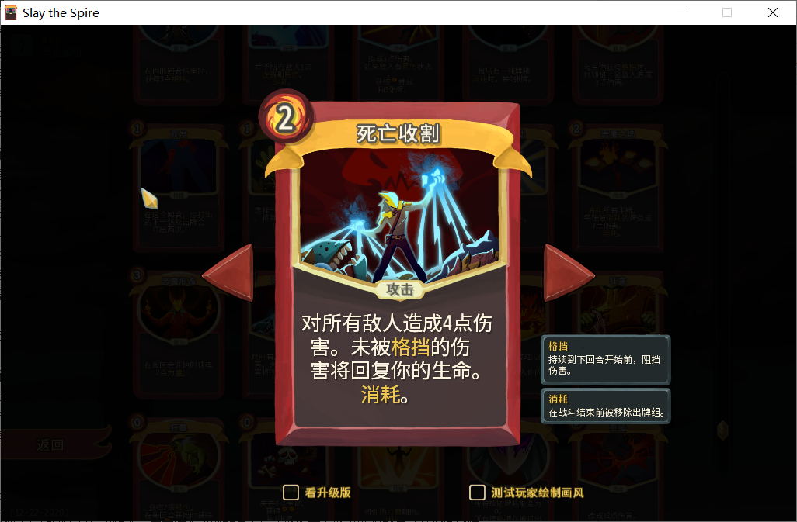

2费稀有攻击卡，9.5分，金卡中排名3-5/16。对所有敌人造成4（5）点伤害。未被格挡的伤害将回复你的生命。消耗。

简评:一张极其<strong>灵活</strong>的跨战斗收益卡，任何卡组都可以带一张。因为死亡收割配合力量的收益过于恐怖，笔者还是把收割划到力量体系内。

可能会有读者纳闷，为何一张2费攻击牌，会被笔者冠以“灵活”一词。实际上，一张卡的灵活与否，除了考虑费用，还要看卡牌的具体功能。以猎手的夜魇为例，可以夜魇幽魂、余像起防，夜魇杂技、骰子、战术打运转，也能夜魇催化、隐秘、华丽斩杀，还能夜魇炼药获取跨战斗收益，夜魇夜魇玩花活。有高额费用消耗的夜魇，依然是一张灵活的牌。

从字面上看，死亡收割的功能仅有低额的AOE伤害和等量回复，和灵活似乎有点不搭。而实际上，正如笔者在[血量的周转](#p-0071)一节写的，尖塔的一切举动，本质上都是各类资源的相互转化，而血量无疑是资源转化的核心。充足的血量，可以在血量的调配上更加游刃有余，极大减少亏周转的可能。

死亡收割对血量的影响和其他牌有何不同？一般的卡牌只能通过减少战损的方式变相省血，这种方式受边际效应的制约，并且永远不能把战损减到负数。而死亡收割提供了一种燃烧之血以外的直接回复手段，只要辅以传统的减少战损方式，便能通过战斗获得额外的血量资源。如果上面关于血量调配的说法有些抽象，从实战的角度来看，不难得到一个具体的案例——面对弱小的怪物时，通过死亡收割实现血量的增长；而面对强大的怪物，凭借积累的血量强行击杀。在弱小的怪物积累资源，并在强怪面前释放，死亡收割实现了血量的调度，这是收割在血量周转上的灵活性。

在上面的论述之后，剩下唯一需要解决的，同时也是最重要的，便是死亡收割的效率问题。诚然，收割的下限确实略低，白板死亡收割部分时候无异于2费包扎，收益还会因虚弱降低，甚至可能无法击穿护甲。但是，即便是白板收割，在面对群怪时也能产生相当可观的回复效果，也勉强能和初始卡组的痛击配合。总体来说，白板收割的发挥差强人意，而收割和大量卡牌间直接都存在或多或少的配合，其中效果毁天灭地的配合不在少数——极大地增加抓牌的选择空间，这是收割在卡牌抓取上的灵活性。

提高收割效率的手段有两种，一是增加收割造成的伤害，比如力量、易伤、红牛等；另一种则是增加收割的数量，比如双持、发掘等。在上述手段的配合下，即便是正常使用的收割也具有很高的强度，更为可怕的是，由此产生了各种“恶用”收割的养猪方法，把几乎所有可以防杀的怪物，变成了一个个超级大血包。叠高力量一刀入魂，双持收割慢慢凌迟，这些属于养猪的基本操作，还难以称为“恶用”。众所周知，尖塔所有局内印卡都无法印出回血卡，这是游戏设计之初为了防止恶意养猪的手段。不过细心的玩家不难发现，虽然印卡无法印出回血，但是能印出发掘，发掘能发掘收割。于是乎，收割+印卡=一切，印卡养猪相较于力量和双持看似有些笨拙，实战操作中反而灵活不少，不再需要留一张收割一直不打，并能通过印卡不断降低养猪难度，也可以现印力量和双持。如果说用尼利和发现+印卡还勉强能算正常手段，像笔者这种比较丧病的玩家还会SL一个花样百出/转化印磁力，磁力印发现，武装发现养猪收割吸血，最后用武装将磁力印的点金手升级，点掉怪物+25。收割给所有印卡提供了血量容错，印卡为收割提供了效率和养猪环境，两者相辅相成，结合在一起便能产生质的飞跃。

最后，收割在战斗中降低了启动阶段对战损的要求，提供了一种卖血快速启动最后回满的战斗方式，最典型的便是死亡收割突破极限力量战。此外，收割和别的消耗攻击牌一样，配合双持无惧黑拥能玩出各种花活，而收割回复的血量，便可以用于放血，达成真正的无限。这是收割在局内操作的灵活性。

显然，收割没有任何主动升级的理由。

### 3.烧牌篇

#### （1）重振精神

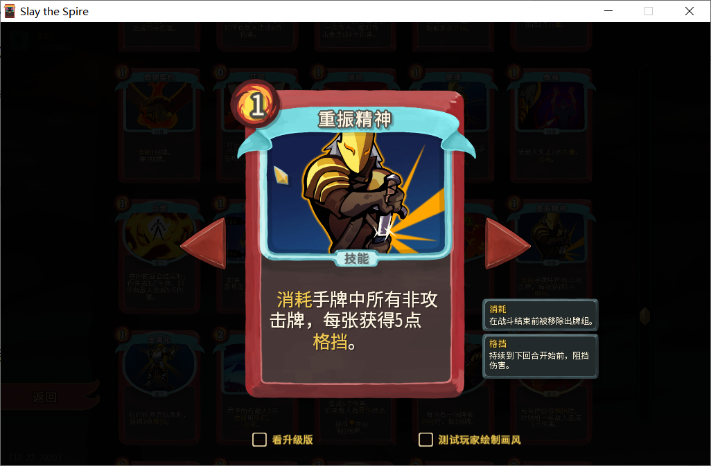

1费罕见技能卡，10分，蓝卡中排名3-4/36（笔者给出的评分表中，同分一般排名不分先后，然而蓝卡的十分卡是例外，第一第二毫无疑问是黑暗之拥和无惧疼痛）。消耗手牌中所有非攻击牌，每张获得5（7）点格挡。

简评：正如笔者在[四.6.（3）烧牌](#p-0190)提到的，所有的烧牌，都是可能的后续循环收益，与当回合烧牌代价（费用，手牌数量）的矛盾统一体。为了获得更大的后续循环收益，需要提高烧牌效率；为了弥补当回合的<strong>烧牌代价</strong>，需要在烧牌时获得<strong>烧牌补偿</strong>。能同时兼具这两个功能的卡有三张，重振精神便是其中之一。

在讨论烧牌代价与烧牌补偿之前，首先要明确一个事实：烧牌是一种COMBO。一个COMBO的强度由COMBO难易度和COMBO效果综合决定，而无论是烧牌代价还是烧牌补偿，影响的都是COMBO效果。而另一方面，重振精神的COMBO难易度到底如何呢？和其他烧牌比较之下，不难发现一个显然但容易被忽略的事实：重振精神有着所有烧牌中最大的COMBO难度。原因是显然的：限制燃料种类的烧牌只有三张，其中腐化是跨回合COMBO，剩下的重振和断魂斩只能垫底。非攻击牌的限制和战士糟糕的初始卡组结合的产物是——不可忽略的手牌事故。此外，重振精神的烧牌补偿和烧牌数量直接挂钩，进一步扩大了手牌事故带来的恶果，这是重振精神的阿喀琉斯之踵。

而这一事实，往往被重振精神强大的COMBO效果——超高的烧牌效率和强大的烧牌补偿掩盖了。这实际上是一种心理上的错觉，大部分玩家都会记得无敌撑振帮自己吊打心脏，但是却不会把鬼抽暴毙三奴隶归结于重振精神，而是归罪于卡组的5张打击——实际上重振也应该负一部分责任。笔者花如此多篇幅强调这一点是想说明，重振并不是一张完美的卡牌，反而是一张下限很低的卡牌，一些过于依赖撑振的玩家，应当辩证地看待重振的功与过。

重振的下限虽低，但是强大的COMBO效果让重振只要发挥出比下限略好的水平，便已经超越了很多卡牌；而上限则是毁天灭地，配合两大烧牌能力，卸牌过牌一气呵成，四十张的卡组也能光速烧穿，附带产生的海量护甲，退可抵御绝大部分攻击，进可配合全身撞击十步杀一人，千里不留行。同时，重振也是战士最强最无脑的套路——撑振——的组件之一。但是所有玩家都应明确一点，撑振是振拖着撑走的一个COMBO，振脱离了撑依然强大，撑脱离了振只能给进化当拐。撑振的具体细节，笔者将放在硬撑的部分讲解。

最后，重振并不是一张常规防牌，大部分时候也并不具备太高的敲位，但是某些极度缺乏防御的卡组，可以升级重振缓解启动的压力，或是为重振全身撞击一波提供更高的爆发。

#### （2）腐化

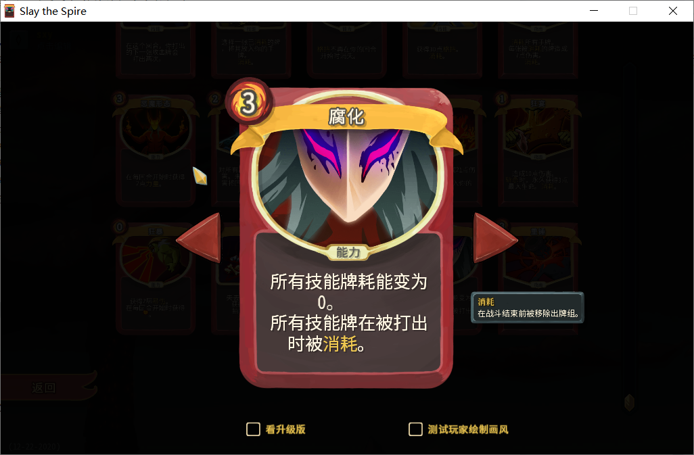

3（2）费稀有能力卡，10分，金卡中排名并列第一/16。所有技能牌耗能变为0。所有技能牌在被打出时被消耗。

简评：破釜沉舟，尽显霸气的卡牌。虽然适用面较其他烧牌略低，但是有所有烧牌中最高的绝对强度。

从COMBO难易度来看，腐化提供了烧牌的常驻状态，实现了跨回合COMBO，仅凭这点便已经超出其他烧牌太多。从烧牌代价和补偿来看，腐化的烧牌代价是自身的3费1卡位，以及被烧掉的技能牌卡位；补偿则是被烧掉的技能牌自身。换言之，<strong>腐化的烧牌补偿完全弥补了烧牌代价</strong>，和不烧牌相比甚至产生了费用上的盈余。同时，腐化也有所有烧牌中最高的烧牌效率，自身打出之后便不再浪费下轮循环的卡位，两轮循环内便能把所有技能牌烧得一干二净。腐化单卡实现了整个卡组的卸牌、费用需求，获得了彻底的后续循环轮次的收益，只要辅以过牌，便解决了卡组运转的两大矛盾。

而最完美的过牌自然是黑暗之拥。腐化-黑暗之拥，是最优美的运转模型，一万张牌的卡组也能一回合过穿，配上全身撞击这一战士的最强输出，一回合打出上万伤害也并非不可能。

当然，腐化也并非没有缺点，无法停止的烧牌，使腐化卡组通常缺乏后劲，通常需要强输出尽早结束战斗。面对心脏这种对回合数有强制要求的BOSS，往往需要保留战力的手段（壁垒、暴走、力量），或是足够多并且均匀分配的燃料。只是这个缺点实在太小，腐化能帮助卡组一路乱杀到三层BOSS，玩家完全可以在这段时间发育出一个不依赖腐化的赢法，在心脏战中跳车。

#### （3）恶魔之焰

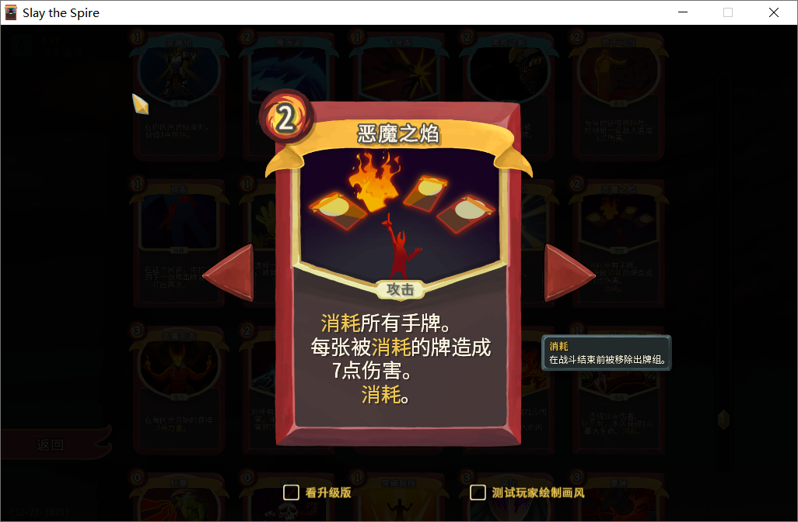

2费稀有攻击卡，9.5分，金卡中排名3-5/16。消耗所有手牌，每张被消耗的牌造成7（10）点伤害。消耗。

简评：烧牌补偿“喧宾夺主”的一张牌，烧牌附带的打伤害作用比烧牌本身重要得多。

事实上，恶魔火的烧牌补偿和烧牌本身的作用是相悖的。烧牌是为了后续循环收益，而打伤害是为了尽快终结战斗，两者可以说是八竿子打不着。只是在打伤害方面，恶魔火展现出了绝对的硬实力。前期恶魔火是战士卡牌战斗力的天花板，升级后的一把火能斩杀绝大部分怪物，配合各类增加手牌数的手段打穿二层也是绰绰有余。三层开始恶魔火的伤害开始变得乏力，这时候恶魔火工作的重心便转向烧牌。恶魔火的烧牌效率毋庸置疑，也拥有批量处理攻击牌的优势，但是缺乏对后续循环有益的烧牌补偿。单纯作为烧牌工具的恶魔火，比较依赖两张烧牌能力——黑暗之拥和无惧疼痛。

#### （4）破灭

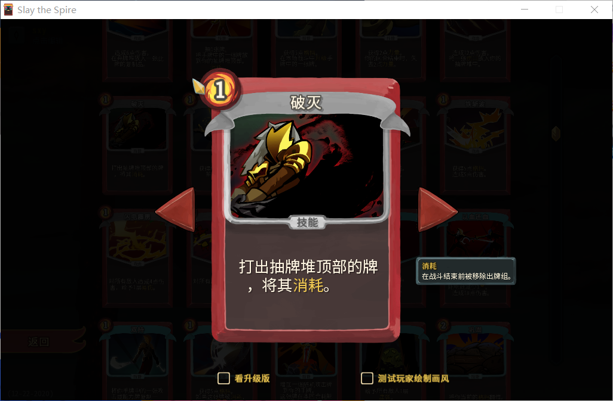

1（0）费普通技能卡，10分，白卡中排名并列第一/20。打出抽排堆顶部的牌，将其消耗。

简评：兼具稳定性与强度的烧牌。

可能有读者对破灭的稳定性抱有疑问，这是很正常的，毕竟打出破灭之前无法预料到将会破到哪张牌，大部分玩家也都遇到过破灭全身撞击、破灭恶魔火导致必须SL的情况，但要是因此就觉得破灭发挥不稳定，那就有些因噎废食了。虽然破到的牌无法预料，但是可以用四个字来形容破灭：<strong>稳定的强</strong>。一个卡组中不能被破掉的卡总是极少数，遇到这种情况也能通过过牌调整，如果是在第二轮以后遇到，还能通过改变上一轮的出牌顺序进一步调整。而剩下的情况中，破灭的烧牌补偿都远超付出的烧牌代价。破灭和腐化一样，烧牌补偿是被烧卡自身，而破灭烧牌除了消耗破灭本身的卡位及1费以外，并不会额外消耗手牌。而升级后的破灭连自身的费用也免去了，达成了一种<strong>“绝对烧牌收益”</strong>——打出破灭+必赚。如果再配上黑暗之拥，破灭本身占据的卡位也得到了弥补，形成了强欲之壶一般的绝对赚卡概念。不少玩家都在为战士如何顺利渡过二层犯难，事实上，战士打二层最有力的方式，不是靠燔祭，也不是靠撑振，而是依靠破灭黑暗之拥实现运转的绝对碾压。不同于其他大部分烧牌卡，破灭在卡组最后开始循环核心卡之后依然能发挥重要作用，可以拼概率破灭核心卡终结战斗，或是破灭过牌卡抽到核心卡再次打出。如果配合黑暗之拥，更能使所有手牌获得类似回响的效果。

破灭的使用方法用一句话概括就是：看到就拿，拿到就敲，抽到就打。特别地，当卡组拥有破灭与黑暗之拥/无惧疼痛时，卡组中的过渡能力卡可能拥有比过渡攻击卡更高的删位，毕竟破到能力卡是无法触发消耗的效果的。

#### （5）坚毅

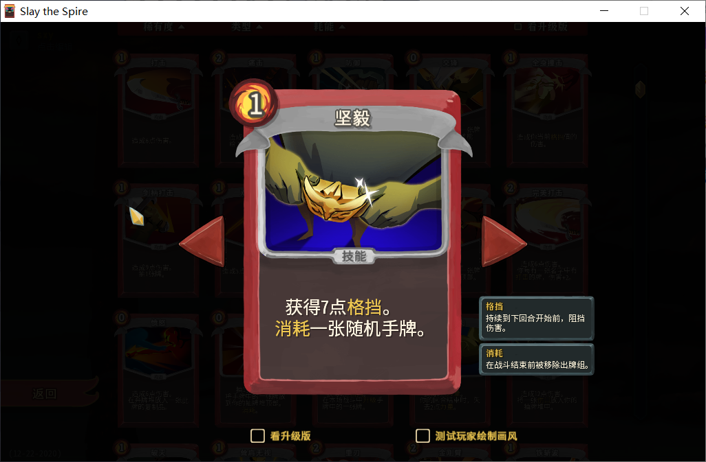

1费普通技能卡，9.5分，白卡中排名第4/20。获得7（9）点格挡。消耗一张随机手牌（消耗一张手牌）。

简评：坚毅既是烧牌也是常规防牌之一，防御牌部分将省略坚毅。

单论绝对实力，坚毅其实并不能和耸肩相比，但是烧牌对战士来说有着最高的战略地位，再加上坚毅能一定程度上代替耸肩的防御作用，最终坚毅获得了比耸肩更高的分数。白坚毅的数值相当一般，随机消耗也颇有些恶心人，但是能用于调整随机数；相比之下，绿坚毅的数值比较可观，定向烧牌的游戏体验也会舒服很多。一般地，第一张坚毅有极高的抓位，但卡组里的白坚毅不应该超过两张，绿坚毅则是多多益善。笔者还是推荐在敲位不是很紧张的时候在坚毅身上投入一个敲位，毕竟改随机数的手段不应该被过分依赖，以及某些情况下，特别是需要烧打击防杀或者配合全身撞击输出的时候，白坚毅的犯病可能会产生非常恶劣的影响。

#### （6）燃烧契约

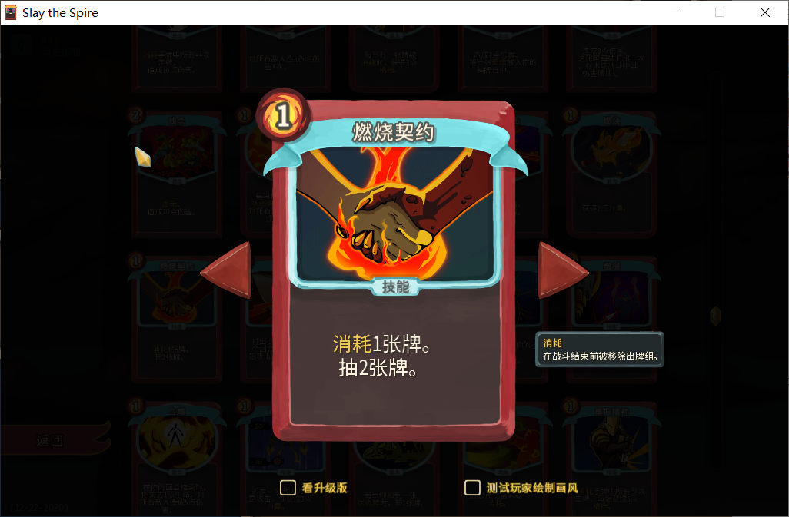

1费罕见技能卡，10分，蓝卡中排名3-4/36。消耗1张牌。抽2（3）张牌。

简评：在当轮循环就能加速卡组循环的烧牌卡，过牌部分将省略燃烧契约。

烧牌卡并不是游离于循环外，而是深入参与了卡组循环。在通过处理废牌加速下轮卡组循环速度的同时，烧牌速度依赖于卡组当轮循环的速度。不巧的是，烧牌卡本身便会拖累当轮循环速度，例外的卡有两张，其一是破灭（不改变当轮循环速度），其二是燃烧契约（加速当轮循环速度）。燃烧契约加速当轮循环，便能更快进行下一轮烧牌，进一步加速下轮循环……滚出宛如等比数列求和般的雪球，最后节省大量的回合数。更何况，燃烧契约通常能将手牌数维持在比较高的数量，如果就此洗牌，便能在下轮循环省下大量的废卡抽牌位。

可能有读者会这么想，通过坚毅、重振这些卡在烧牌的同时防住一回合，点下结束回合获得下个回合的5张抽牌和费用，也能获得和燃烧契约类似的效果。这个逻辑没有问题，但是想做到防住的前提，在没有无惧疼痛的情况下是有一定难度的。更重要的是，在面对会塞状态的敌人时，结束回合会扩大塞牌的影响。没有进化妄图用撑振防杀六火的人，最后都死得很惨，一般地，遇到这种敌人只能放弃烧牌的策略，用伤害硬怼；然而，当卡组第一轮循环已经够快时，依然能顶着敌人的塞牌采取烧牌循环的策略。集烧牌过牌于一身的燃烧契约，自然是这种策略的上佳选择。

上面的优点都是从循环的角度出发，众所周知，战士在过渡时期并非总是要打循环的，此时燃烧契约只是一个，能配合消耗能力的纯过牌，本身还有些亏模。所有的过牌都会增加费用压力，更何况是一张需要费用的过牌，这时通常需要玩家用放血、哨位、腐化等加费或足够多的0费牌缓解费用压力，将燃烧契约的过牌转化为数值。话虽这么说，实际上战士打循环的能力远比很多玩家想象的要强。只要有黑暗之拥，战士就有打循环的资本，而燃烧契约能大幅减少卡组到循环的启动时间，配合黑暗之拥和0费数值卡，可以依靠运转碾压二层。不用太考虑燃烧契约在非循环时期的一些缺陷，看到就拿，多多益善。

#### （7）断魂斩

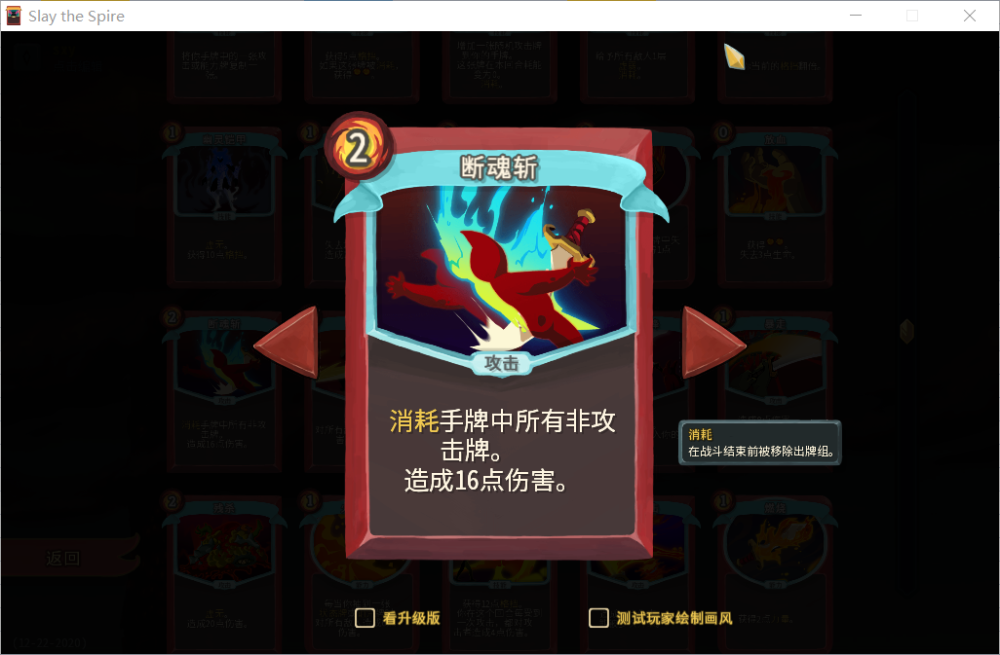

2费罕见攻击卡，7分，蓝卡中排名26/36。消耗手牌中所有非攻击牌。造成16（22）点伤害。

简评：再差的烧牌也是烧牌。

烧牌之耻。虽然断魂斩有着极高的烧牌效率，但是2费的烧牌代价实在有些大。不像恶魔火能处理攻击牌且伤害毁天灭地，断魂斩对燃料挑三拣四，作为烧牌补偿的伤害也停留在完美打击的水平。作为一张大烧牌，断魂斩的补偿竟然和烧牌数量没有关系，这导致了一个非常神奇的现象：烧得越多反而觉得自己亏得越多。伤害这个属性和烧牌的收益本来就不搭，而断魂斩缺乏终结战斗的能力，导致了断魂斩作为烧牌，格外依赖两张烧牌能力——黑暗之拥和无惧疼痛。

纵使有万般缺点，断魂斩好歹是张烧牌，而且是大烧牌。前期可以抓一张作为过渡使用，往后可以作为重振的下位替代凑合着用。除非想靠单断魂斩打精英，不然不要升级。

### 4.过牌篇

#### （1）黑暗之拥

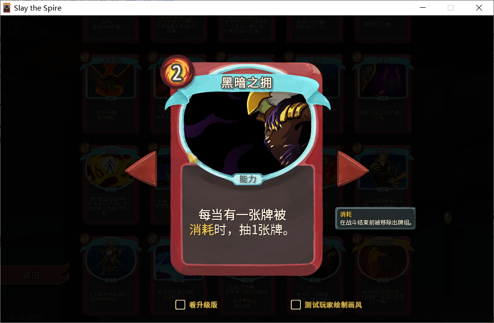

2（1）费能力卡，10分，蓝卡中排名第一/36。每当有一张牌被消耗时，抽1张牌。

简评：尖塔第一卡。其他牌能拿10分是因为本身值10分，黑暗之拥拿10分是因为满分只有10分。

黑暗之拥本质是提供了<strong>一种特殊的烧牌补偿</strong>，想要真正理解黑暗之拥的强大，必须深刻理解烧牌过程中矛盾的运动规律。

笔者在[运转](#p-0175)一节提过，卡组运转的矛盾分为：

①卡组大小和手牌上限的矛盾。

②过牌和加费的矛盾。

烧牌是解决①的手段，不过，烧牌并不是一个瞬间的举动，而是战斗内的一个过程，烧牌速度和战损限制下的回合数之间的矛盾因运而生。烧牌速度并不是一个固定的、机械的数值，烧牌卡深入参与了卡组循环。烧牌卡烧掉废牌加速下轮循环，而自身却会拖慢当轮循环速度。对燃烧契约、破灭以外的烧牌卡来说，这本应是一对宿命式的矛盾。

然而黑暗之拥解决了这一矛盾，黑暗之拥的烧牌补偿，彻底弥补了烧牌卡拖慢的循环速度，大烧牌甚至能在当轮加快循环速度。而黑暗之拥作为战士乃至尖塔最强的过牌，所谓过牌与加费的矛盾也顺势解决了一大半。

如果说单纯的文字略显单薄，那么下面的数据能够尽显黑暗之拥的强大：一个需要烧掉25张牌，抓取了5张单体烧牌的卡组，有黑暗之拥比没有黑暗之拥的启动快6个回合，这个数据还是向下放缩的结果。

从过牌量来看，黑暗之拥轻松提供了十余张，甚至几十张过牌，并且和一般的过牌卡不同，这些过牌和烧牌完美结合，实现了卸牌+过牌的效果，几乎不会受到手牌上限的限制。特别地，各种大烧牌在黑暗之拥的配合下，纷纷变成了有烧牌补偿的计算下注，使原本笨拙呆板的卡组，瞬间变得气势如虹，一泻千里。黑暗之拥带来的海量过牌，给0费牌提供了最好的舞台，把所有的0费牌像臭鸡蛋一样发射到对手身上，一张燃烧契约又瞬间补满了弹药，而燃烧契约还会在黑暗之拥的作用下回手，这些0费牌可以是全身撞击，可以是愤怒，甚至可以是活动肌肉。而一旦黑暗之拥和加费结合，卡组运转瞬间达到了一种极其优美的境界。放血黑暗之拥燃烧契约，是标准的一回合突破十次模型，富有气质的玩家甚至可以无限发现或武装手敲灼热；破灭黑暗之拥，是典型的奇迹卡组，把所有的费用全部投入到开启数张黑暗之拥上，通过破灭和0费数值牌的参与，0点能量击杀对手；而腐化黑拥，则是整个尖塔最为完美的运转体系，把过牌与加费，过牌与卸牌，运转与数值完美结合，一万张牌的卡组也能一回合过穿，辅以全身撞击，无惧疼痛等强力数值牌，一回合造成上万伤害也并非难事。

要说黑暗之拥唯一的缺点，可能是使玩家变得越来越娇生惯养。蓝卡黑暗之拥在9成以上的对局中都能获得，让玩家逐渐养成了对黑暗之拥的依赖性，这和新手对个别听牌的依赖性、老手对撑振的依赖性并无本质区别。没有黑暗之拥怎么赢？这是每个战士玩家必须时刻牢记并思考的问题。

笔者是一个比较谨慎的玩家，即使拿到了日晷，拿到了撑振，也不会轻言“这把赢了”这种大话，但在抓取到黑暗之拥的那一刻，笔者不由得从内心深处发出感叹：这局又是在浪费时间了。出现的100张黑暗之拥中，笔者会抓取其中99张，跳过的剩下一张是因为卡组已经有了10张黑暗之拥。黑暗之拥具有最高的打出优先级，自然有着最高一档的升级位。

#### （2）进化

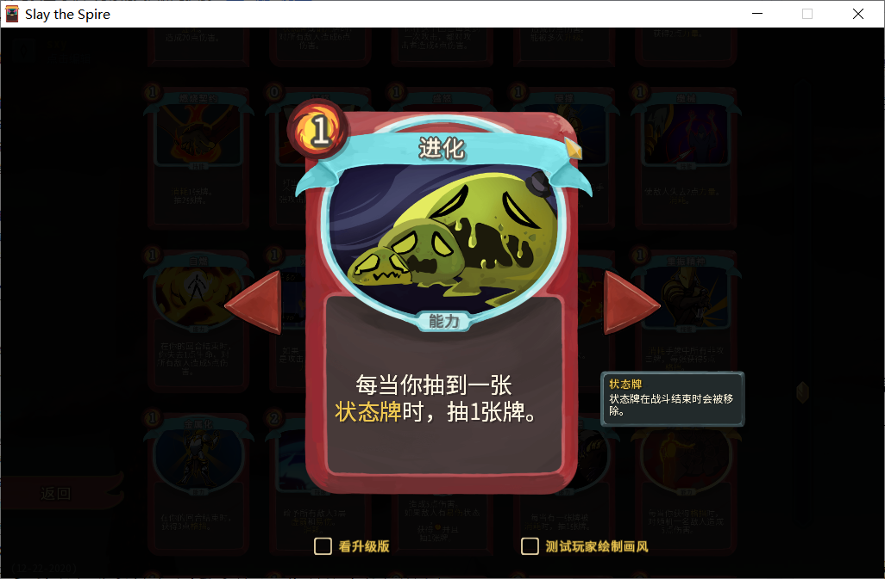

1费罕见能力卡，9分，蓝卡中排名8-13/36。每当你抽到一张状态牌时，抽1（2）张牌。

简评：进化本质上是一张补弱性质的针对牌。

进化与[火焰吐息](#p-0508)在作用上高度相似，不妨在此一并分析两者的共性。在卡组拥有产状态卡牌时，进化和火焰吐息，特别是进化，无疑具有很高的抓位。而问题主要在于，当卡组缺乏产状态能力时，大量玩家都对两者寄予了过高的期望，而笔者反复强调这两张牌针对牌的本质，就是想让读者对这两张牌的抓取回归理性。以进化和火焰吐息的关系为例，从表面上看，进化能抽到更多的状态牌，配合火焰吐息打出巨额输出，那这是否意味着这两张牌互相促进，其中一方提高了另一方的抓位呢？答案恰恰相反，这两者大部分时候是相互排斥的，原因也很简单，这两者中任意一方已经达到了针对塞牌怪的效果，为了不需要针对的怪物再抓取针对牌，是严重缺乏纪律性的行为。在卡组自身缺少产状态卡牌时，抓其中一张作为针对，并提高后续抓牌空间是不错的选择，两张都抓则不是一种值得提倡的行为。

另一方面，对塞牌怪的针对也不总是必要的。过牌充足的卡组，或是采取极限攻杀策略的卡组，为保证卡组的连续性往往不愿意在这两张针对卡上再投入一个卡位，笔者在[攻杀](#p-0100)部分给出的两个卡组便是典型的例子。相反的，进化与火焰吐息非常适合偏向防杀的卡组抓取，不仅产生的副作用更小，也能在防止被特定怪物单杀的同时，提高后续抓牌的空间。而两者的区别在于，火焰吐息有较强的时效性，而进化在几乎任何时期都可以抓。

进化的升级位也类似于抓位，越需要依靠进化配合塞状态卡牌打循环的卡组，或是越需要进化针对的半吊子卡组，越需要升级进化。对35张牌以下的卡组，几乎没有抓第二张的必要。

#### （3）战斗专注

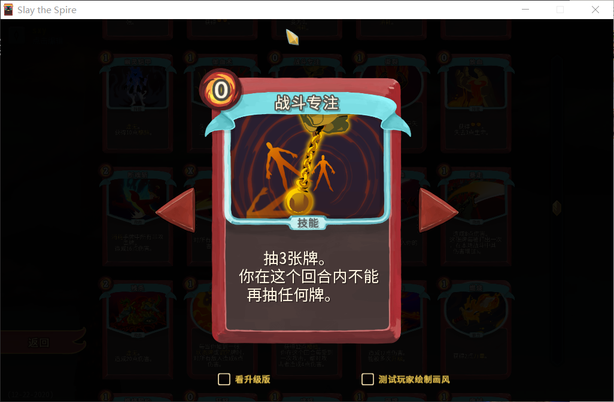

0费罕见技能卡，9分，蓝卡中排名8-13/36。抽3（4）张牌。你在这个回合内不能再抽任何牌。

简评：运转中的过渡卡。

显然的，战斗专注的强度和卡组的过牌能力反相关，而战斗专注的初值强度是所有过牌中最高的一档。那么最重要的问题便是：如何根据已知卡组的过牌能力，判断战斗专注是否有值得抓取的强度？最简单的判别方法是：看卡组是否有黑暗之拥或者复数祭品。任何没有满足上述条件的卡组都可以抓取一张战斗专注，而战斗专注这种“运转上的过渡”，甚至能用到心脏。巨大的过牌量让战斗专注成了战士不多的手牌爆发手段，配合重振、武装、恶魔之焰等手牌收益卡能产生毁天灭地的效果，极大增加了卡组的COMBO稳定性；本身的0费也缓解了过牌带来的费用压力，降低过牌产生负收益的概率。虽然对后续抽牌的限制让战斗专注在循环中难当大任，但是也完全可以在最后一轮循环中作为无副作用的0费过牌使用，进一步提高循环的数值收益。特别地，人工制品和药丸可以抵消/解除战斗专注的负面效果，在特定情况下可能产生奇效。

一般来说，战斗专注最多抓取一张，也不存在什么删除的可能，但是在破灭黑暗之拥的卡组中，战斗专注可能有比打击更高的删位。战斗专注并非没有升级的价值，然而在前期升级位往往投入给数值，中后期则是投入给其他运转，战斗专注往往缺少升级的机会。

#### （4）残暴

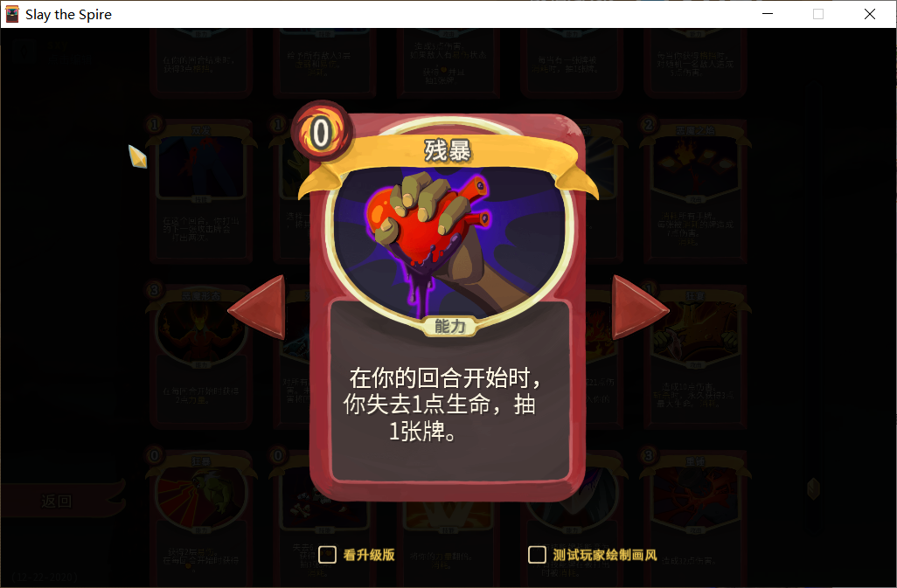

0费稀有能力卡，9分，金卡中排名6-9/16。在你的回合开始时，你失去1点生命，抽1张牌。（固有）。

简评：战士最被低估的牌之一，小巧而稳定的过牌能力。

对残暴、机器学习这些卡的评价，部分玩家持有这么一种观点：第一回合亏牌，第二回合回本，第三回合才开始有收益，所以这些卡很垃圾。对此，笔者只想建议这些玩家好好翻一翻历史记录，看看每场战斗的平均战斗回合。

如果说机器学习因为费用原因会增大启动压力，0费的残暴开起来极其方便，对启动的影响微乎其微。笔者一直有些不解，大部分玩家都能认识到背包首回合多抽2张牌的强大，却很少有人把每回合多抽1的残暴视为一张好卡。至于附带的扣血效果，每回合1点是非常轻微的代价，大部分时候避免鬼抽降低的战损都远超残暴自身扣除的血量，在比较碾压的战斗也可以不开，更何况扣血还能配合以血还血、撕裂和符文立方体。

残暴通常只需要抓一张，在不超过35张牌的卡组中也不需要考虑升级。在有回复手段，同时卡组极其缺少过牌时，可以考虑抓取复数残暴或者双持残暴。

#### （5）祭品

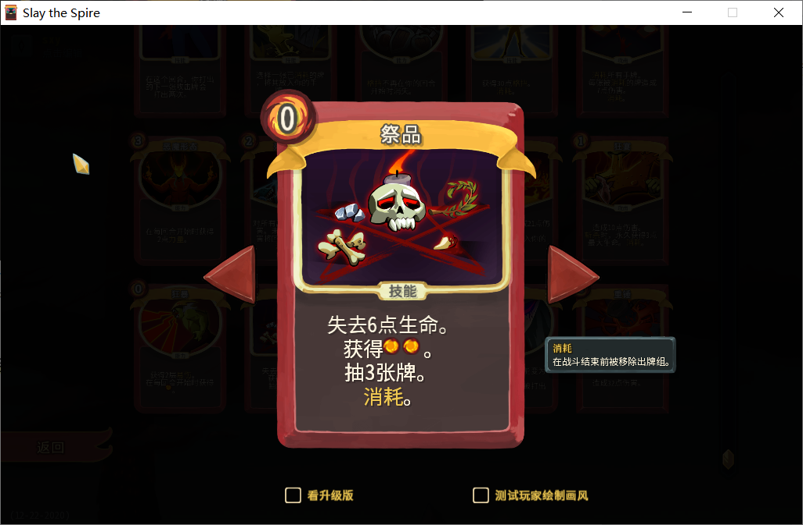

0费稀有技能卡，10分，金卡中排名并列第一/16。失去6点生命。获得两点能量。抽3（5）张牌。消耗。

简评：战士暴力美学的集中体现。

扣6血是相当大的代价，而祭品能在如此巨大副作用的前提下，稳居金卡第一的宝座，最根本的原因是：祭品是攻杀的战略成立的充分条件。通常来说，过牌卡和加费卡间是有矛盾的：过牌卡抽到的牌需要更多的费用打出，加费卡提供的费用需要更多手牌消耗，一旦过牌卡和加费卡无法同时上手，运转的失衡往往会产生极其恶劣的影响。而祭品同时提供了手牌和费用上的双重爆发，仅凭单卡便在当回合实现了运转的彻底碾压。虽然从表面上看，祭品提供的加费和过牌并没有一个回合的自然过牌加费那么多，但是巨大的过牌量和宝贵的2点费用极大提高了斩杀线，把防御所需的资源也投入到输出上，缩短的战斗回合远不止一个。

在祭品的帮助下，战士对输出牌的要求骤降，以残杀为首的一众笨重攻击卡，甚至各类1费打9，在二层都能发挥出不俗的作用。

此外，在卡组的工作重心转向循环之后，祭品也能以一个可以接受的代价，极大提高卡组的启动速度。当然，无论是攻杀也好，还是提高启动速度也好，开祭品的出发点和落脚点都是为了省下超出6点的战损，在足够碾压的战斗中，完全可以不开祭品。

在缺乏回复手段的卡组中，祭品一般不要超过两张，对有充足回复的卡组则是多多益善。第一张祭品有着极高的升级位。

### 5.加费篇

#### （1）放血

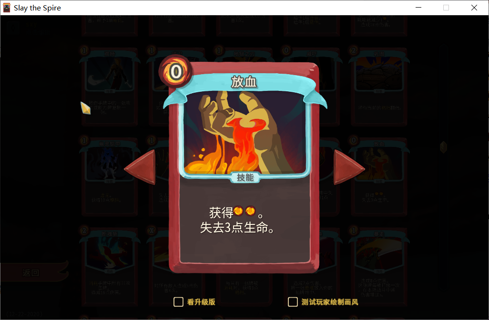

0费罕见技能卡，9分，蓝卡中排名8-9/36。获得2（3）点能量。失去3点生命。

简评：最强的持续性加费。

加强之后，放血的加费效率堪称离谱，让内核加速都有些相形见绌。不同于消耗类加费，放血可以在核心卡循环中大放异彩。以全身撞击-耸肩无视-深呼吸+的循环为例，这个循环在心脏面前极其乏力，而添加放血之后瞬间乱杀心脏。但是，放血的副作用通常要求循环的数值够高，上述循环成立的根本原因是全身撞击有极高的输出效率，若换成剑柄打击，击败心脏之前血早就被放干了。特别地，在卡组有持续回复手段，如噬咬、双持死亡收割时，放血能达成真正的无限，不过这种无限炫技成分比较大，实战中的价值有限。

一般只需要抓一张。除非卡组的循环费用压力极大（比如暴走燃烧契约的循环），放血也不具备很高的敲位。

#### （2）盛怒

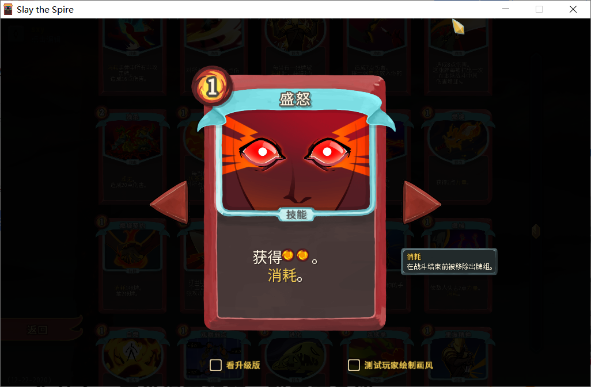

1（0）费罕见技能卡，5.5分，蓝卡中排名29-31/36。获得2点能量。消耗。

简评：各方面都平平无奇的加费牌。

盛怒的加费效率相当一般，也无法用于卡组循环，但是从另一方面考虑，如果不追求循环，仅仅是为了首轮循环攻杀或缓解首轮循环的启动费用压力，盛怒反而有能配合消耗能力的优势。一般地，当卡组费用压力过大（例如抓取了两张2费牌以后），或是有消耗能力时，抓取一张盛怒是不错的选择。一般只抓一张，除非启动费用压力极大，否则也不具备什么敲位。

#### （3）哨位

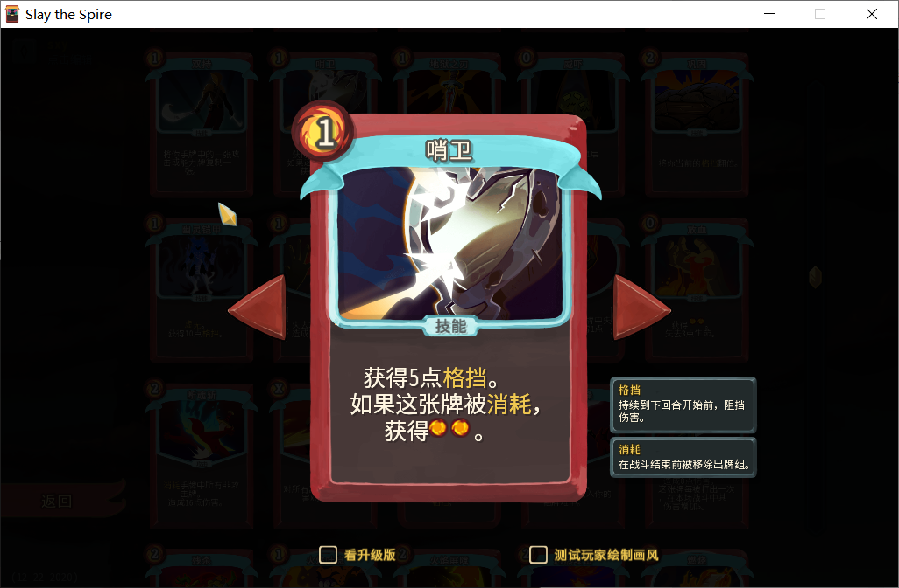

1费罕见技能卡，5.5分，蓝卡中排名28/36。获得5（8）点格挡。如果这张牌被消耗，获得2（3）点能量。

简评：有一定强度，但适用范围很窄的加费。

虽然哨位兼有加费与防御的功能，但数值仅有防御水准。只有能稳定触发哨位的加费效果，并且能把费用合理利用的卡组才适合抓哨位，按照这个标准，在没有黑暗之拥的前提下，契合哨位的烧牌仅有腐化和燃烧契约。相对地，哨位提供的费用也够多，在满足条件的卡组中有相当不错的发挥。一般只需要抓取一张，也不需要升级。

#### （4）狂暴

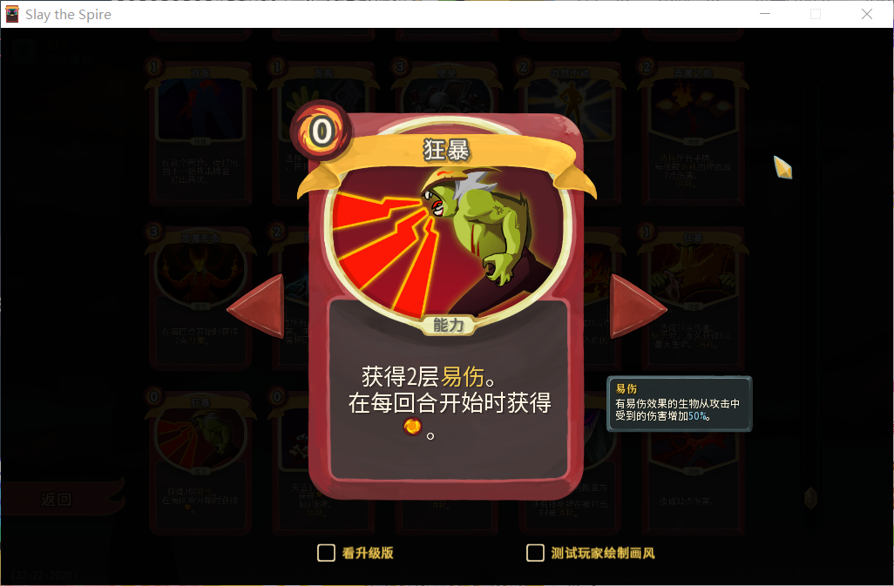

0费稀有能力卡，4分，金卡中排名15-16/16。获得2（1）层易伤。在每个回合开始时获得1点能量。

简评：战士唯二的持续性加费，也是最差的加费。

衡量卡牌强度的唯一标准，是对战损的综合影响能力。虽然每回合额外获得1点能量是非常强大的效果，但是伴随的副作用是毁灭性的。两回合的易伤动辄带来几十点战损，不升级几乎完全无法使用；而升级后的狂暴依然受牌序和怪物行动的双重影响，发挥极不稳定。同时，费用向数值转化的效率高度依赖卡组本身的强度，导致狂暴补弱的效果极其有限，而狂暴本身不具有成长性，也不足以使卡组上限质变。

巨大的启动代价，换来的是高不成低不就的效果，这样看来还不如恶魔形态。如果没有人工制品、药丸或蘑菇等抵消或缓解副作用的手段，狂暴几乎不具有抓位。不过考虑到易伤的数值并不会随着层数增加而改变，极度缺费的卡组使用双持狂暴摆烂也不失为一种选择。

### 6.过渡篇

#### （1）剑柄打击

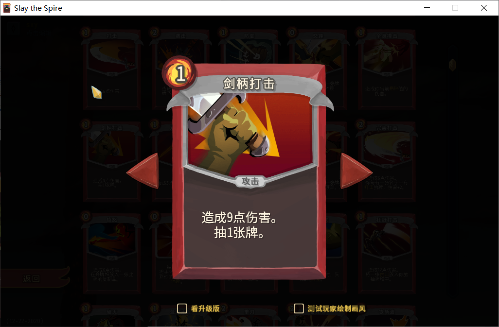

1费普通攻击卡，8分，白卡中排名7-8/20。造成9（10）点伤害。抽1（2）张牌。

简评：笔者将剑柄打击放在过渡部分是想表明，剑柄打击打输出的功能比过牌功能重要得多。

剑柄的过牌功能相当具有迷惑性。诚然，战士缺少过牌，但这不是抓取剑柄并升级的理由，答案也很简单：1费过2就是纯弱智，更何况是一张需要升级的过牌。关于盗贼的后空翻，老中医曾有个精辟的评价：当你需要打出防御时，抓后空翻。剑柄也是同理，当需要1费打9时，抓剑柄打击。关于1费打9的作用，笔者在[四.卡池结构.5.过渡卡](#p-0153)中已经解释过了。

如果仅把过牌看作是1费打9的添头，抓取剑柄打击的理由一下子就充分了起来，毕竟这是1费打9中最强的特效。从手牌数量来看，打出白剑柄保持手牌数不变，绿剑柄会增加一张手牌，和各类手牌收益卡都有不错的配合。从卡组循环来看，打出白剑柄之后不亏循环速度，绿剑柄反而会加速循环，在后期依然保有一定的作用。这些都是过牌给剑柄带来的优势。

同时，过牌既是剑柄的优势也是软肋。正如笔者在[四.卡池结构.6.运转](#p-0175)提到的，过牌因为回合规划的原因，并非总会带来正面收益。而剑柄打伤害和过牌作用强行捆绑，并且打伤害才是主要功能。一旦发生手牌事故，亏损的伤害会直接影响战斗的回合数。一个实战中的反例便是，本来计划打出痛击+剑柄，结果剑柄抽到了残杀。过渡时期亏损的几点伤害比难以变现的循环速度、手牌数量致命得多。

由上面的分析便不难得出一个和大众主流看法相反的结论：剑柄打击并不具有很高的升级位。升级剑柄伤害只提升了1点，而由过牌产生副作用的概率直接翻倍。如果消耗一个火堆只是为了多刮削掉一张牌，这收益低得有点过分了。

为了充分发挥剑柄过牌的优势，也为了避免过牌带来的手牌事故，抓取剑柄之后，填充各类缓解费用压力的卡成了既充分也必要的选择，包括并不限于优质大烧牌、几乎所有的0费牌、加费牌等。一般只抓取一张，并在中后期有富余升级位时升级，如果卡组攻击卡浓度过低可以抓取复数张。

#### （2）头槌

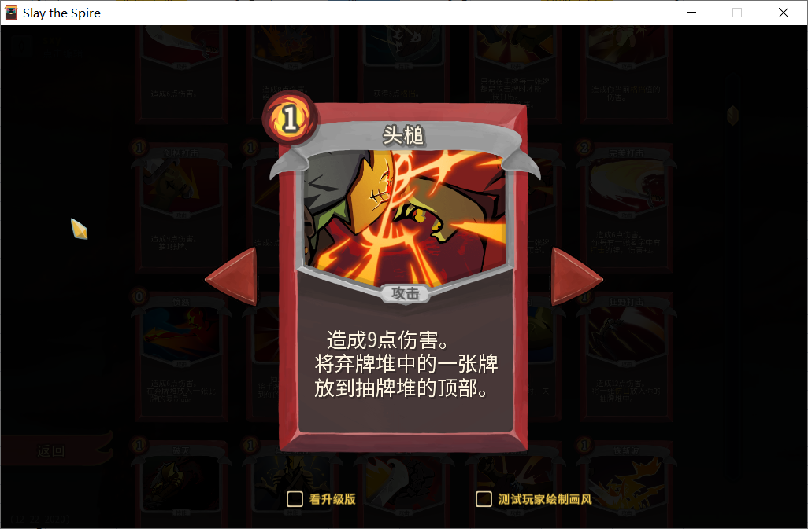

1费普通攻击卡，8分，白卡中排名7-8/20。造成9（12）点伤害。将弃牌堆中的一张牌放到抽排堆的顶部。

简评：不依赖卡组循环便能提高特定卡牌利用率的1费打9。

作为1费打9的功能便不再赘述，这里主要分析头槌的特效。将弃牌堆中的卡置顶，提高弃牌堆利用率的同时，也给过渡时期的战士带来了宝贵的回合规划能力。过渡时期的卡组循环极其缓慢，为了将某张卡片打出第二次，往往需要等上至少三个回合，如果敌人有塞牌的能力还会更久。而头槌把这个时间稳定地缩短为一个回合。置顶残杀，便能通过更快击杀敌人减少战损；置顶武装或耸肩，便能提高卡组的防御能力和稳定性；置顶破灭，便能在提高烧牌效率的同时缓解费用压力。无论如何，头槌使用起来都是一张极其灵活的卡牌。

同样是提高弃牌堆特定卡牌的利用率，很多玩家情不自禁将头槌和机器人的全息影像作对比，试图以加入全息影像的加入手牌对头槌进行全方位的批判，但是这种批评显然是不充分的。首先，全息数值不如防御，而头槌在数值上并不亏；其次，全息和过牌一样，会增大费用压力，除非加入手牌的是加费——而机器人有内核加速，对缺费的战士来说，置顶往往能在费用规划产生更加灵活的效果；最后，头槌能和破灭、精炼混沌之间形成小配合，实现量变的积累。

头槌的缺点则是置顶不可拒绝，当弃牌堆没有值得置顶的牌时，只能被迫置顶造成不同程度的鬼抽，首回合需要痛击头槌打伤害则是典型案例。头槌没有抓取第二张的理由，也几乎不会升级。

#### （3）狂野打击

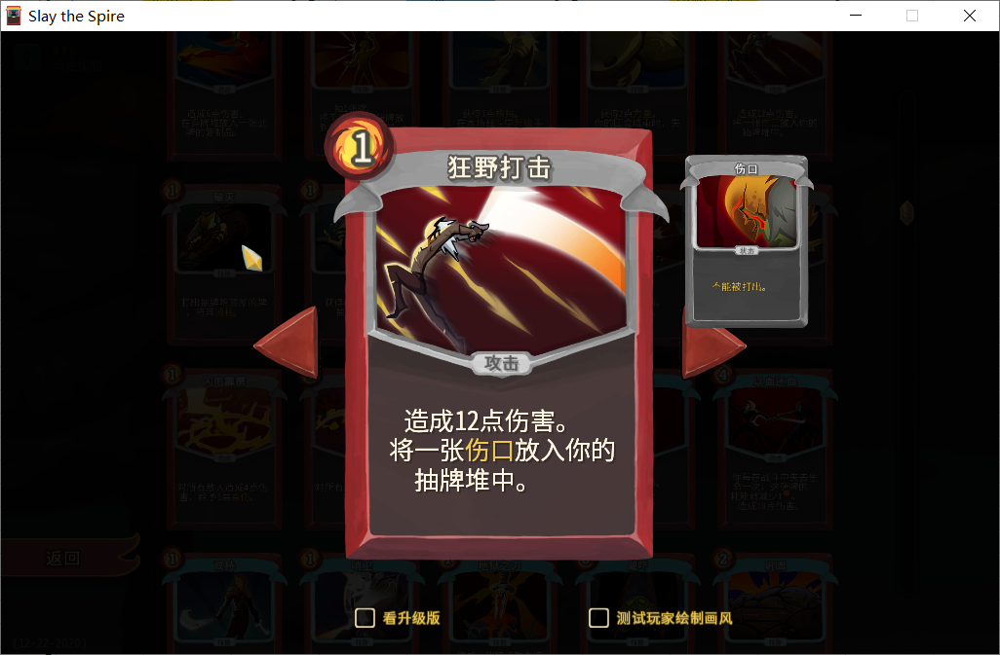

1费普通攻击卡，7分，白卡中排名第10/20。造成12（17）点伤害。将1张伤口放入你的抽牌堆中。

简评：以战斗中的卡位，换取更为集中的升级位与费用利用率的牌。

狂野打击最引人瞩目的便是高额的伤害，不升级便有1费12，升级的提升也高达5点。副作用也相当大，塞伤口——而且是向抽牌堆塞——让狂野打击的牌效在抽到伤口那一刻骤降到打击水准，并且这个降低来得很快。战士虽然在前期缺费的情况更严重，但是对狂野打击副作用的容忍度也只有两轮循环。如果狂野打击无法把回合数缩短到这个数值以下，抓取更多的输出卡是必然的选择。另一方面来说，狂野打击的副作用让状态能力的抓取变得更为自然，和其他过渡卡相比，也一定程度上提高了后续抓牌的空间。

狂野打击本身缺乏操作性，副作用较大，升级位也较高，几乎不存在抓取第二张的可能。

#### （4）双重打击

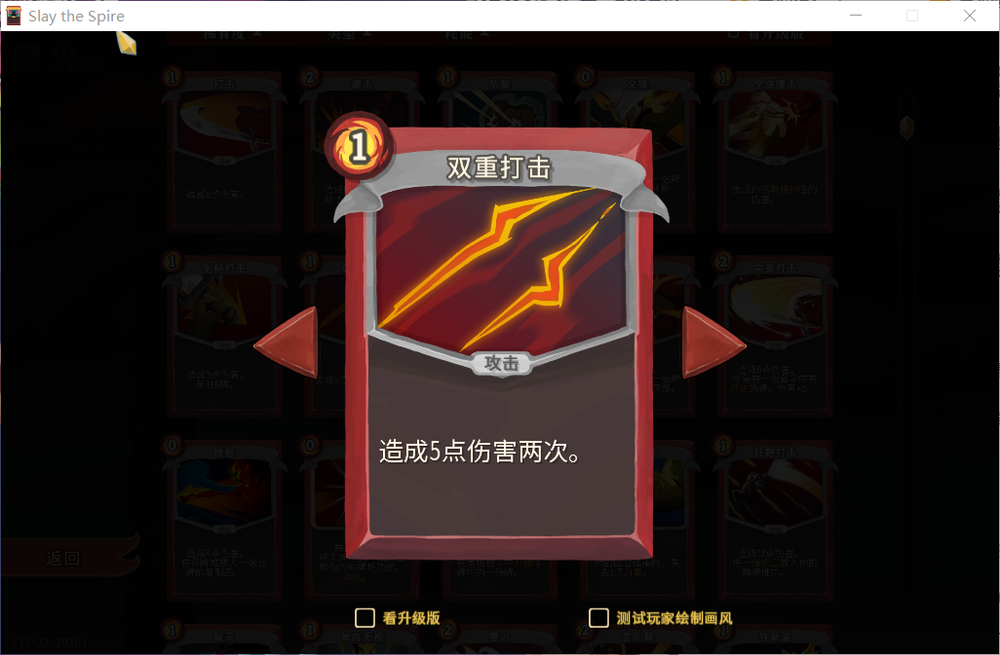

1费普通攻击卡，5分，白卡中排名13-14/20。造成5（7）点伤害两次。

简评：毫无特色的过渡卡。

和其他1费打9相比，双重打击的数值优势很小，而吃两段力量的特效实在弱太多。升级提升4点伤害在诸多1费牌里确实很高，但是在牌效的限制下，一般也不会在双重打击身上投入升级位。双重打击通常只会用于应急，比如前两抓都没有抓牌时，或抓取了基础力量但是缺乏力量倍率卡时，其他情况下几乎不存在抓取的理由。

#### （5）順劈斩

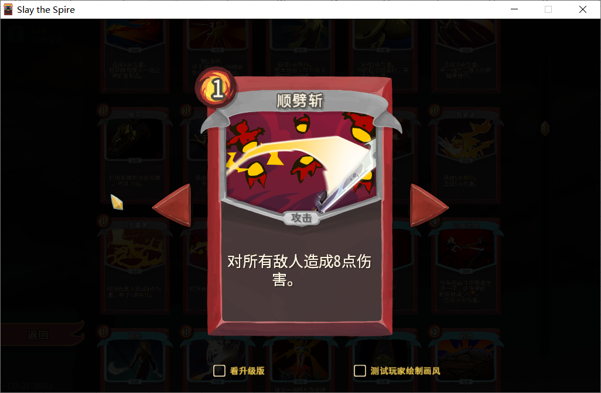

1费普通攻击卡，6分，白卡中排名第11/20。对所有敌人造成8（11）点伤害。

简评：战士最容易获得的AOE，虽然数值略低，也不失为一个保底的选择。

顺劈斩的数值介于能用与不能用的分界点，无法作为主力过渡，但若仅作为一个增加攻击频率，并针对群怪的选择，顺劈斩还是有一定的抓位。就算后续抓到了残杀、愤怒等强力过渡，顺劈斩的AOE属性也能和其互补。

由于AOE面对群怪费伤比翻若干倍的特性，顺劈斩有一定的敲位，和力量也有不错的配合。很显然，顺劈斩没有抓取复数张的理由。

#### （6）完美打击

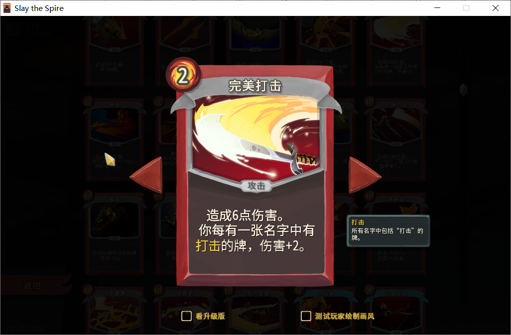

2费普通攻击卡，5分，白卡中排名13-14/20。造成6点伤害。你每有一张名字中有打击的牌，伤害+2（3）。

简评：进阶20下的牺牲品。

完美打击的描述很自然引出了，以完美打击为核心，抓取大量“打击”词条的卡牌的所谓“完美打击流”。在曾经最大进阶只有15，也没有第四大层的版本，这种构筑是有强度的，但是在进阶20和心脏更新之后，完美打击的数值显得如此渺小。完美打击本身几乎不存在任何操作空间，三层的双BOSS和四层矛盾心脏的连战也断绝了卖血强莽的策略。所谓的“完美打击流”被击得粉碎，最终沦为了<strong>过渡的劣质选择</strong>。

作为一张过渡卡，5张打击加持下的完美有不错的数值，如果再填充剑柄打击、狂野打击等牌，完美打击在一层有着不逊于残杀的发挥。但是最为尴尬的是，比起抓取更多打击词条的卡牌，更常见的情况是在商店或事件删除/变化掉打击，而4张打击下的完美哪怕在一层也相当垃圾。在依赖卡组打击数量的缺点之外，完美打击并未脱离笨重攻击卡的范畴，这导致完美在二层的发挥几乎是所有过渡卡中最差的一档，很多时候有比打击更高的删位。

为了弥补在二层的缺陷，抓取完美打击的卡组在一层不应该只局限于唯唯诺诺，被动防守，而更应该主动击杀精英滚起雪球。初始卡组加一张完美可能难以做到这一点，但是如果再加一张打击词条的卡牌，配合各种通用卡牌和药水，一层打三个精英也并非难事。不过要注意的是，为了配合完美打击，抓取第二张完美打击不是一个值得提倡的行为，因为这会导致卡组转型时期战力的急剧下降，抓取剑柄打击，狂野打击甚至双重打击都比抓第二张完美要好得多。由于完美打击是一张时效性极强的咸鱼卡牌，虽然卡位足够集中，有一定余裕的卡组依然可以选择不升级。

#### （7）闪电霹雳

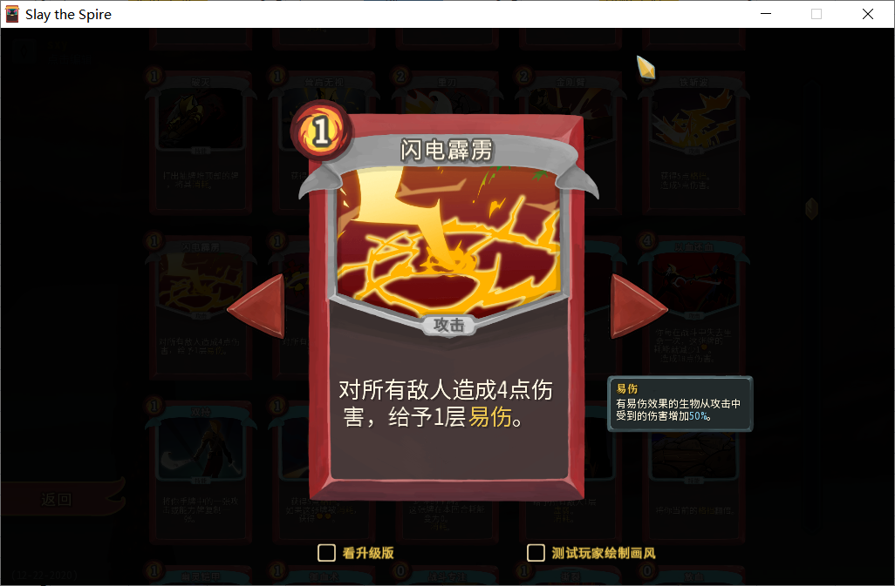

1费普通攻击卡，3.5分，白卡中排名第17/20。对所有敌人造成4（7）点伤害，给予1层易伤。

简评：一张极难驾驭的卡。闪电霹雳获得如此低的评价，是由内因和外因决定的。内因是本身单卡质量实在捉急，外因是战士的初始卡组已经有了一张易伤卡——痛击。

AOE，群体易伤，伴随着这两个超强特效的，是整个尖塔最低的数值。1费打4，这个滑稽的数值直接让AOE属性沦为笑柄。而剩下的易伤部分，无论升级与否，都仅仅持续一个回合，这使得闪电霹雳的使用手感类似于活动肌肉，非常依赖发牌员脸色。和活动肌肉不同的是，闪电霹雳需要1费，易伤的伤害加成也并不会随着层数提高，并不像肌肉那般有很高的操作性和上限。总而言之，闪电霹雳是一张质量非常差的易伤牌，很巧的是，战士的初始卡组也有一张质量非常差的易伤牌——痛击。闪电霹雳和痛击，堪称易伤界的卧龙凤雏。

这里不比较这两兄弟的强弱，只分析一下易伤这个属性。易伤提供了极高的伤害增幅，其数值和层数无关，这使得易伤层数的收益受边际效应的制约。如果没有痛击，可以通过抓取闪电霹雳，实现易伤从无到有的飞跃；而既然初始卡组已经有了痛击，闪电霹雳的收益进一步降低，大部分时候都不具有抓取的理由。

痛击降低了闪电霹雳的抓位，在某种程度上也是在说，一旦痛击难以满足卡组对易伤的需求，闪电霹雳就变成了填充易伤的可用选择。比如抓取了飞身踢的卡组；抓取了残杀，燔祭等强输出的三费卡组等。

闪电霹雳几乎不具有升级位，也不会抓第二张。

#### （8）金刚臂

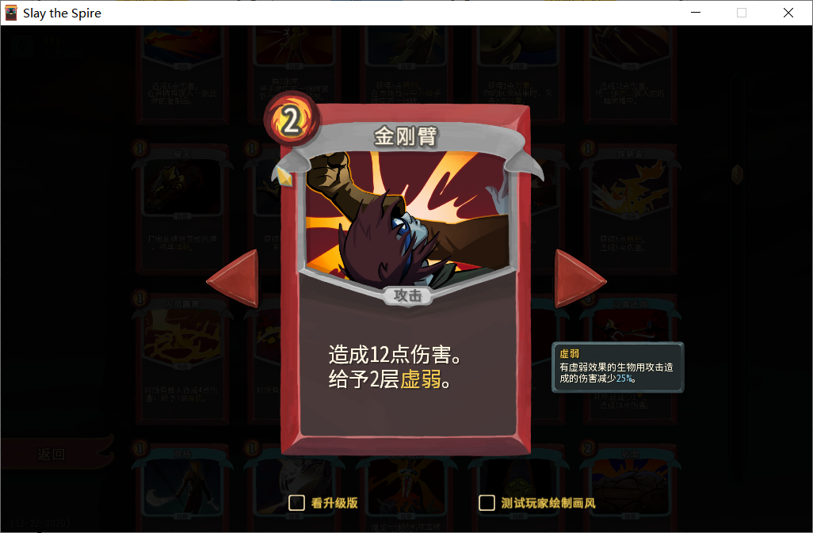

2费普通攻击卡，2.5分，白卡中排名第18/20。造成12（14）点伤害。给予2（3）层虚弱。

简评：金刚臂在模型上其实不亏，但是在攻防矛盾的作用下，沦为了战士最差的过渡之一。

笔者在[三.以血量为中心的思考.3.攻杀与防杀](#p-0087)中提过，攻击与防御之间存在矛盾，两者减少战损的方式也截然不同。从防御来看，虽然虚弱能让之后几个回合更容易防住，但是在当回合仅凭剩下的1费难以完全规避战损，更何况金刚臂的虚弱层数其实也不多，不升级也很难提前用虚弱覆盖怪物重击的回合。从输出上来看，本身的费伤比也是打击水平，虽然卡位更加集中，但在操作上也更加笨重，升级提升的伤害还不如大部分1费卡。只有在需要打击输出，并需要和敌人换血的卡组抓金刚臂才能取得收益——也仅仅是基本的收益而已。而金刚臂也存在着明显的上位替代——上勾拳和震荡波，在抓取这些卡后金刚臂会陷入非常尴尬的境地。

除了即将面临基础卡打精英这种情况以外，金刚臂几乎不存在抓取的可能，尽量不要升级。

#### （9）铁斩波

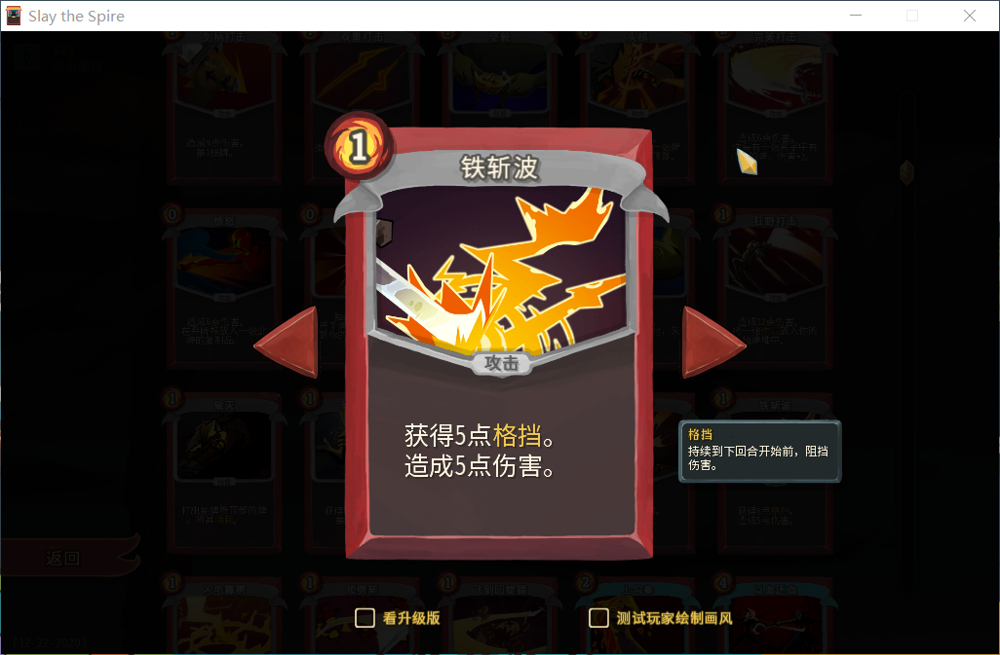

1费普通攻击卡，2分，白卡中排名第19/20。获得5（7）点格挡。造成5（7）点伤害。

简评：和金刚臂一样，攻守兼备，都是垃圾。

铁斩波的数值实在太可怜了，输出甚至不如打击。如果说金刚臂还有卡位集中的优势，铁斩波可以说是全身上下一无是处，除非火蛋或者二层前期发一张+，几乎不存在抓取的理由。白铁斩波就根本不应该出现在卡组中，根本不需要考虑是否需要升级。

#### （10）愤怒

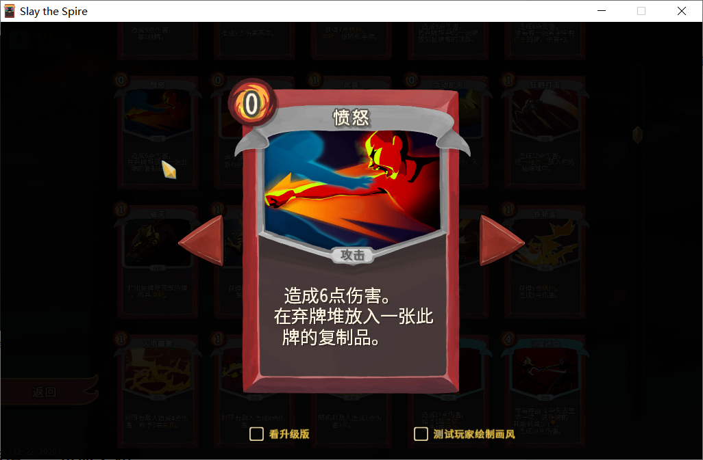

0费普通攻击卡，9分，白卡中排名5-6/20。造成6（8）点伤害。在弃牌堆放入一张此牌的复制品。

简评:愤怒是数值与特效完美结合的产物，战士的最强过渡。

仅从数值上看，0费打6/8的数值只有基本的强度，离神卡相差甚远。但是战士的0费牌——特别是0费攻击牌——具有天生的优越性，能在缓解费用压力的同时，和双持、力量等方面形成收益极高的配合。简而言之，愤怒有着极其广阔的操作空间。

从特效来看，自我复制的功能提供了一种在战斗内提高0费打6/8浓度的手段，这种浓度的提升，使局内操作尽享卡位分散带来一切优势，实战中的最好例子就是——愤怒能有效针对六火亡魂和史莱姆老大两个BOSS。和“抓取两张双重打击”这样获得的卡位分散不同，愤怒获得上述优势的代价，仅仅是一个抓牌位和一个升级位。一言蔽之，<strong>愤怒在局内操作方面享有卡位分散带来的优势，同时在抓牌的卡位和升级位上高度集中</strong>。

而数值和特效再结合起来，非常自然地引出了过牌+大量愤怒的攻杀策略，一些新手喜闻乐见的陀螺愤怒无限，便是这种策略的极限情况。0费的愤怒彻底摆脱了费用的限制，把省下的费用完全交给过牌自由发挥；同时，不同于一般的0费牌，愤怒自我复制的特性，让一张过牌抽上若干张愤怒变为可能。对过牌比较差的战士而言，这个“若干”可能是两三张，对过牌够强的战士，比如黑暗之拥+燃烧契约，或者双黑拥破灭的战士而言，一回合打出十余张甚至几十张愤怒是家常便饭。即便是BOSS，也很难在如此数量愤怒的倾泻下幸存下来。愤怒，是最好的过牌收益卡之一。

愤怒是最好的过牌收益卡，也等于在说，愤怒是把过牌变现的最好手段，使各类过牌，特别是燃烧契约的抓取变得极其自然，这是愤怒和其他过渡卡的最大区别。衔接前期过渡和后期运转，这是愤怒独有的优势，而这个优势最大的影响，体现在二层战斗。

正如笔者在[四.卡池结构.5.过渡卡](#p-0153)所写的，二层怪物属性的增长，使得传统过渡卡难以继续靠硬实力碾压对手，需要依赖COMBO突破经典费伤比的限制，而愤怒+过牌，便是一个突破费伤比限制的典型，如果再辅以力量、易伤、双持等因素，在二层砍瓜切菜也并非难事。过渡牌的优劣取决于剩下的血量以及其分布情况，愤怒在一层确实不能和燔祭相比，但是在二层大放异彩，甚至在BOSS战也有上佳的表现，这便是笔者称愤怒为最强过渡的原因。

既然愤怒在抓牌位和升级位上高度集中，自然只需要抓一张并尽快升级，在前期的升级位甚至高于武装。极度吃敲是愤怒的缺点之一，但是又有哪张卡位集中的卡牌不值得敲呢？无法投入敲位，同时卡组也缺乏力量时，不拿便是。

#### （11）交锋

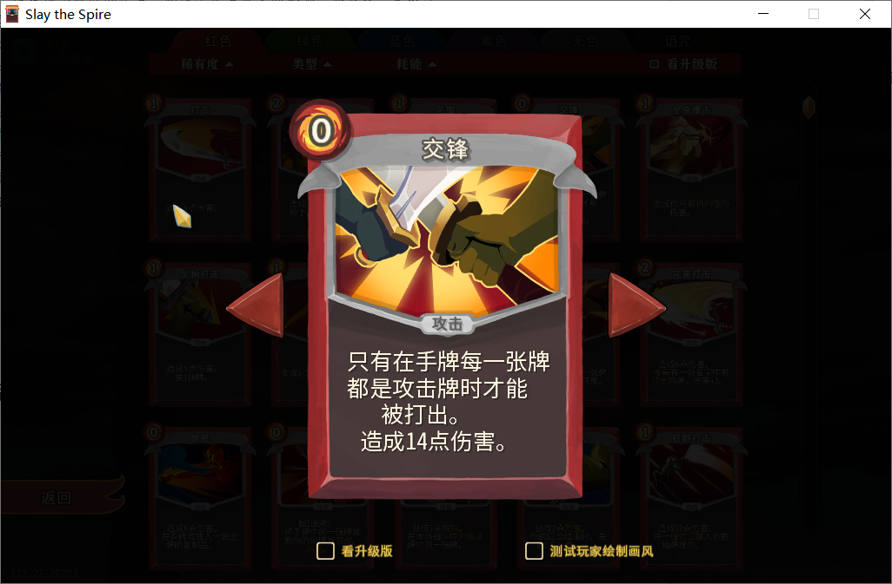

0费普通攻击卡，4分，白卡中排名15-16/20。只有在手牌每一张牌都是攻击牌时才能被打出。造成14（18）点伤害。

简评：进阶之灾杀死了交锋的稳定性，但并没有摧毁交锋的可能性。

交锋最为人诟病的一直是打出难度，而打出难度是由内因和外因决定的。外因是怪物的塞牌行动，内因则是卡组本身的非攻击牌，而内因中最致命的是，卡组必有的一张进阶之灾。由于进阶之灾的存在，交锋在首轮循环中的发挥离不开发牌员脸色。初始卡组抓取交锋后，有1/4以上的概率和进阶之灾同时上手，这不仅意味着当回合难以规避战损，更导致战斗回合大幅延长。等到交锋能够发挥的第二轮循环，塞牌的威力也开始彰显，交锋大概率再无打出的可能。

由于上述原因，交锋确实应受到批判，但当前主流观点已经把交锋批得一无是处，狗都不抓，这未免过于武断。实际上，无论进阶之灾存不存在，解决交锋打出问题的手段一直只有一个：卸牌，而进阶之灾只不过是大幅增加了卸牌难度。换言之，只要卡组有及时卸进阶之灾的能力，交锋又成为了一张可以使用的牌，而战士的烧牌系统便是最好的卸牌，重振，断魂斩，坚毅+都能大幅解决交锋面临的卸牌问题。解决了卸牌问题的交锋在过渡卡中有着最顶尖的强度，本身具有很高的数值，以及老生常谈的0费牌优越性，在二层也有很好的发挥。

综上所述，交锋确实不是一张适合裸拿的卡牌，但是在特定情况下能成为一张优秀的过渡卡。一般不需要升级，如果有双持双发等爆发手段可以升级。

#### （12）残杀

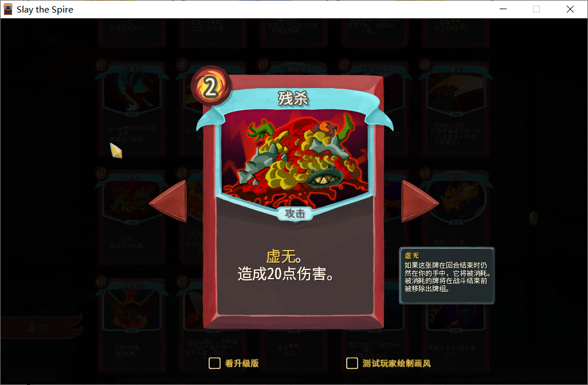

2费罕见攻击卡，9分，蓝卡中排名8-13/36。虚无。造成20（28）点伤害。

简评：顶级过渡卡，但依然没有摆脱笨重攻击卡的范畴。

残杀有过渡卡中的顶级费伤比，卡位也高度集中，在怪物血线普遍不高的一层，升级后的残杀基本能在一轮循环内解决战斗，省下大量的战损。值得注意的是，残杀虽然是非常强力的过渡卡，但是依然严格受到费伤比的限制，指望靠一张残杀+单刷六火史莱姆，甚至轻松过渡二层的玩家最好去洗把脸清醒一下。所以抓取了残杀的卡组，通常都会在一层击杀大量的精英滚雪球，缓解残杀在BOSS和二层的乏力。如果想要残杀在二层也有不错的发挥，往往需要祭品，双发或加费遗物的支持。此外，虚无在过渡时期是确实是负面效果，但是也让残杀到循环时期能自动烧掉，同时配合消耗能力。

残杀是战士大部分过渡卡的缩影，虽然有很强的单卡实力，但已经具备了一定过渡能力的卡组并没有再抓取残杀的理由。残杀的升级位极高，不升级便没有抓取的价值。

#### （13）御血术

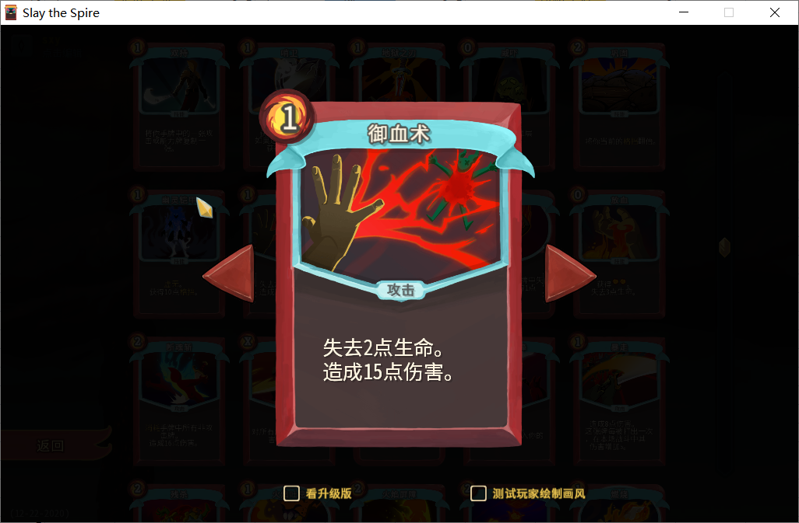

1费罕见攻击卡，8.5分，蓝卡中排名14-17/36。失去2点生命。造成15（20）点伤害。

简评：以极低的代价，获得了近乎无脑超模的数值。

如果说残杀的优势有很大程度上来源于卡位的集中，御血术的强度则完全来源于夸张的数值，1费攻击卡无出其右。和残杀相比，1费的御血术使用起来也更加灵活，更容易和痛击形成配合。虽然御血术有掉血的负面效果，但是2点血量是比较轻微的代价，减少的战损通常远超御血术带来的损失，也能配合以血还血，或在后续抓取撕裂作为一种保底选择。

御血术有很高的过渡效率，抓取之后再补充一张1费打9,便基本完成了过渡框架的构建。和残杀不同，御血术不升级依然是一张优秀的过渡牌，很多时候能把敲位让给必敲的运转卡。

#### （14）上勾拳

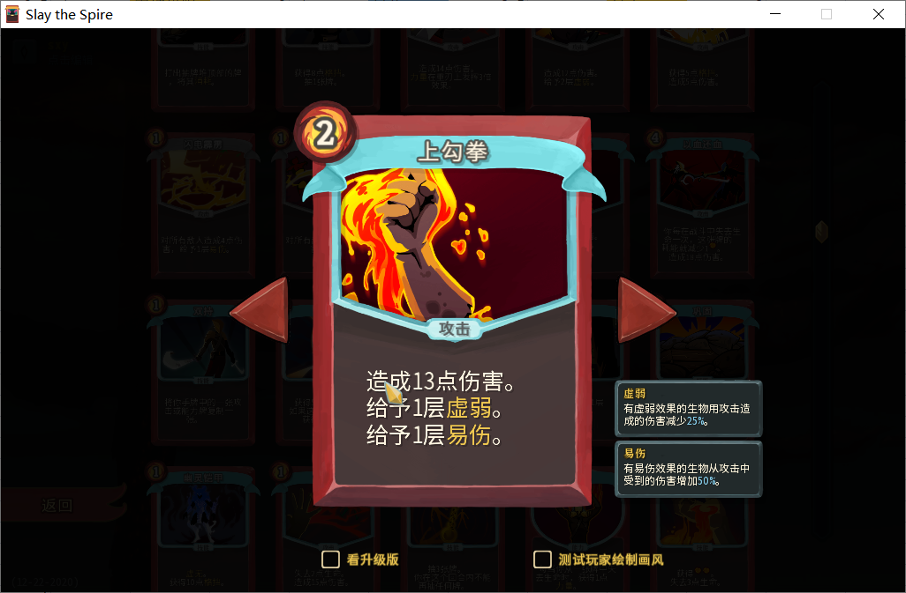

2费罕见攻击卡，7.5分，蓝卡中排名22-25/36。造成13点伤害。给予1（2）层虚弱。给予1（2）层易伤。

简评：上勾拳强在不升级就有13点伤害，弱在升级后只有13点伤害。

2费攻击，造成伤害+合计为2层的DEBUFF，这个结构和痛击、金刚臂有一定相似之处。不过，上勾拳的伤害比痛击高出足足5点，比金刚臂高出1点，再加上易伤和虚弱的层数都具有边际效应，上勾拳的单卡质量碾压这两者。低层的易伤+虚弱，也使上勾拳成为了战士手里相对高效的破除人工制品手段，不升级依然是一张可用的过渡。

不过，未升级的上勾拳有一个尴尬之处：在缺乏0费牌的前提下，想要同时利用易伤和虚弱，只能把剩下的1费也用于输出，而这种卖血强莽的战斗方式，通常并不是一个很好的选择。所以，上勾拳有不低的升级位。升级后的上勾拳有相当不错的使用手感，但是此时的13点伤害则显得有些不够看，通常需要补充别的输出手段。一般地，抓取1张上勾拳并升级之后，卡组的费用压力剧增，痛击便成为了比打击删位更高的存在，除非能尽快抓到飞身踢。

#### （15）以血还血

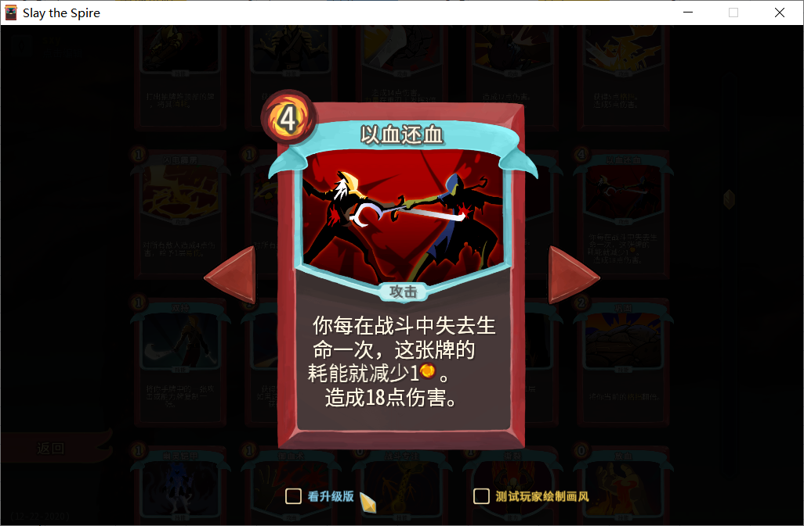

4（3）费罕见攻击卡，7.5分，蓝卡中排名22-25/36。你每在战斗中失去生命一次，这张牌的耗能就减少1点能量。造成18（22）点伤害。

简评:一张有核心潜质的优秀过渡。

过渡卡以减少前期的战损为目的，而以血还血的减费以失去生命为前提，这表明，以血还血在过渡中的发挥，取决于掉血的自然程度。

战士初始卡组极其糟糕的防御能力，和严重失衡的攻防比例，使无伤成为了一种奢望。同时，攻击恰为5的倍数的怪物只有极少数，依靠初始卡组完全防御，通常伴随着防御的浪费。硬吃怪物攻击模5余数的战损，把省下的费用用于输出，通常能通过减少回合数节省更多的血量。无论从充分性还是必要性来看，以血还血的减费都非常契合战士本身的战斗节奏。此外，战士还存在不少能主动掉血的卡牌，能和以血还血之间形成小配合。

从费用来看，以血还血的每一次减费都是质变。从4→3，此时虽然以血还血的费伤比依然极其拉胯，但是至少有了3费硬打的可能；从3→2，开始具备一个合格的费伤比；从2→1，完成了对经典费伤比的突破；从1→0，这是最大的质变，拥有无限费效的同时，也有着很高的牌效，结合卡组循环，辅以易伤、双持等的配合，充当碎心战中的核心卡也未尝不可。

不过无论战士的掉血有多么自然，以血还血作为过渡卡的发挥总是具有一定的延时性，进而带来不小的鬼抽风险——如果在第一轮循环中较早上手，费用还比较高，以血还血只有极其平庸的收益，甚至直接无法打出；如果较晚上手，反而会面临沉底的风险，导致在第二轮循环中无法打出。这个风险在面临一层小怪时可能并没有太大影响，而在一层精英，史莱姆老大，以及部分二层小怪面前，这个风险会被进一步放大。单单一张以血还血，不能成为莽精英的理由。

升级以血还血，不仅能减费以加快战斗节奏，还能增加宝贵的4点伤害 。以血还血有极高的升级位，通常只需要抓取一张并尽快升级。

#### （16）火焰吐息

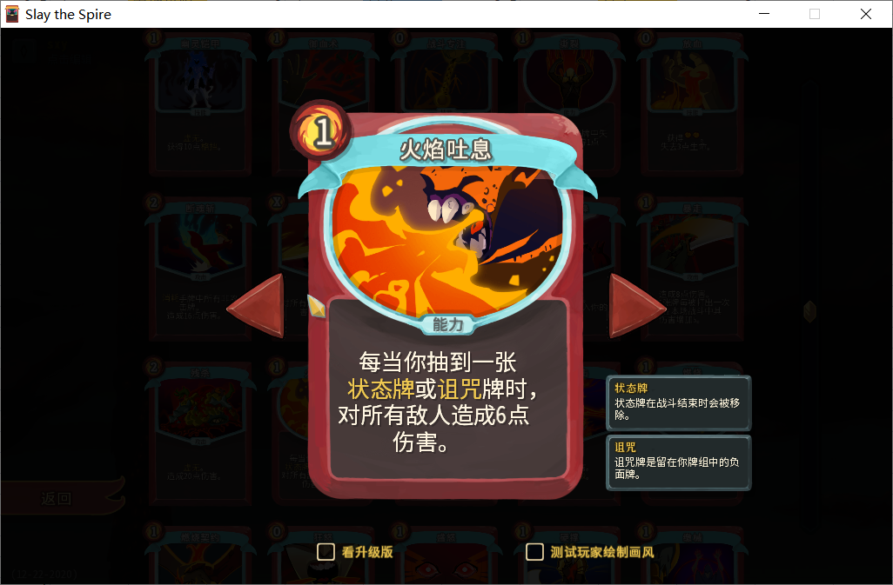

1费罕见能力卡，8分，蓝卡中排名18-21/36。每当你抽到一张状态牌或诅咒牌时，对所有敌人造成6（10）点伤害。

简评：和[进化](#p-0351)一样，本质上是张针对牌。

关于火焰吐息的评价已经在进化部分一并分析，这里只简单说明火焰吐息的升级位。对缺乏产状态能力的卡组而言，火焰吐息在大部分时候没有升级的必要，少有的例外情况是：卡组本身过于残疾，不升级甚至打不过一层BOSS。有优秀产状态卡牌——比如无谋冲锋和硬撑——同时缺少输出手段的卡组，升级火焰吐息是不错的选择。但是值得注意的是，这种输出方式存在很强的延时性，受牌序影响非常大，不应被过分依赖。至于抓取复数张火焰吐息并升级的所谓火焰吐息流，进化的功劳远比这些吐火大得多。

#### （17）地狱之刃

1（0）费罕见技能卡，5分，蓝卡中排名29-31/36。增加一张随机攻击牌到你的手牌。这张牌在本回合耗能变为0。消耗。

简评：地狱之刃的精髓不在于随机攻击牌，而在于0费攻击牌。

大部分玩家，无论对地狱之刃持褒还是贬，都被地狱之刃的随机迷惑了双眼，持贬态度的认为地狱之刃的下限低，持褒态度的大多抱有一种赌徒式的心理。首先，随机性在SL的前提下是部分可控的，白坚毅、飞剑、破灭都能更改随机数，虽然很难让地狱之刃稳定出残杀燔祭重锤，但是避免旋风斩交锋，发挥出基本的1费打9水平还是不难做到的；其次，随机性也仅仅是部分可控，总是指望地狱之刃出奇迹是不现实的。当把地狱之刃的期望维持在1费打9后，自然想到在0费上做文章，而对应的卡便是双持。

双持是战士卡牌操作性的巅峰，双持0费攻击是战士最强的攻杀手段，而地狱之刃便是提供0费攻击的方式之一。诚然，这种配合依赖牌序和基本的运气，但是也无疑大幅提升了地狱之刃的战略地位，成为了一张有较高可控上限的过渡卡。最后，地狱之刃能被振掉，以及配合消耗能力，也是一个微弱的优势。

综上所述，地狱之刃可以在卡组拥有双持，或者急需即时战力时抓取。升级地狱之刃只会省1费，并不会提升数值，而前期把费用转化为数值的效率很低，所以基本上不存在升级的可能。

#### （18）旋风斩

X费罕见攻击卡，6分，蓝卡中排名第27/36。对所有敌人造成5（8）点伤害X次。

简评：一张饱受争议的卡牌，但是坚持以AOE的视角来看待旋风斩，一切问题都迎刃而解。

毫无疑问，旋风斩是一张AOE（废话）。同时，旋风斩作为X费卡有很高的牌效，自然有很高的升级位，而升级后的旋风斩和白顺劈斩有相同的费效。既然如此，为何要考虑那么多额外因素呢？旋风斩吃敲，不错；旋风斩卡位集中，配合空间多，也不错。但是这些小打小闹的原因，不会改变旋风斩作为AOE天生的补弱性质。换言之，旋风斩的优缺点可以看作相互抵消，除了敲位不同以外，在抓位，使用方法上和顺劈斩没有本质区别。

#### （19）自燃

1费罕见能力卡，5分，蓝卡中排名29-31/36。在你的回合结束时，你失去1点生命，对所有敌人造成5（7）点伤害。

简评：自燃的伤害类型割裂了和其他卡牌的关系，这才是限制自燃强度的最大原因。

按回合生效是自燃区别于其他过渡卡的最大特色，一方面和低数值结合，导致自燃的发挥有一定延时作用；另一方面也会随着回合推进，获得越来越高的牌效和费效。仅从数值上来看，自燃比顺劈斩和旋风斩更优秀，但是值得注意的是，自燃的数值是恒定的，这意味着自燃既有不吃虚弱以及飞行的优点，也有不受易伤、力量加成的劣势。易伤和力量在AOE身上本来就容易获得更大的收益，而这种加成对低数值AOE往往也是必要的。自燃的伤害类型扼杀了数值的上升空间，使自燃成为了过渡卡中的一座孤岛。讽刺的是，自燃仅有的配合恰恰是其负面作用给予的。虽然自燃和撕裂、以血还血的配合强度并不算高，但是自燃的掉血也不算多。综合来看，自燃的副作用并不算大。

作为一张缺乏提升空间的低数值AOE，自燃有极高的升级位，如果不能升级便不要拿。

#### （20）重锤

3费稀有攻击卡，7分，金卡中排名12-13/16。造成32（42）点伤害。

简评：虽然重锤作为过渡卡有很高的强度，但是由于稀有度的原因，大部分时间都污染卡池。

高度集中的牌效，顶尖的费伤比，这两点决定重锤作为过渡卡强度的同时，也让重锤成为了最笨重而死板的卡牌。而这类过渡卡的特征是：乱杀一层，二层吃瘪。不巧的是，作为稀有卡牌的重锤，最常见的获得来源便是BOSS掉落，这时白重锤几乎不存在抓取的可能，只会减少玩家获得祭品与腐化的概率。只有开局祝福的重锤，或是一层前半段获得的重锤才能发挥出自己的优势，但即使在开局祝福中，重锤也竞争不过恶魔之炎，燔祭与狂宴，前期掉落的概率也极小。

如果侥幸在前期获得了重锤，那么需要尽快升级并打足够多的精英。

#### （21）燔祭

2费稀有攻击卡，9分，金卡中排名6-8/16。对所有敌人造成21（28）点伤害。将一张灼伤放入你的弃牌堆中。

简评：燔祭是战士最强的过渡卡之一，也是最被神化的卡牌之一。

燔祭是一张AOE，而AOE的作用是针对尖塔中占比约50％的群体怪物。面对剩下50％的单体怪物时，燔祭的数值同残杀一样，并未摆脱笨重攻击卡的范畴，这导致燔祭面对二层的单体怪物时依然是很乏力的。当然，笔者并非试图否认燔祭的强度，否则也不会给燔祭9分的评价，只是想表明燔祭在二层的发挥是优秀而非无敌。那么一个显然的结论便是，一层BOSS掉落的金卡中，白燔祭的抓位相当低，不仅竞争不过祭品腐化，大部分时候也比不过残暴、岿然不动和双发。由此可见，燔祭的获得途径依然相当狭窄，仍然只能靠开局祝福和前期掉落。不过和重锤相比，燔祭开局祝福的抓位极高，仅次于恶魔之炎。

虽然燔祭能够产生状态，但是无论从塞牌方式还是效率来看，和状态能力都很难产生配合，AOE属性和火焰吐息也严重冲突，塞的灼伤最好当做纯负面作用来看。和众多卡位集中的卡牌一样，燔祭有极高的升级位。

#### （22）势不可当

2费稀有技能卡，4分，金卡中排名15-16/16。每当你获得格挡时，对随机一名敌人造成5（7）点伤害。

简评：过渡卡能有的缺点全占了。

2费笨重、延时性高、随机、数值低、不吃易伤力量加成，种种缺点让势不可当成为了金卡中不可救药的存在。大部分战士获得防御频率的能力很低，只有少数抓取了金属化和无惧疼痛的卡组才会考虑抓取势不可当。

### 7.防御篇

#### （1）武装

1费普通技能卡，10分，白卡中排名并列第1/20。获得5点格挡。在本场战斗中升级手牌中的一张（所有）牌。

简评：武装的最强之处在于，广泛而分散的数值。

武装本质上是用战斗中的卡位和费用换取更多的升级位，而这是否意味着升级位越高的卡牌，配合武装的收益更高呢？恰恰相反，升级位越低的卡牌配合武装的收益更高，原因也很简单，升级位高的卡牌往往都能在火堆获得升级。越是处于升级序列底端的卡牌，越需要武装的拯救，而最底端的卡牌，自然是初始卡组的打击防御。如果说别的数值卡是用自身的高数值拖着初始卡组走，武装则是直接将武器分发给了广大的人民群众，使卡组的稳定性和数值实现了质的飞跃。特别地，白防御在脆弱后仅剩3点数值，在二层众多脆弱怪面前形同虚设。相比之下，绿防御的6点直接翻倍，极大降低了防御难度，如果辅以单体烧牌和过牌，防杀的战略便得以成立。以武装+坚毅+战斗专注的卡组为例，这种卡组能以较低代价防杀掉令人头疼的带壳寄生怪和圆球守护者，这便是笔者将武装放在防御篇的最大原因。当然，除了基础卡组外，大量低升级位的数值卡也能借武装之手，通过量的积累实现质的飞跃。

武装的5点护甲只是个保底，本质还是为了升级，而绿武装的升级效率比白武装翻了好几倍。综合来看，武装有着战士所有卡牌中最高的升级位。升级后的武装成为了一张手牌收益卡，先过牌增加手牌数再武装成为了更好的选择。由此，武装转移了升级位的权重，过牌，消耗卡和能力卡拥有了更高的升级位，卡组也有了更高的稳定性和数值上限。

#### （2）耸肩无视

1费普通技能卡，9分，白卡中排名5-6/20。获得8（11）点格挡。抽1张牌。

简评：战士最优秀的民工防御。

耸肩的数值在整个尖塔的防牌中也是最高的一档，附带的抽1也赋予了耸肩有别于其他防牌的主动性，既能保持手牌数量配合各类手牌收益卡，也能在核卡组循环中充当过1和提供防御数值的角色。

耸肩的升级位随着用法的不同会发生极大的改变。对一个以耸肩为防御核心的防杀型卡组，或一个让耸肩参与循环的核卡组而言，耸肩有很高的升级位；如果只是把耸肩作为填充防御密度，维持卡组稳定性的润滑剂，这时耸肩没有太多升级的必要。

复数耸肩容易打破卡组的攻防比例并增加费用压力，大部分卡组只需要一张耸肩，有全身撞击的卡组或有加费遗物的卡组可以考虑抓第二张。

#### （3）幽灵铠甲

1费罕见技能卡，3分，蓝卡中排名35/36。虚无。获得10（13）点格挡。

简评：最被动的防御牌。

防御是玩家和怪物的一种互动，而幽灵铠甲的虚无特性，近乎强迫式地逼玩家将其打出，极大削弱了玩家的能动性。实战中玩家为了避免这种情况，往往任凭幽灵铠甲消耗，自然不愿意在这样的卡牌上投入一个升级位。而白幽灵铠甲在数值上只是略高，至于其他方面，无论是操作空间还是后续抓牌空间都极其狭窄，几乎不存在主动抓取的可能。

#### （4）火焰屏障

2费罕见技能卡，8分，蓝卡中排名18-21/36。获得12（16）点格挡。你在这个回合每受到一次攻击，都对攻击者造成4（6）点伤害。

简评：卡位高度集中的防御牌。

从费用利用率来看，火焰屏障只有防御水准，但是卡位集中，进而带来的升级位的集中，让火焰屏障成为了一张有不低敲位的优质民工防牌。附带的伤害特效可以当做针对异鸟和杀人书的添头，这种针对并不是火焰屏障的强度来源，不必强求。

#### （5）威吓

0费罕见技能卡，2分，蓝卡中排名36/36。给予所有敌人1（2）层虚弱。消耗。

简评：配合消耗能力是抓取威吓的唯一理由。

诚然，战士缺费，也缺少能单兵作战的防御牌，但是威吓的牌效也低得过分了，可能虚弱产生的收益还没有配合无惧疼痛叠的甲多。只有在拥有复数消耗能力的前提下才会考虑抓白威吓，甚至可以更极端一点，只有瓶装黑暗之拥才会抓。

#### （6）巩固

2（1）费罕见技能卡，4分，蓝卡中排名32-34/36。将你当前的格挡翻倍。

简评：存在的意义就是壁垒和外卡钳。

巩固的单卡实力超乎想象的弱，但是与保留护甲的壁垒和外卡钳配合，能达成绝对强度最高，最无脑的数值碾压。此外，巩固也有低可能出现于缺乏叠甲能力的腐化黑拥卡组，或应急按钮双持全身撞击爆发的卡组中。巩固的最大弱点不是费用，而是初始叠甲能力，以及将超额护甲转化为收益的能力。巩固自身的升级位，往往排在壁垒和各类过牌卡之后。

#### （7）无惧疼痛

1费罕见能力卡，10分，蓝卡中排名第2。每当有一张牌被消耗时，获得3（4）点格挡。

简评：最硬的数值。

和黑暗之拥一样，无惧疼痛也提供了一种额外的烧牌补偿，但是两者的差异在于，黑暗之拥的过牌有待转化为数值，而无惧疼痛本身就是数值。恶魔之焰因为过高的数值，让本应作为补偿的伤害功能喧宾夺主，那无惧疼痛的数值是否能做到这一点呢？答案是肯定的。

可能有读者对无惧疼痛的数值缺乏概念，笔者在此直接给出结论：对战士而言，1点无惧疼痛大于1敏捷，大于0.5点余像。有无惧疼痛的卡组，甚至不需要再仔细考虑卡组循环，抓取大量烧牌和消耗牌便能无脑碾压绝大部分怪物，有两张无惧疼痛的卡组甚至能碾压心脏。虽然实战中可能抓不到复数张无惧疼痛，但是战士还有一张神奇的技能卡——双持。某种程度上说，双持无惧疼痛比黑暗之拥更必要，毕竟双持黑暗之拥更多的是为了追求运转上的美，而双持无惧疼痛等同于下回合开始获得无敌。

从比例上看，升级无惧疼痛仅仅提升了1/3，但是一点无惧疼痛已经是质的飞跃。无惧疼痛有极高的升级位，也有极高的抓位，说看到就拿也毫不夸张。

#### （8）狂怒

0费罕见技能卡，8.5分，蓝卡中排名14-17/36。打出此牌后，你在这个回合内每打出一张攻击牌，获得3（5）点格挡。

简评：拥有最高上限的单体防御。

战士高上限的防御体系，往往依赖于几张特定卡牌的配合，而狂怒自身在卡组循环下便能产生恐怖的数值，再加上自身也是0费牌，所有过牌和狂怒都能形成配合，从这方面来看，狂怒是结构非常简单的防牌。虽然狂怒需要通过打出攻击卡才能获得收益，不过在循环中这并不需要担心，作为核心的攻击卡在输出的同时便能顺带触发狂怒的效果。特别地，兼具攻击与过牌功能的剑柄打击和狂怒有着极佳的配合。狂怒本质是一张从输出到防御的高效桥梁卡，一旦同另一张从防御到输出的高效桥梁卡全身撞击结合，卡组便在攻防端取得了费用上的完全自由，把费用交给过牌随意发挥，产生上百种乱杀心脏的循环，其中典型的便是结合深呼吸急躁的0费无限，结合双持燃烧契约的究极爆发，结合双发剑柄稳扎稳打的循环。

上述评价都是从循环的角度出发，而狂怒在非循环时期的发挥如何呢？该时期狂怒的发挥比较依赖卡组的攻击卡密度，并且往往需要投入一个升级位，总体而言发挥差强人意，这也是狂怒虽然有极高的循环收益，但依然只能获得8.5分的原因。比起开局裸抓，狂怒更适合中后期弥补，或是已经有充足余裕的卡组抓取作为对未来的投资。

#### （9）硬撑

1费罕见技能卡，8分，蓝卡中排名18-21/36。增加2张伤口到你的手牌。获得15（20）点格挡。

简评：硬撑的发挥会随卡组处理伤口能力的变化发生天翻地覆的改变，并不是一张常规防牌。

硬撑有最顶级的防御效率，副作用是手牌中的伤口将在下轮循环占据抽牌位，降低硬撑的牌效。可以看出，越是依赖卡组循环的卡组，硬撑的发挥越差，而战士以一层BOSS为分界线，对卡组循环的依赖剧增。如果说一层怪物血量较低，不难在一轮循环中击杀，那在一层BOSS和二层，战斗拖入第二轮循环是难以避免的事，此时硬撑的牌效将会降到防御水准，但同时仍保留了很高的费用利用率。换言之，能在两轮循环中结束战斗，同时缺费的卡组才适合抓硬撑，最典型的便是抓取了残杀震荡波的卡组。

但笔者有充分理由相信，很多抓硬撑的玩家根本就不会考虑这些硬撑本身的优劣，而完全是抱着提高后续抓牌空间的想法，说得更直白一点便是：等撑振。为了不同程度抵消伤口对循环产生的副作用，有三种常见的选择：火焰吐息，进化，重振精神。

硬撑与火焰吐息、进化的配合相当优秀——前提是仅把这种配合看作是输出和过牌的辅助手段。硬撑的伤口只有在下个回合，以及下轮循环才能被充分利用（如果硬撑沉底还要等到第三轮循环），这让硬撑和火焰吐息、进化的配合有很强的延时性，过分依赖这种配合的卡组，会在一些限制短回合的战斗中被打得头破血流。

最后，硬撑和[重振精神](#p-0292)的配合——撑振，是尖塔最强，最广为人知的COMBO之一，但是就笔者所知，很多玩家对撑振的理解都存在一定的偏差。

首先，撑振的本质是一个防御体系，带来了防杀的战斗策略，只是和一般的防杀型卡组相比，撑振能提供更高的数值，而且重振精神是卡组烧牌启动的组件之一。那和一般的防杀型卡组相比，撑振有弱点吗？当然有，而且有很大的弱点，撑振绝非一个拿到就赢的COMBO。无论是硬撑还是重振精神，都是有很大缺陷的卡牌，而两者的配合对弥补各自的缺陷毫无帮助。撑振成立的前提是两张同时上手，这实际上是一个非常严苛的要求，对一个15张牌的卡组来说概率不足1/3。所以，撑振往往需要先用重振精神烧掉卡组的大量废牌，而这种启动问题暴露了重振精神的缺点：这是一张对燃料极其挑剔的手牌收益卡，为了处理多余的攻击卡，单体烧牌和过牌成为必要。与此同时，硬撑会继续拖累重振的烧牌进度，虽然伤口能配合重振产生护甲，但是延长的战斗回合往往会带来更多的战损，需要进化为裸开硬撑创造前提。撑振确实是结构简单的两卡COMBO，但是为了使其发挥出相应的威力，往往需要大量的准备工作。同时，哪怕是撑振的数值，也无法避免防杀型卡组的通病——对全身撞击的依赖。

那么另一方面，撑振为什么强？笔者可以断言：<strong>撑振强在无脑</strong>。哪怕是再不熟练的玩家，只要无脑抓第一张硬撑重振全身撞击，坚持删打击，用足够的纪律性贯彻这种战略，都能有最基本的通关率。不妨再分析一下撑振的作用过程。①用重振精神烧掉卡组的废牌。②复读硬撑重振。①实际上是所有循环的共同要求，使撑振真正区别于其他循环的因素是②，即循环的核心卡不同。那由此带来了何种细节上的差异呢？撑振引入了硬撑这一产燃料手段，把重振，硬撑两张非常规防牌，变成了高数值的防御套路，而最大的成果便是——<strong>大幅简化了碎心对循环的要求</strong>。白撑振加无惧疼痛，或绿撑振，辅以全身撞击，每回合循环一次便能击败心脏。这种简化让撑振成为了<strong>垃圾对局的量产机</strong>，保证玩家维持较高胜率的同时，使玩家逐步丧失了对循环的想象力，甚至还有玩家产生了“这局没有产燃料赢不了”的想法，殊不知<strong>只有因为无法烧干牌库输掉的战士，没有烧干卡组后想不到怎么赢的战士</strong>。有很多靠撑振赢下的对局，完全有更稳定更漂亮更浪漫的赢法，如果仅仅停留在撑振的舒适区中，遇到没有撑振的局便大呼“毒种”、“发牌员NMSL”，这样进步是非常缓慢的。

笔者的这些话有充分的实践依据。笔者在两年前的19连胜中，10局有9局是撑振，而现在只有十分之一不到的局是撑振。虽然这和黑暗之拥降蓝这一愚蠢的改动也有很大关系，但更多的是因为现在的笔者比两年前强上十倍，进而能发现更好的赢法。对进阶20一胜难求的玩家们，笔者的建议是无脑撑振，并在实践中把撑振的细节和纪律性做到极致；对已经有了8成以上胜率的玩家，笔者建议放弃撑振（主要是放弃硬撑，毕竟重振在大部分时候很难拒绝），只有这样才能更快提升自己的水平。

#### （10）缴械

1费罕见技能卡，8分，蓝卡中排名18-21/36。使敌人失去2（3）点力量。消耗。

简评：一层BOSS开始发力的针对牌。

缴械很明显是一张针对多段攻击怪物的卡牌，针对到两段攻击已经能取得很好的收益，但是有一个值得注意的事实：在一层BOSS之前没有任何多段攻击的怪物。缴械在一层精英战中的发挥非常差，打算一层击杀较多精英，或者BOSS是史莱姆老大时，缴械并非一个好的选择。作为针对卡，只需要抓一张并不用升级。

#### （11）金属化

1费罕见能力卡，7.5分，蓝卡中排名22-25/36。在你的回合结束时，获得3（4）点格挡。

简评：最被低估的卡牌之一，均匀稳定的防御能力。

低看金属化的玩家往往对3点数值不屑一顾，殊不知防御体系正是这样一步一个脚印建成的。防御延长战斗回合的思路，完美契合金属化按回合生效的特点，一场战斗下来取得的护甲总收益相当可观。和其他防牌不同，金属化的防御均匀分布于每个回合，提供了一种不依赖卡组结构的稳定叠甲能力，这在前期是极为宝贵的。同时，金属化的护甲不吃脆弱，虽然数值一般，在二层依然有不错的发挥。

一层金属化的抓位相当高，但也始终只能作为卡组的润滑剂，最多抓取一张并且不需要升级。

#### （12）壁垒

3（2）费稀有能力卡，7分，金卡中排名12-13/16。格挡不再在你的回合开始时消失。

简评：一张不具有数值的数值卡。

一个防杀型卡组应具备两点：①较高水平的叠甲能力。②叠甲必须足够均匀稳定。显然的，壁垒对前者几乎起不到任何作用，解决的是后者的问题。换言之，壁垒最适合的是满足①不满足②的卡组。这种实用性并不宽，但在合适的卡组也完全值得3（2）费1卡位的投入，最经典的例子便是各种一波流卡组，例如黑化一波流、重振一波流。此外，壁垒的另一个用法是趁怪物行动的空当叠够充足的护甲，以应对后续的重击，这种用法依赖于怪物的行动方式，在特定卡组中起到了针对卡的作用。最后，壁垒巩固是战士上限最高的配合，和几乎没有抓位的巩固不同，壁垒没有巩固也能发挥一定的实力，抓取壁垒为壁垒巩固创造了自然的前提。

壁垒的敲位也和用法相关，为了解决叠甲稳定性，或是配合巩固的壁垒有很高的敲位，同时仅仅作为针对卡的壁垒通常不会选择升级。

#### （13）岿然不动

2费稀有技能卡，9分，金卡中排名6-9/16。获得30（40）点格挡。消耗。

简评：岿然不动最大的作用是，提高了次级BOSS加费遗物的抓位，进而降低了二层对卡组的要求。

防御的目的是以尽可能低的战损结束回合，获得下个回合开始的自然加费和过牌。岿然不动超高的防御数值让点下结束回合这一举动变得更加轻松，加费遗物则提高了结束回合的费用收益，两者相辅相成，而获益最大的便是次级加费遗物。原本贤者之石、添水、灵体外质、痛楚印记等遗物，大部分时候都是比较差的选择，然而岿然不动的存在，极大提高了卡组的稳定性，非常自然地实现了从BOSS金卡到次级BOSS加费的过渡。而加费遗物又让一众严格受费伤比限制的卡牌在二层也有了发挥的空间，虽然这种发挥缺乏操作性，但至少有了最基本的战斗能力。

当然，没有加费遗物的岿然不动依然是一张好卡，只是在由于费用压力的原因变得相当被动，往往需要高费效输出卡的配合，最经典的例子便是全身撞击。

白岿然不动的数值已经够高，再加上消耗的属性，几乎不具有升级的可能。

### 8.功能牌

#### （1）战吼

0费普通技能卡，4分，白卡中排名15-16/20。抽1（2）张牌。将手牌中的一张牌放到你的抽牌堆顶部。消耗。

简评：有调度规划功能的反过牌卡。

绿战吼是一张多多益善的优秀的白嫖卡，但是在白战吼上投入敲位未免太过奢侈，下面的讨论都是以白战吼为前提。白战吼亏一张牌，亏一点循环速度，这两个作用和过牌恰恰相反，换言之，过牌的正面作用就是战吼的负面作用，过牌的负面作用便是战吼的用武之地。那么战吼的作用已经呼之欲出：弥补过牌打破的回合规划。正如笔者在[四.卡池结构.6.运转](#p-0175)中提到的，过牌因为回合规划，特别是费用规划的原因，并非总会产生正面收益，而战吼便是解决过牌副作用的方法之一，可以用战吼将战斗专注过上的祭品置顶，将震荡波剑柄打击过上的残杀留到下个回合，将进阶之灾置顶打出交锋，将岿然不动置顶防住下个回合……当然，战吼也能配合破灭、将状态置顶配合进化。

但是无论如何，战吼的作用大部分都是弥补特定情况损失的数值，很难产生正面的收益。在卡组依赖过牌带来的手牌与循环速度打出COMBO时，战吼往往会损失更多的数值。真正能让战吼有主动发挥的，只有费用压力过大的卡组，或有无惧疼痛的卡组。从这方面来看，战吼的地位和盛怒极其相似，没有抓取复数张的理由。

#### （2）双持

1费罕见技能卡，9.5分，蓝卡中排名5-7/36。将你手牌中的一张攻击或能力牌复制一（两）张。

简评：战士卡牌操作性的巅峰。

对双持的开发经历了一个漫长的过程，哪怕在2.0更新前夕，大部分玩家对双持的理解还停留在双持金属化、双持死亡收割的水准，鲜有人认识到双持的强大。实际上双持的作用远不止这些，是战士所有卡牌中最灵活多变的卡牌。

双持的效果可以分成两部分：<strong>产生复制</strong>和<strong>加入手牌</strong>，其中加入手牌的作用，只有在复制被打出或烧掉才能产生收益。传统对双持的用法，例如双持死亡收割、完美打击、狂宴等，由于费用或规划原因，都没有发挥加入手牌的作用，导致双持只有在下个回合以及下轮循环才能发挥，变成了一张缺乏即时收益，适用范围很窄的卡牌。

而实际上发挥双持加入手牌作用的用法很简单：双持0费攻击全部打出即可，此时双持向即时收益转化面临的费用问题便荡然无存。0费牌是战士突破费伤比限制最常见的手段，然而这种手段受到牌效的限制。同时，如果想要靠过牌解决0费牌的牌效问题，必须提高0费牌在卡组的浓度。（例如，只抓取了一张切割的卡组。无论是用剑柄打击还是杂技，祭品还是潦草急就，奥术智慧，无中生有还是强欲之壶，都最多只能抽上手1张切割）。相比之下，双持通过对0费攻击的复制，节省了在0费牌上付出的抓牌位和升级位，加入手牌也起到了过牌类似的作用。换言之，<strong>双持仅凭单卡使0费攻击牌获得了卡位集中的优势</strong>——无论是抓牌位、升级位还是战斗中的抽牌位。最后的结果便是，双持0费攻击卡构成了战士结构简单，同时也最暴力的攻杀套路。

可能有玩家觉得战士卡池的0费攻击并不多，和双持配合起来有些许困难。诚然，战士的0费攻击只有4张，但是飞身踢和以血还血也是有0费潜力的卡牌，还有无色牌中的亮剑、闪亮登场，把其他牌变成0费的疯狂预谋，产生0费攻击卡的地狱之刃、发现和羽化，甚至一瓶异蛇之油或攻击药水都能成为抓取双持的理由。把视野放宽之后，双持的配合遍地都是，裸抓也是不错的选择。

而双持的恐怖之处不仅于此，双持能力卡，给卡组带来了近乎无穷的上限。双持金属化很弱不是双持的原因，而是金属化效率太低。最适合双持的能力卡无疑是黑暗之拥和无惧疼痛，这两者分别代表了运转的极限和数值的极限。这两个变态的能力让双持付出的代价仅在一回合，甚至在当回合就能获得完全的补偿，之后便彻底进入垃圾时间。笔者不妨举一个自己实战的案例：双持死亡收割黑暗之拥无惧疼痛预谋构成了一个能满血吊打时光老人的无限，这是双持各方面优势综合运用的结果。

最后，双持产生复制的功能，也能在特定情况充当燃料产生器。虽然双持产燃料效率低，质量往往也不佳，但也是一种选择。以双持黑暗之拥全身撞击狂怒的卡组为例，通过双持全身撞击作为燃料，这个卡组可以持续产生极其恐怖的攻防数值。

双持往往只需要抓一张，只要卡组存在任何配合，便具有很高的升级位。

#### （3）无谋冲锋

0费罕见攻击卡，8.5分，蓝卡中排名14-17/36。造成7（10）点伤害。将一张晕眩放入你的抽牌堆中。

简评:灵活多变的输出牌，最好的燃料产生器。

从数值来看，无谋冲锋在0费打X的卡中有着顶尖的伤害，略高于切割、愤怒，和无色卡中的迅捷打击持平。附带的塞状态特效，看似是对超模数值的“偿还”，而事实上，正是这个特效，赋予了无谋冲锋更多的可能性。

状态牌是其可能产生的负面效果和潜在配合的矛盾统一体，而晕眩有着所有状态牌中最小的负面效果，以及最广的COMBO空间。负面效果仅仅是当轮循环的一个卡位，潜在配合除了进化、火焰吐息这些状态能力，还有无惧疼痛、黑暗之拥这些消耗能力。同时，无谋冲锋是战士所有状态产生卡中唯一的0费牌，在卡组循环中的灵活性远非其他牌可比。这一切使得无谋冲锋成为了，唯一一张能在均值上，使塞状态成为正面效果的卡牌。从这方面来看，无谋冲锋使得状态能力和消耗能力的抓取变得更为自然。

从塞牌方式来看，塞抽牌堆提前暴露了状态带来的风险，也使对状态的利用提升了一个层次。和塞手牌的硬撑相比，无谋冲锋和重振精神等大烧牌的配合确实麻烦不少，但是和进化、火焰吐息的配合，则摆脱了回合数的必然制约。

而塞抽牌堆的绝妙之处不仅于此，<strong>确立了状态牌与产状态牌之间的抽牌顺序</strong>——这才是塞抽牌的精髓。当抽牌堆和弃牌堆均没有其他牌时，打出的无谋冲锋进入弃牌堆，而产生的状态牌进入抽牌堆，这意味着任何抽牌都必然会先抽到状态牌。这种必然性，为把状态卡牌和状态能力加入卡组循环提供了理论依据，而产生的最重要的结果是：<strong>拓宽了战士0费抽牌的选择空间</strong>。

双黑暗之拥无谋冲锋破灭——这个经典而浪费的无限，正是因为塞抽牌堆才得以成立。如果把眼光放宽一点，无谋冲锋妙计配合进化+的循环，因为手牌上限的限制，这并不是一个无限，但是在循环中断之前，已经打出了相当不俗的输出，而如果把妙计换为急躁，再添加一张狂怒，俨然成为了一副足以碎心的卡组。上面两种循环的共同组件只有无谋冲锋，但是有共同的运作的理念——以无谋冲锋为中介，把循环中的非常规的0费过牌变为常规。破灭本身的不稳定性和消耗特性，在循环中往往难以持续，而无谋冲锋克服了这一矛盾，在前者的无限中，破灭和两张黑暗之拥分别扮演了0费过1/2的角色。在后者的循环中，向抽牌堆塞入的晕眩，使得抽1能稳定抽到状态，进化+也成为了常规的0费过2。源于这个理念，不难脑补出几十，甚至上百种足以碎心的循环方式，笔者不再一一穷举，留给读者自行思考。

这些特性表明，无谋冲锋既能用于前期的过渡，也能和各种能力配合，适用于最终的卡组循环；同时也暴露了无谋冲锋的弱点——在0费打7不足以帮助踩到临界，同时卡组还不能高速循环的二层，无谋冲锋发挥的作用相当有限。在二层抓取无谋冲锋，通常要求卡组在过牌上有充分的余裕。无谋冲锋的价值很大程度上来源于塞晕眩的特效，自然没有抓取第二张的理由，也没有升级的价值。

#### （4）飞身踢

1费罕见攻击卡，7.5分，蓝卡中排名22-25/36。造成5（8）点伤害。如果敌人有易伤状态，获得1点能量并且抽1张牌。

简评:根本目的是白嫖伤害，飞踢无限只是下策。

没有任何配合的飞踢甚至不如打击，有配合的飞踢不过是一张亮剑-，那么飞踢是一张很垃圾的卡——这是笔者曾经的想法。

上述观点的问题在于，亮剑-真的很弱吗？现阶段笔者给亮剑打出了9.5的高分，位于无色蓝卡第三，而飞踢虽然有1费的前置条件，但伤害比亮剑高出足足2点。对飞踢的评判，绝不是“不过一张亮剑-”能含糊带过的。

从初始卡组来看，抓取飞踢的功过大致相抵，一方面能随缘打出痛击飞踢的配合白嫖伤害，另一方面会被人工制品克制，会因为鬼抽或无法打出痛击等情况产生负面受益。

从长远来看，飞踢是一张能拓宽局内操作和选牌空间的卡。飞踢有易伤的前置条件，某种程度上也是在说，飞踢是一张易伤收益卡。通常战士愿意主动抓取的易伤卡只有震荡波，而抓取飞踢之后，敲痛击，抓上勾拳，甚至闪电霹雳都可以纳入考量，购买绊倒甚至易伤药水也变成了不错的选择。此外，飞踢也是双持收益卡，双发收益卡，力量收益卡，存在着大量可以挖掘的潜在配合。飞踢只要配合易伤打出，便已经突破了费伤比的限制，而在上述额外COMBO加持下，飞踢造成的伤害不容小觑。

飞踢的是战士不多的“0费”过牌之一，下可用于调整牌序，上可用于卡组的最终循环。当然，这时飞踢并非一个上好选择，毕竟延续易伤和破除人工制品都要付出不小的代价，这些才是飞踢的最大敌人，而不是什么老头心脏这种货色。

众人:飞踢是亮剑的下位替代。

肥宅:双发亮剑，无限了。

就笔者的认知而言，似乎飞踢在玩家眼中的存在感大多来源于飞踢无限。实际上，飞踢无限是一种很弱的低数值无限，可以用于过渡打BOSS，强走往往是舍本逐末。最简单的飞踢无限是双飞踢无限，剩下的是双发飞踢无限，双持飞踢无限。抓两张飞踢的无限往往是很差的选择，绝大部分时候都没有为这么一个低数值无限投入两个攻击卡卡位的必要。而剩下两种是不错的选择，升级过的双发飞踢是加费无限，双持本身也几乎是必抓卡，并不会对跳车进行妨碍。

过渡时期飞踢不过是一张随缘的白嫖卡，没有任何升级的必要。

#### （5）震荡波

2费罕见技能卡，9.5分，蓝卡中排名5-7/36。给予所有敌人3（5）层虚弱和易伤。消耗。

简评：超强的控场牌。

作为一张AOE DEBUFF，震荡波对单体怪物也能发挥出值得的效果，其强度可见一斑。值得注意的是，虽然震荡波有虚弱的效果，但震荡波的侧重并不在防御而在进攻。一是由于震荡波同时也提供了易伤高额的伤害加成；二是由于震荡波的持续时间有限，效果结束之后往往会伴随着防御压力的剧增，需要尽可能在持续时间内解决战斗。和各类DEBUFF牌一样，震荡波被人工制品克制，但是震荡波超高的绝对强度完全可以弥补这一点。

开震荡波当回合剩下的操作空间有限，震荡波升级后可以近似看做持续时间翻倍，有着极高的升级位，如果无法挤出升级位，可以抓取第二张。

#### （6）发掘

1（0）费稀有技能卡，8.5分，金卡中排名10-11/16。选择一张已消耗的牌，将其放入你的手牌。消耗。

简评：发掘最常见用法是发掘进阶之灾。

笔者在简评给出的暴论是想表明：大部分战士抓发掘的时候都没什么想发掘的卡牌。发掘进阶之灾触发两次消耗能力，是看上去很蠢实际上很强的用法。发掘最常见的获取手段是BOSS宝箱，而战士在一层为了获取战力，通常不会有太多消耗牌值得发掘，而为发掘的发挥兜底的便是两大消耗能力。二层开始，为了避战通常会走大量的问号和商店，优质消耗牌获取的概率暴增，发掘的作用开始逐渐彰显。再加上发掘也能复用被腐化烧掉的优质技能卡，在一层BOSS宝箱裸拿发掘也是不错的选择。发掘不能发掘同名卡，没有配合的发掘最多拿一张，有配合可根据卡组需要抓取复数。

除了主动抓取以外，发掘在印卡中也发挥了中介的作用。印卡不能印出回复，但可以印出发掘寻找抓取的回复，构成了回复-印卡-发掘的究极养猪套路，提高了回复和印卡的抓取地位。

#### （7）双发

1费稀有技能卡，8.5分，金卡中排名10-11/16。在这个回合，你打出的下一（2）张攻击牌会打出两次。

简评：让笨重攻击卡创造奇迹的卡牌。

显然的，越是集中的攻击卡，双发的收益越高，而获益最大的，便是以残杀为首的一种笨重攻击卡。这些卡牌在一层可以用数值碾压，但是从二层开始，怪物属性的增加使战斗往往会拖入第二轮循环，期间的过程带来了大量战损。而双发配合这类卡牌，不光节省了费用，复制了高牌效，更翻倍了斩杀线。传统的残杀-混回合-残杀的战斗方式，变成了双发残杀秒杀的策略，除了能省下中间回合的战损外，更是节约了第一次打出残杀伴随的战损——而这种损失往往是最大的。此外，双发的下限相当之高，如果说双持攻击卡只能配合0费牌发挥，双发的配合则是几乎所有的攻击卡，而且这种配合很难产生亏损，无非是赚多赚少的问题。升级后的双发效果翻倍，虽然因为攻击卡质量不同，通常难以取得翻倍的数值，但是双发第二优先级的攻击卡往往也能取得足够的收益。更何况在卡组开始循环后，能靠双发+把同一张攻击卡双发两次，升级双发便能获得翻倍的收益。无论是双发飞踢，双发暴走，双发全身撞击，双发都有升级的价值。

总而言之，双发在没有竞争的前提下非常值得抓取，卡组有笨重攻击卡或暴走会进一步提升双发的抓位，同时双发也有很高的升级位。

#### （8）狂宴

1费稀有攻击卡，9.5分，金卡中排名3-5/16。造成10（12）点伤害。斩杀时，永久获得3（4）点最大生命。消耗。

简评：连续的长盘收益卡。

想要正确评价狂宴，离不开对血量以及血量上限的理解。笔者曾问过很多玩家血量的具体作用，得到最多的回答是“容错率”，这实际上是一个很肤浅的理解。正因为对血量和血量上限的理解不足，导致无论对狂宴持褒还是贬态度的玩家，对狂宴的评价都停留在感性层面。

笔者在[三.以血量为中心的思考](#p-0064)中提过，血量是尖塔一切资源转化的核心，而狂宴在数值不亏的基础上，引入了燃烧之血以外不多的回复手段之一。虽然狂宴的回复不像死亡收割那么夸张，但一个大层积累出18点血也是极其容易的事，对大部分卡组来说，18点血已经足以支付一个一层精英的战损。更何况，狂宴增加的是血上限这种保值的血量，在二层和心脏这些战损较高的区域，提供了更为灵活的路线规划和更广阔的局内操作空间，甚至能衍生出卖血强莽的战斗方式，和其他单纯减少战损的过渡卡相比有天然的优越性。更为可怕的是，狂宴达成这一效果，只需要自身一张卡，并不像死亡收割那般，需要各类挂件的配合。然而，这不代表狂宴和其他卡牌没有配合空间，除了老生常谈的消耗能力以外，还存在双持，发掘以及印卡的各类配合。

狂宴是一张连续的收益卡，这意味着越后期的狂宴抓位越低，而具有决定性的临界点是二层BOSS。二层BOSS宝箱的狂宴依然有不低的抓位，此后的狂宴则会被逐渐淘汰。一方面是因为玩家在三层并不愿意走过多的小怪，另一方面则是由于三层有以四机器为首的易被批量斩杀的怪物，卡组也通常拥有了发掘或双持，狂宴在三层前期容易实现血量上限的暴增。

一层的狂宴可以抓取复数张，二层则只需要抓一张，三层后便不再值得抓取。虽然升级狂宴能提高1/3的血上限收益，但是获得的攻防极其有限，通常只会交给武装升级，不会主动升级。

### 9.常见核心输出

#### （1）全身撞击

1（0）费普通攻击卡，10分，白卡中排名并列第一。造成你当前格挡值的伤害。

简评：战士最好的输出。

全身撞击是从防御到输出的桥梁卡，但这与其说是全身撞击的优势，不如说是缺点——为全身撞击的输出加上了防御的限制条件。而攻防之间本身便存在一定的矛盾，同时战士的初始卡组防御能力也是垫底水平。裸拿全身撞击，往往需要路线够好，或是玩家对自己水平足够自信。

当然，从游戏设计的角度来看，要是没有这个缺点，自然也不会赋予全身撞击如此高的输出效率。输出效率由牌效和费效共同决定，而全身撞击虽然有很高的牌效，但这是以防御为前置条件的，任何使用过白全身撞击的玩家都知道，这只是特定卡组的大杀器，而缺乏普适性。真正引发问题的是，升级后的全身撞击变为了0费牌，这时全身撞击+的牌效对其他非消耗0费卡来说无疑是降维打击。战士在循环中会选取效率最高的卡作为核心卡，而全身撞击无疑是最优质的选择。一方面作为0费牌解放了费用，在过牌和防御上有更多操作空间；另一方面依靠极高的效率，把卡组对运转的要求降到了对大部分对局都能满足的层次。

全身撞击算过渡卡吗？按照笔者的定义是不算的，因为从均值上来看，全身撞击在前期会增加战损。然而这不代表全身撞击在过渡时期没有发挥，相反的，在特定的防杀型卡组中，全身撞击能发挥出比任何过渡卡都优秀的效果。防杀型卡组的发挥受怪物影响更大，一个武装坚毅耸肩战斗专注的卡组可以轻松击败圆球守护者或带壳寄生怪，同时也会被三咔咔单杀。所有防杀型卡组都必须准备输出应对无法防杀的怪物，而全身撞击是最简单的选择。全身撞击能在最大限度保证防御稳定性的同时，提供毫不逊色于残杀、重锤等笨蛋卡牌的输出。如果说仅靠单一的全身撞击，在过渡时期转化的输出并不能和其他纯输出卡牌拉开差距，那么复数全身撞击便彻底终结了这种比较。特别地，在双持的爆发之下，全身撞击反而成为了战士最强的攻杀武器，岿然不动双持全身撞击，应急按钮巩固双持全身撞击，狂怒双持全身撞击，以及在运转体系下形成的黑化一波流，重振一波流，可以从拿到的那一刻开始乱杀到心脏。

已经不需要笔者说明，所有人都知道全身撞击有最高的升级位之一。但是值得注意的是，有武装的情况下全身撞击的升级位反而变得很低，几乎低于所有的过牌和能力牌。

#### （2）暴走

1费罕见攻击卡，9分，蓝卡中排名8-13/36。造成8点伤害。这张牌每被打出一次，在本场战斗中其伤害增加5（8）。

简评：结构最简单的核心卡。

暴走是一张具有成长性的卡牌，非常自然地引出了，以尽可能多次打出暴走为目标的构筑和战斗策略。一张卡的打出次数和回合数，以及卡组循环速度正相关，从前者考虑，对应的战斗策略是——防杀。防杀型卡组通过结束回合这一朴素而原始的的手段，提供了多次打出暴走所需要的能量和过牌，实现了暴走的成长。而提到防杀，让人很难不把暴走和全身撞击做一个比较，结果也是显而易见，暴走在防杀型卡组中的发挥被全身撞击完爆，需要费用、输出慢等弱点暴露无疑，于是一种观点便广为流传:暴走不过是全身撞击的下位替代。

很明显，上述观点忽略了卡组循环速度对暴走的作用，误解了暴走的战斗理念，混淆了手段与目的，浪费了暴走最大的优势。所谓的上下位替代，是在共性基础上的强度差异关系，而防杀只是多次打出暴走的充分不必要条件。另一种增加暴走打出次数的方法是，提高卡组的循环速度，而达成这一目标的手段是——运转，而运转本身也是所有卡组的刚性需求，这体现了暴走的最大优势——<strong>结构简单</strong>。全身撞击的输出还要依赖防御，突破极限的输出还要依赖基础力量和力量倍率卡，相较之下，暴走单卡便能完成输出端的构建。结构上的简单和操作上的难易没有必然联系，暴走作为一张需要费用的输出牌，对运转的要求自然高于全身撞击，某种程度上更类似于突破极限的循环。然而循环暴走和一回合突十次这种炫技成分更大的循环之间有本质区别，暴走的输出要快得多，这让另一种和防杀截然不同的“暴走莽战”的战斗方式得以成立——把部分防御的费用投入于运转和暴走，同时暴走的高数值成长也保证了输出效率，最终缩短战斗回合弥补防御缺失带来的战损。这种战斗方式的核心理念是，短回合内打出多次暴走，一张比运转体系更为直接的卡牌自然浮出水面——双发。双发几乎直接减半了暴走所需的卡组循环次数，双发+省费的作用，也一定程度上弥补了暴走要费的缺点，堪称暴走战的究极杀器。

在上述战斗方式下，全身撞击和暴走不再是上下位替代关系，而成了互补的好帮手。以缺乏叠甲能力的黑化卡组为例，这样的卡组循环全身撞击能轻松击败200血以内的杂鱼，但是往往难以应对血量更高，以及有干扰技能的怪物，而循环暴走却能轻松击败上述敌人。

最后，从在过渡中的发挥来看，暴走的1费打8属于笔者归纳的1费打9的等价类，有最基本的过渡作用。在过渡时期，大部分战斗都会拖入第二轮循环，而第二次打出暴走后，平均费伤比已达到10.5，是一个比较可观的数值。实战中暴走的平均费伤比会随着具体情况而波动，但总体呈现强于其他所有1费打9的趋势，是一张具有不俗过渡功能的核心卡，在大部分时候都可以抓取一张。

而暴走的升级位，则完全取决于暴走的使用方法。在防杀型卡组中暴走几乎不存在任何升级位，在攻杀型卡组中暴走则有着顶尖的升级位。

#### （3）灼热攻击

2费罕见攻击卡，4分，蓝卡中排名32-34/36。造成12点伤害。能被多次升级。（升级提升的伤害是首项为4，公差为1的等差数列）

<strong>本卡由HELLE大佬代写。</strong>

简评：弱过渡，弱核心。

先列出灼热前几次升级的伤害：12，16，21，27。不难看出，+1和+2灼热的2费16/21相当于4打完美。但这是+1灼热而非+0的基底，先消耗一个火堆才能让灼热变成一张正常偏下水平的过渡。显然抓灼热再敲几次用来过渡是极其不划算的事情。

灼热过渡性能弱非常显然，但灼热可以投入全部升级位来作为卡组核心，对灼热单卡的评价也不可能离开对于灼热战玩法整体的评价。

灼热吃的资源全部在战斗外，在战斗内灼热是无需任何准备工作的2费巨额伤害。以灼热为输出端，战士实现高数值的烧牌、能力、COMBO等需求被替换为简单的抽到并打出若干次灼热，缩短的战斗回合也能减轻防御压力，从而弥补其他卡牌无法升级的质量缺陷——本应是这样。但现实是，灼热的伤害不够。

一层灼热惨淡的基数自不用提，初入二层时还在+5甚至+4的灼热也跟不上怪物陡增的血量，通常需要到+7（61伤害）才能应对二层道中。尴尬的是，地图前半段没有火堆，让灼热卡组的过渡相当难受。如果撑到了这个临界，后续怪物的血量成长趋于缓和，灼热能够享受一段难得的攻杀时光，直到游戏的最后一个敌人：心脏。

对灼热卡组限制最大的不是坚不可摧，而是心脏高达800（750）的初始血量。作为参考，+10灼热的伤害是97，+13灼热的伤害是142。再加上心脏开局的干扰，弱防御五回合攻杀心脏的策略难度相当之大。特解可遇不可求，心脏也不能像一二层一样用卖血逃跑应付过去。当我们试图强化防御获得更多输出回合时会发现，灼热作为输出端所省下的一切烧牌、能力、COMBO需求又回来了，灼热留下的只有2费卡的笨重与其他卡未升级的空虚。仅仅是为了碎心的话，提前删除灼热抓取一张全身撞击会是更佳的选择。当然，考虑到灼热核前期过渡同样弱势，从一开始就不抓灼热最好。

灼热升级优先度特殊不需要细说，但配合值得一提。腐化的强度无须多言，灼热同时为烧干技能后的卡组提供了终结手段。震荡波的易伤对输出提升显著，尤其是灼热作为攻杀卡组更加追求效率，而且战士的其他易伤手段难堪大用。双发（死灵书）将灼热的输出效率提升到了一个新的高度。上述配合卡都可以说是必抓，震荡波由于敲位欠缺甚至可以考虑抓取复数。相反的，武装在战斗中反复强化灼热确实浪漫但效率过于低下，和卡组速战速决的思路背道而驰，仅应作为一张一二层灼热强度不足时的过渡抓取。

## 六．结语——进阶之路

在漫长的单卡评测之后，本文终于到达了尾声，再次对看到这里的读者表示感谢。笔者也考虑过是否要写无色卡的评价，以及对开局祝福、路线选择、事件抉择进行分析，最后还是觉得情况过于复杂，细写下来难以避免落入穷举地狱，再加上这些因素本身也高度依赖于玩家的实践能力，凭文字难以比较简明地描绘出本质。本文已经足够冗长，结束得干脆一点未尝不是好事。

在此，笔者给希望在战士上更进一步的玩家提一些建议。

①将撑振从入门到精通，再从精通到遗忘是最快的进步方式。

②在感觉自身水平进步之后，对过去忽略的卡牌进行再实践，往往有新的收获。

③虽然国内流行允许SL的正常游戏，但是这种方式压力太小，穷举世界线的SL只能提供干瘪的胜率，无法带来任何进步。有一定余裕的玩家，不妨尝试一下自定义的前路已定，以及NOSL进行正常游戏。国外大神LIFECOACH用战士在NOSL下打出了9成左右的恐怖胜率，并时常做出笔者SL也不会尝试，然而的确是最低战损的操作。既然有这种职业选手的现成例子，所有追求进步的玩家没有理由不向他学习。

最后附上一些笔者在自定义进阶20前路已定下遇到的毒种作为给读者的“礼物”，读者可以根据能力自行尝试。

IQIKDDL2N5D8 双祭品撑振“爽种”

24LP17TZ78PB6 能在小怪精英5连战中杀出一条血路吗？

1D1IVXE5DK0C4 看似温和的路线中潜藏危机

21GEVIVTDQTK3 难度不高，作为战士白卡的使用练习相当不错

59940D70SJ0U4 字面意义上的死种

50URQ7J6BPIQ0 二层究极阴间连战

2H7R2S8ZWUYTT 过了小红就是爽种

FIN.

2022.1.28
